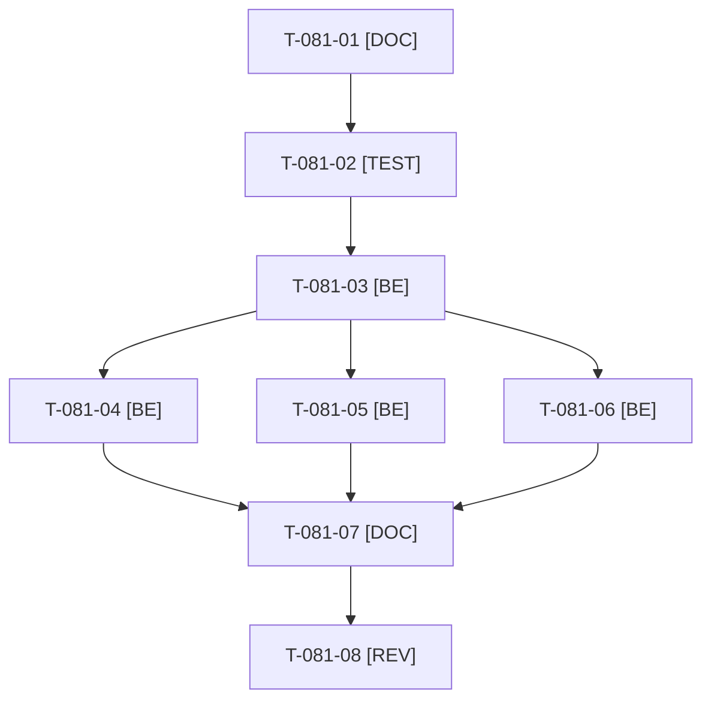

# Tâches : US-081 : Chaîne d'approvisionnement : Dependabot, scan d'image, SBOM et empreintes

## Informations US

- **Epic** : EPIC-10
- **Persona** : Thibaut
- **Story Points** : 5 (Should)
- **Sprint** : sprint-15-dossier-de-go
- **Story** : [US-081](../../../backlog/user-stories/US-081.md)

## Résumé de la US

**En tant que** Thibaut
**Je veux** des mises à jour automatiques, un scan d'image et un SBOM à chaque build, avec actions et images figées par empreinte
**Afin de** tenir mes engagements de sécurité sur une démo publique

## Règles

- Un seul outil de mises à jour par écosystème : choisir entre Dependabot et Renovate (déjà utilisé) et consigner le choix.
- Seule cette story touche `.github/workflows/ci.yaml` et le `Dockerfile` en dehors d'US-082 : sérialiser avec elle (voir [sprint-dependencies.md](../sprint-dependencies.md)).
- Le scan échoue sur une vulnérabilité critique non justifiée ; toute exception porte une raison et une date de revue. Pas de détail exploitable dans la documentation produite.
- Rappels du sprint (D4) : rendu réel vérifié ; `TEST_DB_NAME=<db> WKHTMLTOPDF_BINARY="$PWD/tests/Fixtures/bin/fake-wkhtmltopdf" bin/run-tests …` (le seuil `MIN_FREE_GB` n'est jamais abaissé) ; ECS sur `src tests` ; aucun détail exploitable dans les documents (dépôt public). Contrat de fin de worker (≤ 100 mots) : voir [README.md](./README.md).

## Vue d'ensemble des tâches

| ID | Type | Tâche | Estimation | Dépend de | Statut |
|----|------|-------|------------|-----------|--------|
| T-081-01 | [DOC] | Choisir l'outil de mises à jour par écosystème (Dependabot ou Renovate), consigner dans un ADR court ; état actuel de la CI et du Dockerfile | 1h | - | 🔲 |
| T-081-02 | [TEST] | Contrôle rouge `bin/check-pinned-refs` : échoue si une action ou une image de base est référencée par étiquette ; test du format des exceptions de scan (raison et date de revue) | 1,5h | T-081-01 | 🔲 |
| T-081-03 | [BE] | Figer les actions GitHub par empreinte de commit et les images du `Dockerfile` par condensat ; configuration de l'outil retenu | 1,5h | T-081-02 | 🔲 |
| T-081-04 | [BE] | CI : scan d'image publié en rapport, échec sur critique non justifiée, fichier d'exceptions daté | 2h | T-081-03 | 🔲 |
| T-081-05 | [BE] | CI : SBOM (CycloneDX ou SPDX) publié en artefact à chaque build | 1,5h | T-081-03 | 🔲 |
| T-081-06 | [BE] | Composer retiré de l'image finale (étage de production) ; test de contenu de l'image | 1,5h | T-081-03 | 🔲 |
| T-081-07 | [DOC] | Documentation (`docs/durcissement-demo.md` ou ADR), sans détail exploitable | 0,5h | T-081-04, T-081-05, T-081-06 | 🔲 |
| T-081-08 | [REV] | Revue (CI verte : « Quality and smoke tests » et « Docker image ») | 0,5h | T-081-07 | 🔲 |

**Total estimé : 10 h** (8 tâches).

## Dépendances

