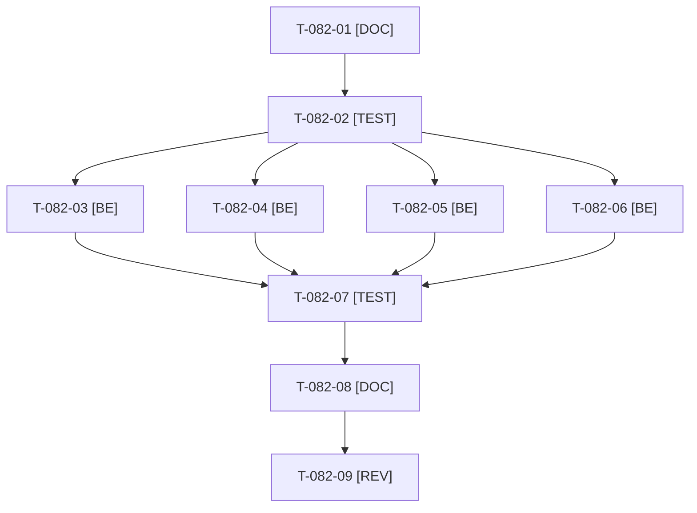

# Tâches : US-082 : Durcissement applicatif : en-têtes, fichiers servis, formulaire du simulateur, correctifs

## Informations US

- **Epic** : EPIC-10
- **Persona** : Thibaut
- **Story Points** : 5 (Should)
- **Sprint** : sprint-15-dossier-de-go
- **Story** : [US-082](../../../backlog/user-stories/US-082.md)

## Résumé de la US

**En tant que** Thibaut
**Je veux** compléter le durcissement (en-têtes Cross-Origin, fichiers cachés, formulaire du simulateur, correctifs de dépendances)
**Afin de** réduire la surface exposée

## Règles

- Dépôt public : la story et ses tâches ne contiennent aucun détail exploitable (ni fichier, ni valeur, ni chemin). Les éléments de l'audit du 2026-10-18 sont lus dans la story et le rapport privé.
- Les en-têtes sont vérifiés pour ne pas casser images, scripts, polices et Turbo : suite de fumée complète et rendu réel après changement.
- Montée de dépendances (api-platform 5.0.4, doctrine/orm 3.7.5) après US-139 : une seule personne touche `composer.lock` à la fois.
- Rappels du sprint (D4) : rendu réel vérifié ; `TEST_DB_NAME=<db> WKHTMLTOPDF_BINARY="$PWD/tests/Fixtures/bin/fake-wkhtmltopdf" bin/run-tests …` (le seuil `MIN_FREE_GB` n'est jamais abaissé) ; ECS sur `src tests` ; aucun détail exploitable dans les documents (dépôt public). Contrat de fin de worker (≤ 100 mots) : voir [README.md](./README.md).

## Vue d'ensemble des tâches

| ID | Type | Tâche | Estimation | Dépend de | Statut |
|----|------|-------|------------|-----------|--------|
| T-082-01 | [DOC] | Relire l'audit et inventorier les éléments à traiter, sans détail exploitable ; état de `composer audit` | 1h | - | ✅ |
| T-082-02 | [TEST] | Tests rouges : en-têtes Cross-Origin attendus sur une page publique ; fichier de configuration serveur non servi (404) ; formulaire du simulateur refusé sans jeton valide, accepté avec ; `composer audit` sans les deux alertes | 1,5h | T-082-01 | ✅ |
| T-082-03 | [BE] | En-têtes Cross-Origin de réponse (serveur ou Symfony), vérification des images, scripts et polices de la démo | 1,5h | T-082-02 | ✅ |
| T-082-04 | [BE] | Fichiers cachés non servis (404) côté serveur | 1h | T-082-02 | ✅ |
| T-082-05 | [BE] | Protection CSRF du formulaire de commande du simulateur PunchOut, message d'erreur générique FR et EN | 1,5h | T-082-02 | ✅ |
| T-082-06 | [BE] | Montée api-platform 5.0.4 et doctrine/orm 3.7.5 (`composer.lock`), `composer audit` | 1h | T-082-02, T-139-03 | ✅ |
| T-082-07 | [TEST] | Suite de fumée complète verte et rendu réel des pages clés après les en-têtes (aucune ressource bloquée) | 1,5h | T-082-03, T-082-04, T-082-05, T-082-06 | 🔲 |
| T-082-08 | [DOC] | `docs/durcissement-demo.md` à jour (conclusions seulement) | 0,5h | T-082-07 | ✅ |
| T-082-09 | [REV] | Revue (relecture « aucun détail exploitable ») | 0,5h | T-082-08 | 🔲 |

**Total estimé : 10 h** (9 tâches).

## Dépendances

Dépendances externes : T-082-06 dépend de T-139-03.
