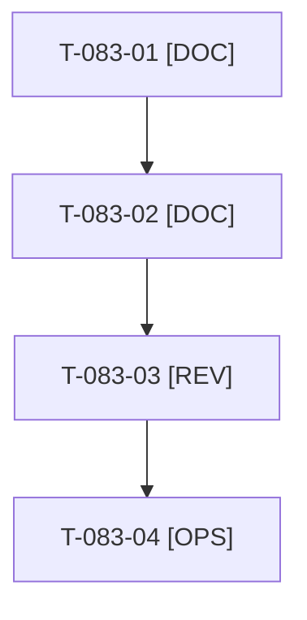

# Tâches : US-083 : Relire la licence du plugin MCP tiers

## Informations US

- **Epic** : EPIC-10
- **Persona** : Thibaut
- **Story Points** : 1 (Should)
- **Sprint** : sprint-15-dossier-de-go
- **Story** : [US-083](../../../backlog/user-stories/US-083.md)

## Résumé de la US

**En tant que** Thibaut
**Je veux** relire la licence propriétaire de `sylius/mcp-server-plugin`
**Afin de** confirmer que son usage dans une démo publique et dans le dépôt est permis

## Règles

- La story produit une note de décision ; la lecture juridique finale revient à Thibaut. Les passages de licence sont cités, jamais paraphrasés en conclusion juridique.
- Usage non clairement permis : proposer une action (contacter l'éditeur, retirer le plugin de la démo publique, adapter la communication), décidée par Thibaut.
- Rappels du sprint (D4) : rendu réel vérifié ; `TEST_DB_NAME=<db> WKHTMLTOPDF_BINARY="$PWD/tests/Fixtures/bin/fake-wkhtmltopdf" bin/run-tests …` (le seuil `MIN_FREE_GB` n'est jamais abaissé) ; ECS sur `src tests` ; aucun détail exploitable dans les documents (dépôt public). Contrat de fin de worker (≤ 100 mots) : voir [README.md](./README.md).

## Vue d'ensemble des tâches

| ID | Type | Tâche | Estimation | Dépend de | Statut |
|----|------|-------|------------|-----------|--------|
| T-083-01 | [DOC] | Lire la licence du paquet installé (fichier de licence, `composer.json`) ; relever les passages sur démo publique, dépôt public, captures et vidéos | 1h | - | ✅ |
| T-083-02 | [DOC] | Note de décision dans `docs/licence-plugin-mcp.md` : permis, interdit, incertain, avec les passages cités et l'action proposée | 0,5h | T-083-01 | ✅ |
| T-083-03 | [REV] | Revue (citations exactes, aucun avis juridique présenté comme définitif) | 0,5h | T-083-02 | ✅ |
| T-083-04 | [OPS] | 📅 Thibaut : trancher et consigner la décision dans la story | 0,5h | T-083-03 | ✅ |

**Total estimé : 2,5 h** (4 tâches), dont 0,5 h calendaire(s) (📅).

## Dépendances

