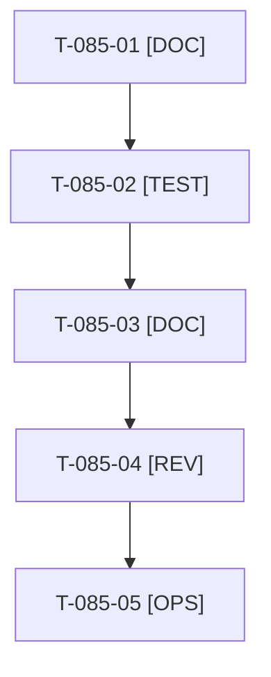

# Tâches : US-085 : Revue de sécurité de réouverture et dossier de GO

## Informations US

- **Epic** : EPIC-10
- **Persona** : Thibaut
- **Story Points** : 2 (Must)
- **Sprint** : sprint-15-dossier-de-go
- **Story** : [US-085](../../../backlog/user-stories/US-085.md)

## Résumé de la US

**En tant que** Thibaut
**Je veux** refaire la revue finale de sécurité et d'accessibilité avec un dossier de GO
**Afin de** décider l'ouverture publique en connaissance de cause

## Règles

- Dernière story du sprint : après toutes les autres. Chaque bloquant a un état et une recommandation GO ou NO-GO ; une story sacrifiée (US-078, 081, 082, 083) devient un risque résiduel daté, à accepter par Thibaut, ou un NO-GO.
- Décision D3 : domaine du site `thibaut-monier.fr` (réservé chez Hostinger le 2026-10-18), démo sur `sylius-b2b.thibaut-monier.fr` (CNAME et `DEMO_PUBLIC_HOST` posés, propagation DNS en cours) : la bascule `CANONICAL_IS_PUBLIC_HOST` et la vérification des deux domaines (US-140) figurent au dossier. Catalogue : `customer-asset-management` reste « À venir » (24 plugins).
- Dépôt public : aucun détail exploitable, conclusions seulement. La décision d'ouvrir est celle de Thibaut seul ; la bascule reste US-052 (commandes Railway par Thibaut).
- Rappels du sprint (D4) : rendu réel vérifié ; `TEST_DB_NAME=<db> WKHTMLTOPDF_BINARY="$PWD/tests/Fixtures/bin/fake-wkhtmltopdf" bin/run-tests …` (le seuil `MIN_FREE_GB` n'est jamais abaissé) ; ECS sur `src tests` ; aucun détail exploitable dans les documents (dépôt public). Contrat de fin de worker (≤ 100 mots) : voir [README.md](./README.md).

## Vue d'ensemble des tâches

| ID | Type | Tâche | Estimation | Dépend de | Statut |
|----|------|-------|------------|-----------|--------|
| T-085-01 | [DOC] | Collecter l'état de chaque bloquant : rapports des sprints 14 et 15 (US-079, 080, 081, 082, 083), accessibilité, signaux prototype | 1h | - | ✅ |
| T-085-02 | [TEST] | Revue de réouverture exécutée : `bin/verify-public-mode`, `bin/check-branch-protection`, pa11y AAA, `bin/measure-mobile`, audit des dépendances ; résultats consignés | 1h | T-085-01 | 🔲 |
| T-085-03 | [DOC] | Rédiger `docs/dossier-de-go.md` : bloquants, état, GO ou NO-GO, risques résiduels datés, bascule du domaine (D3), liste des actions de Thibaut (US-052) | 1h | T-085-02 | ✅ |
| T-085-04 | [REV] | Revue indépendante (relecture « aucun détail exploitable » de tous les documents du dossier) | 0,5h | T-085-03 | 🔲 |
| T-085-05 | [OPS] | 📅 Thibaut : relire le dossier, accepter les risques résiduels, décider GO ou NO-GO | 0,5h | T-085-04 | 🔲 |

**Total estimé : 4 h** (5 tâches), dont 0,5 h calendaire(s) (📅).

## Dépendances

