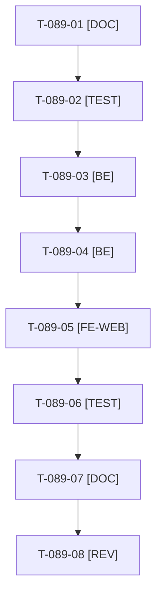

# Tâches : US-089 : Accueil connecté sans doublon : références habituelles, réassort, promotions négociées

## Informations US

- **Epic** : EPIC-11
- **Persona** : Claire
- **Story Points** : 5 (Must)
- **Sprint** : sprint-15-dossier-de-go
- **Story** : [US-089](../../../backlog/user-stories/US-089.md)

## Résumé de la US

**En tant que** Claire
**Je veux** un accueil qui me propose mes références habituelles, un réassort rapide et mes promotions négociées
**Afin de** reprendre mon travail d'achat sans chercher

## Règles

- Les blocs « Dernières offres » et « Derniers produits » (mêmes articles) sont remplacés par trois blocs alimentés par l'historique de commandes et la liste Atelier. En anonyme : présentation sans prix et choix du rôle (Channel Access inchangé).
- Compte sans historique : suggestions de catalogue, jamais un bloc vide ; produit retiré omis sans erreur ; un test de page échoue si deux blocs contiennent les mêmes produits.
- Les promotions négociées reprennent le prix de la société d'US-090 (D2) : le bloc correspondant suit T-090-05.
- Rappels du sprint (D4) : rendu réel vérifié ; `TEST_DB_NAME=<db> WKHTMLTOPDF_BINARY="$PWD/tests/Fixtures/bin/fake-wkhtmltopdf" bin/run-tests …` (le seuil `MIN_FREE_GB` n'est jamais abaissé) ; ECS sur `src tests` ; aucun détail exploitable dans les documents (dépôt public). Contrat de fin de worker (≤ 100 mots) : voir [README.md](./README.md).

## Vue d'ensemble des tâches

| ID | Type | Tâche | Estimation | Dépend de | Statut |
|----|------|-------|------------|-----------|--------|
| T-089-01 | [DOC] | Analyser l'accueil actuel (blocs existants, historique de commandes, liste Atelier) et définir les trois blocs | 1h | - | ✅ |
| T-089-02 | [TEST] | Tests rouges : trois blocs sans doublon, anonyme, compte sans historique, produit retiré, détection de doublon | 2h | T-089-01 | ✅ |
| T-089-03 | [BE] | Fournisseur des références habituelles (historique de commandes et liste Atelier), repli sur des suggestions | 2h | T-089-02 | ✅ |
| T-089-04 | [BE] | Réassort rapide et promotions négociées (prix de la société d'US-090) | 1,5h | T-089-03, T-090-05 | ✅ |
| T-089-05 | [FE-WEB] | Gabarits des trois blocs à la place des deux anciens, FR et EN | 1,5h | T-089-04 | ✅ |
| T-089-06 | [TEST] | Rendu réel FR et EN : Claire avec historique, compte sans commande, visiteur anonyme, mobile | 1h | T-089-05 | ✅ |
| T-089-07 | [DOC] | Documentation (`docs/theme-b2b.md`) | 0,5h | T-089-06 | ✅ |
| T-089-08 | [REV] | Revue | 0,5h | T-089-07 | 🔲 |

**Total estimé : 10 h** (8 tâches).

## Dépendances

Dépendances externes : T-089-04 dépend de T-090-05.
