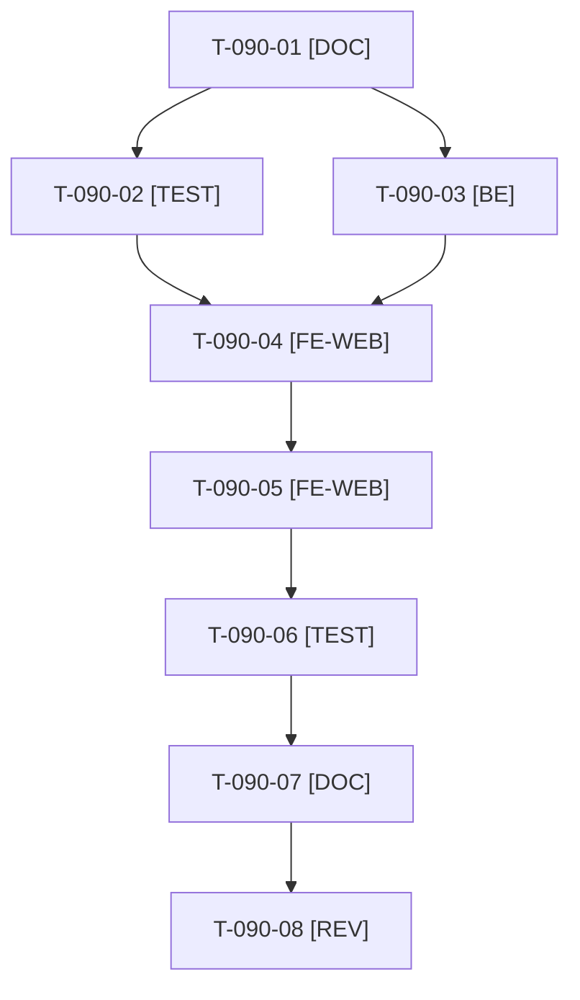

# Tâches : US-090 : Paliers de prix et prix négocié sur la fiche produit

## Informations US

- **Epic** : EPIC-11
- **Persona** : Claire
- **Story Points** : 5 (Must)
- **Sprint** : sprint-15-dossier-de-go
- **Story** : [US-090](../../../backlog/user-stories/US-090.md)

## Résumé de la US

**En tant que** Claire
**Je veux** voir le tableau des paliers et le prix négocié de ma société sur la fiche produit
**Afin de** comprendre mon prix avant d'ajouter au panier

## Règles

- Décision D2 : tableau des paliers du plugin tier-pricing sur la fiche, au catalogue et au panier, PLUS une règle de prix propre à une société de démonstration (ex. ACME), présentée comme « votre prix négocié ». Aucun nouveau plugin.
- Le plugin gère des règles par canal, groupe de clients, produit, variante et catégorie (README du plugin), pas par société : la société de démo s'appuie sur son groupe de clients, ce qui est documenté (T-090-07). T-090-01 le confirme dans le code du plugin et explique pourquoi la fiche n'affiche pas déjà le tableau.
- Données de paliers révisées (écarts crédibles, au moins 3 paliers) ; tableau accessible (légende, en-têtes de colonnes). Channel Access respecté : anonyme sans prix ni palier. Voir aussi US-078 (même gabarit de fiche).
- Rappels du sprint (D4) : rendu réel vérifié ; `TEST_DB_NAME=<db> WKHTMLTOPDF_BINARY="$PWD/tests/Fixtures/bin/fake-wkhtmltopdf" bin/run-tests …` (le seuil `MIN_FREE_GB` n'est jamais abaissé) ; ECS sur `src tests` ; aucun détail exploitable dans les documents (dépôt public). Contrat de fin de worker (≤ 100 mots) : voir [README.md](./README.md).

## Vue d'ensemble des tâches

| ID | Type | Tâche | Estimation | Dépend de | Statut |
|----|------|-------|------------|-----------|--------|
| T-090-01 | [DOC] | Spike D2 : ce que permet tier-pricing (canal, groupe, produit, variante, taxon) et pourquoi la fiche ne montre pas le tableau ; décision « société = groupe de clients » consignée dans la story | 1,5h | - | ✅ |
| T-090-02 | [TEST] | Tests rouges : tableau d'au moins 3 paliers avec palier atteignable en évidence ; prix de la société et écart ; anonyme sans prix ; produit sans palier sans tableau vide ; total recalculé sans rechargement | 1,5h | T-090-01 | ✅ |
| T-090-03 | [BE] | Données : groupe de clients de la société de démo, règle de prix propre à ce groupe, paliers révisés dans les fixtures | 1,5h | T-090-01 | ✅ |
| T-090-04 | [FE-WEB] | Tableau des paliers sur la fiche (hook du plugin ou surcharge), palier atteignable en évidence, légende et en-têtes accessibles | 2h | T-090-02, T-090-03 | ✅ |
| T-090-05 | [FE-WEB] | Ligne « Votre prix négocié » de la société et écart avec le prix catalogue, FR et EN | 1,5h | T-090-04 | ✅ |
| T-090-06 | [TEST] | Rendu réel FR et EN (fiche, quantité saisie, mobile 375 px), pa11y du tableau | 1h | T-090-05 | ✅ |
| T-090-07 | [DOC] | Documentation : D2, société = groupe de clients, données de démonstration | 0,5h | T-090-06 | ✅ |
| T-090-08 | [REV] | Revue | 0,5h | T-090-07 | 🔲 |

**Total estimé : 10 h** (8 tâches).

## Dépendances

