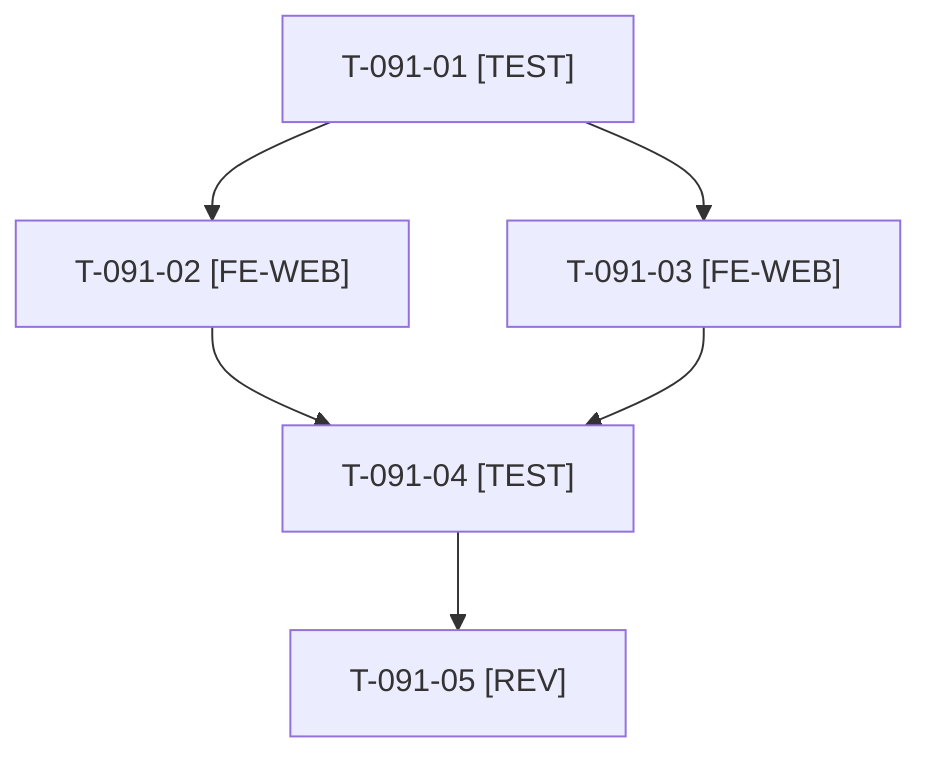

# Tâches : US-091 : Paliers et prix négocié au catalogue et au panier

## Informations US

- **Epic** : EPIC-11
- **Persona** : Claire
- **Story Points** : 3 (Must)
- **Sprint** : sprint-15-dossier-de-go
- **Story** : [US-091](../../../backlog/user-stories/US-091.md)

## Résumé de la US

**En tant que** Claire
**Je veux** retrouver ces prix négociés dans les listes et dans le panier
**Afin de** vérifier le total d'une commande avant de la valider

## Règles

- Prolonge US-090 (D2) : ligne « Prix de la société » dans les cartes de la liste (mention « dès » seulement si l'écart dépasse 5 %), palier appliqué et ligne de remise dans le panier et le devis, aucun bloc de remise sur un panier vide.
- Le plugin affiche déjà des prix conditionnels dans le panier : réutiliser ses gabarits avant de surcharger.
- Rappels du sprint (D4) : rendu réel vérifié ; `TEST_DB_NAME=<db> WKHTMLTOPDF_BINARY="$PWD/tests/Fixtures/bin/fake-wkhtmltopdf" bin/run-tests …` (le seuil `MIN_FREE_GB` n'est jamais abaissé) ; ECS sur `src tests` ; aucun détail exploitable dans les documents (dépôt public). Contrat de fin de worker (≤ 100 mots) : voir [README.md](./README.md).

## Vue d'ensemble des tâches

| ID | Type | Tâche | Estimation | Dépend de | Statut |
|----|------|-------|------------|-----------|--------|
| T-091-01 | [TEST] | Tests rouges : panier détaillé (prix unitaire, palier appliqué, total) ; carte de liste avec prix de la société et « dès » au-delà de 5 % ; panier vide sans bloc | 1,5h | T-090-05 | ✅ |
| T-091-02 | [FE-WEB] | Cartes de la liste : prix de la société, mention « dès » conditionnée à l'écart | 1,5h | T-091-01 | ✅ |
| T-091-03 | [FE-WEB] | Panier et devis : palier appliqué et ligne de remise, FR et EN | 1,5h | T-091-01 | ✅ |
| T-091-04 | [TEST] | Rendu réel FR et EN, mobile 375 et 320 px via `bin/measure-mobile` | 1h | T-091-02, T-091-03 | ✅ |
| T-091-05 | [REV] | Revue | 0,5h | T-091-04 | 🔲 |

**Total estimé : 6 h** (5 tâches).

## Dépendances

Dépendances externes : T-091-01 dépend de T-090-05.
