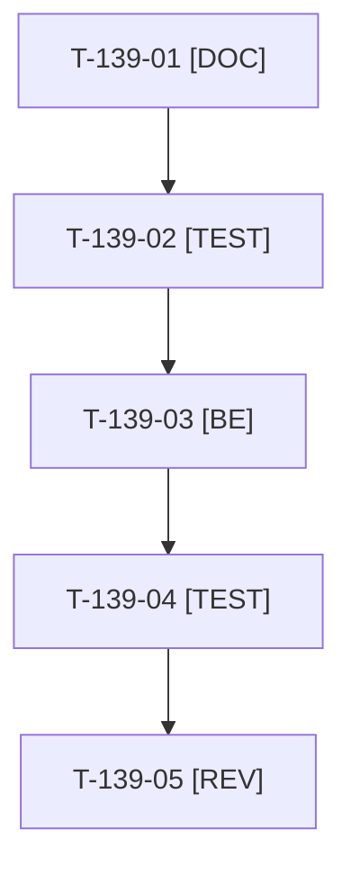

# Tâches : US-139 : Plugins à jour dans la démo

## Informations US

- **Epic** : EPIC-10
- **Persona** : Thibaut
- **Story Points** : 2 (Must)
- **Sprint** : sprint-15-dossier-de-go
- **Story** : [US-139](../../../backlog/user-stories/US-139.md)

## Résumé de la US

**En tant que** Thibaut
**Je veux** que la démo utilise quick-order ^1.2.0 et punchout ^1.2.1 publiés
**Afin de** retirer les contournements temporaires

## Règles

- Pas de dépôt VCS ni de version de développement dans `composer.json`. Composer s'exécute dans Docker (PHP 8.4).
- La surcharge `templates/bundles/TmonierSyliusQuickOrderPlugin/shop/quick_order/_form.html.twig` est supprimée au profit de `tmonier_sylius_quick_order.example_lines: '%demo.quick_order_example_lines%'` (`config/packages/demo_quick_order.yaml`).
- `/admin/punchout-buyers/` est réactivée dans `tests/Smoke/RawTranslationKeysSmokeTest.php`.
- Rappels du sprint (D4) : rendu réel vérifié ; `TEST_DB_NAME=<db> WKHTMLTOPDF_BINARY="$PWD/tests/Fixtures/bin/fake-wkhtmltopdf" bin/run-tests …` (le seuil `MIN_FREE_GB` n'est jamais abaissé) ; ECS sur `src tests` ; aucun détail exploitable dans les documents (dépôt public). Contrat de fin de worker (≤ 100 mots) : voir [README.md](./README.md).

## Vue d'ensemble des tâches

| ID | Type | Tâche | Estimation | Dépend de | Statut |
|----|------|-------|------------|-----------|--------|
| T-139-01 | [DOC] | Relever les versions publiées (v1.2.0 quick-order, v1.2.1 punchout) et les changements utiles à la démo ; consigner dans la story | 0,5h | - | ✅ |
| T-139-02 | [TEST] | Tests rouges : l'exemple de commande rapide vient de l'option `example_lines` (aperçu à deux lignes valides, échec nommant la référence retirée) ; la surcharge du gabarit n'existe plus | 1h | T-139-01 | ✅ |
| T-139-03 | [BE] | Monter les deux plugins (`composer.json`, `composer.lock`), supprimer la surcharge du gabarit, vérifier `demo_quick_order.yaml` | 1,5h | T-139-02 | ✅ |
| T-139-04 | [TEST] | Réactiver `/admin/punchout-buyers/` dans `RawTranslationKeysSmokeTest` ; lancer la suite complète via `bin/run-tests` | 0,5h | T-139-03 | ✅ |
| T-139-05 | [REV] | Revue (rendu réel de la commande rapide et de l'admin PunchOut, FR et EN) | 0,5h | T-139-04 | 🔲 |

**Total estimé : 4 h** (5 tâches).

## Dépendances

