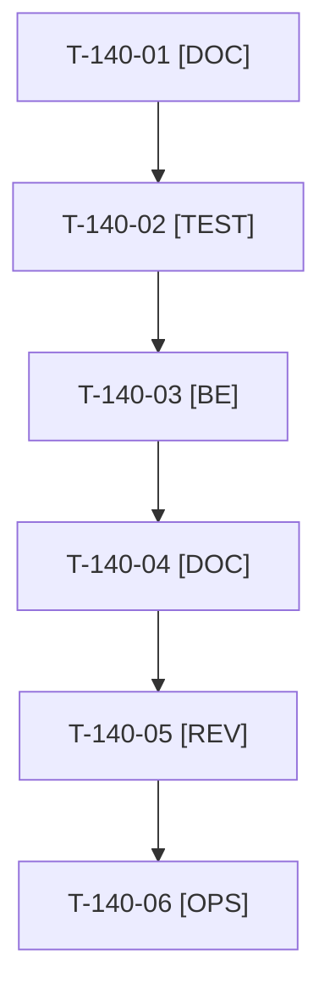

# Tâches : US-140 : Hôtes de confiance indépendants du domaine public Railway

## Informations US

- **Epic** : EPIC-10
- **Persona** : Thibaut
- **Story Points** : 1 (Must)
- **Sprint** : sprint-15-dossier-de-go
- **Story** : [US-140](../../../backlog/user-stories/US-140.md)

## Résumé de la US

**En tant que** Thibaut
**Je veux** que les hôtes acceptés ne dépendent plus de la variable de domaine public de l'hébergeur
**Afin de** qu'un domaine personnalisé ne coupe plus le domaine d'origine

## Règles

- Incident du 2026-10-18 : `.railway/railway.ts` construit `TRUSTED_HOSTS` depuis `RAILWAY_PUBLIC_DOMAIN`, qui a changé à l'ajout du domaine personnalisé ; le domaine Railway d'origine a répondu 400.
- Correction : domaine Railway explicite ou variable dédiée, échappé et ancré ; aucune valeur secrète ; échec clair si la valeur manque.
- Aucune commande Railway par Claude : `railway config apply` est la tâche de Thibaut (T-140-06).
- Rappels du sprint (D4) : rendu réel vérifié ; `TEST_DB_NAME=<db> WKHTMLTOPDF_BINARY="$PWD/tests/Fixtures/bin/fake-wkhtmltopdf" bin/run-tests …` (le seuil `MIN_FREE_GB` n'est jamais abaissé) ; ECS sur `src tests` ; aucun détail exploitable dans les documents (dépôt public). Contrat de fin de worker (≤ 100 mots) : voir [README.md](./README.md).

## Vue d'ensemble des tâches

| ID | Type | Tâche | Estimation | Dépend de | Statut |
|----|------|-------|------------|-----------|--------|
| T-140-01 | [DOC] | Relire `.railway/railway.ts`, `docs/sous-domaine-demo.md`, `docs/deploiement-railway.md` ; consigner l'incident sans valeur secrète | 0,5h | - | ✅ |
| T-140-02 | [TEST] | Test rouge (structurel) : `TRUSTED_HOSTS` ne lit plus `RAILWAY_PUBLIC_DOMAIN`, points échappés, expression ancrée, échec clair si la valeur manque | 0,5h | T-140-01 | ✅ |
| T-140-03 | [BE] | Corriger `.railway/railway.ts` : domaine d'origine explicite ou variable dédiée, `DEMO_PUBLIC_HOST` pour le domaine personnalisé | 1h | T-140-02 | ✅ |
| T-140-04 | [DOC] | Piège documenté dans `docs/sous-domaine-demo.md` ; `docs/deploiement-railway.md` mis à jour | 0,5h | T-140-03 | ✅ |
| T-140-05 | [REV] | Revue (aucune valeur secrète, expression relue) | 0,5h | T-140-04 | ✅ |
| T-140-06 | [OPS] | 📅 Thibaut : appliquer la configuration, vérifier que les deux domaines répondent | 0,5h | T-140-05 | 🔲 |

**Total estimé : 3,5 h** (6 tâches), dont 0,5 h calendaire(s) (📅).

## Dépendances

