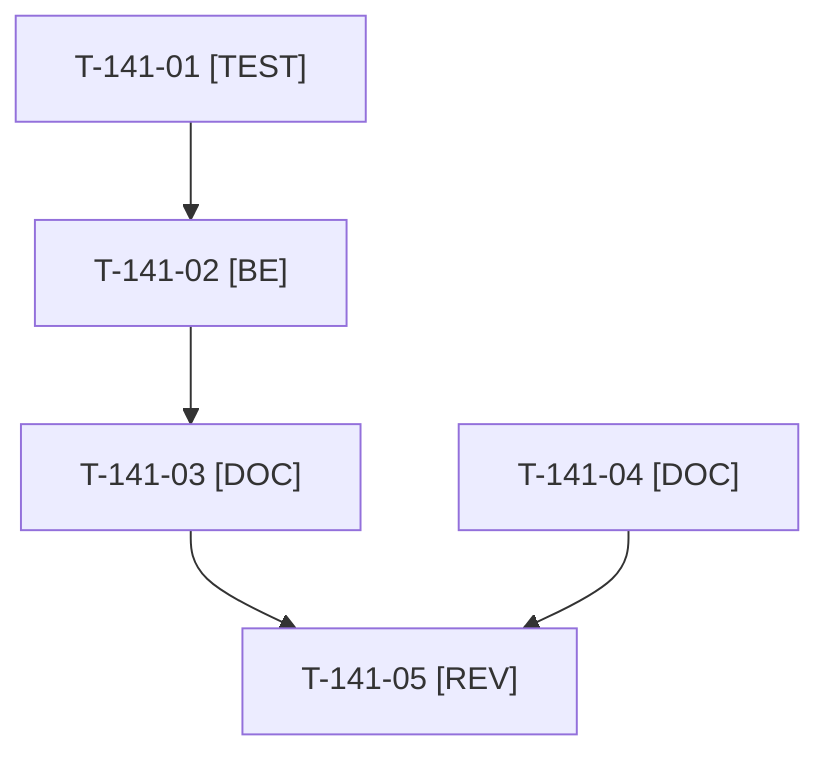

# Tâches : US-141 : Nettoyage des caches de test

## Informations US

- **Epic** : EPIC-10
- **Persona** : Thibaut
- **Story Points** : 1 (Should)
- **Sprint** : sprint-15-dossier-de-go
- **Story** : [US-141](../../../backlog/user-stories/US-141.md)

## Résumé de la US

**En tant que** Thibaut
**Je veux** un script qui libère l'espace pris par les tests locaux
**Afin de** ne plus saturer le disque ni bloquer `bin/run-tests`

## Règles

- Actions 1 et 2 de la rétro du sprint 14. `bin/clean-test-caches` : supprime `var/cache-*`, les bases `sylius_test_*` et `b2b_*` périmées du MySQL local, purge les journaux binaires du MySQL local, affiche `df -h .` avant et après ; option `--dry-run`.
- Le seuil `MIN_FREE_GB` de `bin/run-tests` n'est jamais abaissé : s'il bloque, nettoyer ou demander à l'orchestrateur.
- T-141-04 (action 2 de la rétro : `PUPPETEER_MODULE`, `PUPPETEER_EXECUTABLE_PATH`) n'est pas sacrifiable, même si le reste de la story l'est.
- Rappels du sprint (D4) : rendu réel vérifié ; `TEST_DB_NAME=<db> WKHTMLTOPDF_BINARY="$PWD/tests/Fixtures/bin/fake-wkhtmltopdf" bin/run-tests …` (le seuil `MIN_FREE_GB` n'est jamais abaissé) ; ECS sur `src tests` ; aucun détail exploitable dans les documents (dépôt public). Contrat de fin de worker (≤ 100 mots) : voir [README.md](./README.md).

## Vue d'ensemble des tâches

| ID | Type | Tâche | Estimation | Dépend de | Statut |
|----|------|-------|------------|-----------|--------|
| T-141-01 | [TEST] | Test du script en `--dry-run` : rien n'est supprimé, base active conservée et signalée, seuls `var/cache-*` et les bases périmées sont ciblés | 0,5h | - | 🔲 |
| T-141-02 | [BE] | `bin/clean-test-caches` : caches, bases MySQL périmées, journaux binaires, `df -h .`, `--dry-run` | 1,5h | T-141-01 | 🔲 |
| T-141-03 | [DOC] | `docs/tests-locaux.md` : procédure disque (contrôle au démarrage, seuil jamais abaissé) et usage du script | 0,5h | T-141-02 | 🔲 |
| T-141-04 | [DOC] | Documenter `PUPPETEER_MODULE` et `PUPPETEER_EXECUTABLE_PATH` dans l'en-tête de `bin/measure-mobile` et `docs/tests-locaux.md` ; lancement à froid de la mesure sans aide (non sacrifiable) | 0,5h | - | 🔲 |
| T-141-05 | [REV] | Revue (script relu, lancement à froid de `bin/measure-mobile` selon la doc) | 0,5h | T-141-03, T-141-04 | 🔲 |

**Total estimé : 3,5 h** (5 tâches).

## Dépendances

