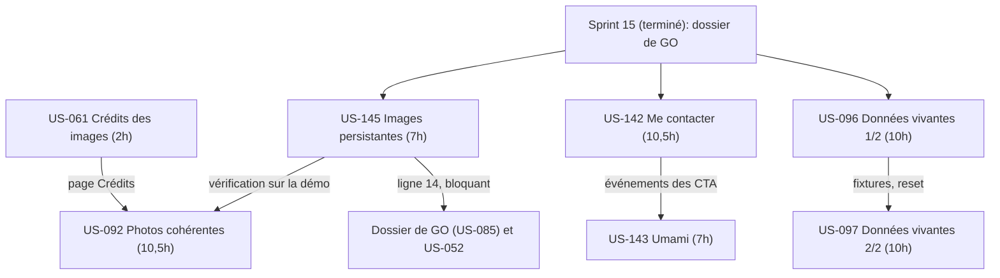
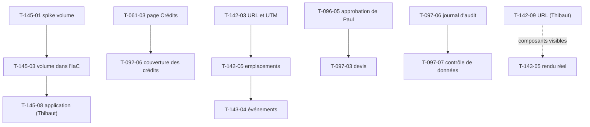

# Dépendances : Sprint 016 (Démo crédible)

## Entre stories et avec les sprints précédents

## Entre tâches (vue transversale)

## Chemin critique

US-142 (T-142-02, T-142-03, T-142-04, T-142-05, 7 h) → US-143 (T-143-02 à T-143-05, 4 h) : environ 11 h en série pour la piste thème ; les pistes images (US-145 puis US-061 → US-092, ≈ 20 h en série) et fixtures (US-096 → US-097, 20 h) sont les plus longues et ne partagent aucun fichier avec elle. Les tâches de Thibaut (T-145-08, T-142-09, T-143-08, T-092-10) sortent du chemin critique de développement.

## Ressources partagées

- `.railway/railway.ts`, `docker/Dockerfile`, entrée du conteneur : US-145 seulement.
- `docs/deploiement-railway.md` : US-145, puis US-142 (variables d'URL), puis US-143 (variables Umami) ; un worker à la fois. `docs/dossier-de-go.md` : US-145 seulement.
- Gabarits du thème (barre de démo, accueil, fiche, Plugins, pied de page, confirmations) : US-142 puis US-143 ; page Crédits et pied de page : US-061.
- `SecurityHeadersSubscriber`, `docs/durcissement-demo.md` : US-143 seulement.
- Manifeste d'images (`ImageManifest`), `bin/fetch-product-images`, `docs/images-produits.md` : US-092 (US-061 en lecture).
- Fixtures de commandes, paniers, devis, crédit, journal d'audit et `docs/remise-a-zero-demo.md` : US-096 puis US-097.
- `.bmad/sprint-status.yaml` : orchestrateur seulement (écrivain unique).
- Comptes, GO et actions de Thibaut : T-145-08, T-142-09, T-143-08, T-092-10.
