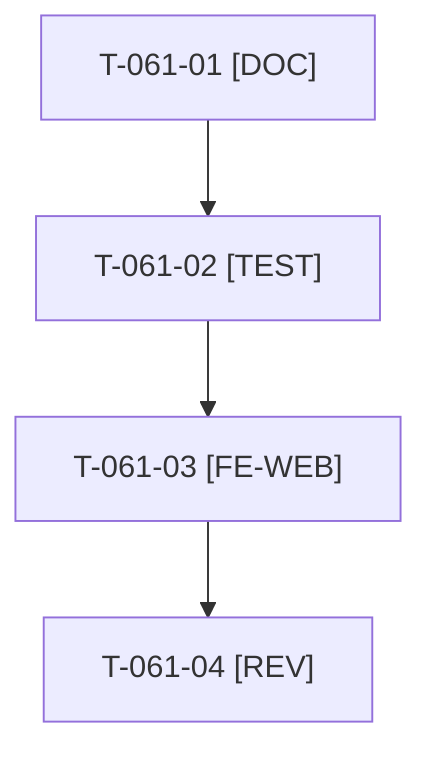

# Tâches : US-061 : Crédits des images de démo

## Informations US

- **Epic** : EPIC-11
- **Persona** : Nadia
- **Story Points** : 1 (Should)
- **Sprint** : sprint-16-demo-credible
- **Story** : [US-061](../../../backlog/user-stories/US-061.md)

## Résumé de la US

**En tant que** Nadia (visiteuse)
**Je veux** voir à qui appartiennent les images de la démo
**Afin de** savoir qu'elles sont libres de droits et créditées

## Règles

- Reprise de T-047-09 (action 4 du sprint 10). Page Crédits (FR et EN) générée depuis le manifeste d'images (`ImageManifest`), lien dans le pied de page B2B, aucun appel externe à l'exécution.
- Image sans source ou sans licence : le contrôle échoue en nommant l'image. Première à sacrifier (ordre de sacrifice n° 1).
- Rappels du sprint (D4) : rendu réel vérifié ; `TEST_DB_NAME=<db> WKHTMLTOPDF_BINARY="$PWD/tests/Fixtures/bin/fake-wkhtmltopdf" bin/run-tests …` (jamais phpunit en direct, le seuil `MIN_FREE_GB` n'est jamais abaissé, `bin/clean-test-caches` avant un lot) ; ECS sur `src tests` ; aucun détail exploitable dans les documents (dépôt public) ; seul l'orchestrateur reconstruit l'image Docker. Contrat de fin de worker (≤ 100 mots) : voir [README.md](./README.md).

## Vue d'ensemble des tâches

| ID | Type | Tâche | Estimation | Dépend de | Statut |
|----|------|-------|------------|-----------|--------|
| T-061-01 | [DOC] | Relever source et licence de chaque image du manifeste, écarts consignés dans la story | 0,5h | - | ✅ |
| T-061-02 | [TEST] | ⚠️ Tests rouges : chaque image du manifeste figure sur la page Crédits (FR et EN), lien depuis le pied de page, image sans crédit refusée | 0,5h | T-061-01 | ✅ |
| T-061-03 | [FE-WEB] | ⚠️ Page Crédits générée depuis le manifeste et lien dans le pied de page B2B, FR et EN | 0,5h | T-061-02 | ✅ |
| T-061-04 | [REV] | ⚠️ Revue (rendu réel FR et EN, pa11y) | 0,5h | T-061-03 | 🔲 |

**Total estimé : 2 h** (4 tâches).

## Dépendances

