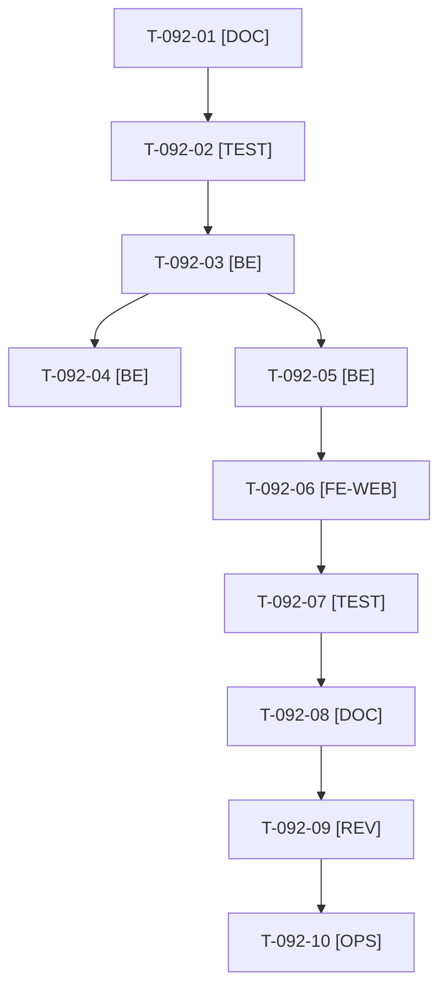

# Tâches : US-092 : Catalogue crédible, tranche 1 : photos cohérentes avec les produits

## Informations US

- **Epic** : EPIC-11
- **Persona** : Nadia
- **Story Points** : 5 (Must)
- **Sprint** : sprint-16-demo-credible
- **Story** : [US-092](../../../backlog/user-stories/US-092.md)

## Résumé de la US

**En tant que** Nadia
**Je veux** que chaque photo corresponde à son produit
**Afin de** croire qu'il s'agit d'un vrai catalogue de distributeur

## Règles

- Contrôle fondé sur un manifeste image ↔ produit relu à la main, crédits CC0 repris d'US-061, jamais d'appel externe à l'exécution (`bin/fetch-product-images` hors dépôt). Licence autre que CC0 ou équivalente : refus.
- Sans photo convenable : visuel neutre de catégorie plutôt qu'une photo trompeuse (cheville nylon = équerre en fonte, scie à métaux = scie en bois, clé = gros plan sans lecture).
- Page Crédits fournie par US-061 (T-092-06 vérifie seulement la couverture des nouvelles images). Relecture de Thibaut sur 20 produits (T-092-10).
- Rappels du sprint (D4) : rendu réel vérifié ; `TEST_DB_NAME=<db> WKHTMLTOPDF_BINARY="$PWD/tests/Fixtures/bin/fake-wkhtmltopdf" bin/run-tests …` (jamais phpunit en direct, le seuil `MIN_FREE_GB` n'est jamais abaissé, `bin/clean-test-caches` avant un lot) ; ECS sur `src tests` ; aucun détail exploitable dans les documents (dépôt public) ; seul l'orchestrateur reconstruit l'image Docker. Contrat de fin de worker (≤ 100 mots) : voir [README.md](./README.md).

## Vue d'ensemble des tâches

| ID | Type | Tâche | Estimation | Dépend de | Statut |
|----|------|-------|------------|-----------|--------|
| T-092-01 | [DOC] | Relever les images incohérentes du manifeste (`ImageManifest`), lister les produits à corriger et les sources CC0 | 1h | - | 🔲 |
| T-092-02 | [TEST] | Tests rouges : chaque image validée ou remplacée, licence non libre refusée, visuel de repli de catégorie, crédits présents | 1,5h | T-092-01 | 🔲 |
| T-092-03 | [BE] | Contrôle de licence et statut « validé » dans le manifeste, commande de contrôle | 1,5h | T-092-02 | 🔲 |
| T-092-04 | [BE] | ⚠️ Visuels neutres de catégorie (repli) | 1h | T-092-03 | 🔲 |
| T-092-05 | [BE] | Remplacer les photos incohérentes (CC0, cache hors dépôt), manifeste à jour | 2,5h | T-092-03 | 🔲 |
| T-092-06 | [FE-WEB] | Vérifier que la page Crédits d'US-061 couvre chaque nouvelle image, FR et EN | 0,5h | T-092-05, T-061-03 | 🔲 |
| T-092-07 | [TEST] | Rendu réel FR et EN sur un échantillon de 20 produits (captures pour Thibaut), fiche et catalogue | 1h | T-092-06 | 🔲 |
| T-092-08 | [DOC] | ⚠️ `docs/images-produits.md` (manifeste, repli, crédits) | 0,5h | T-092-07 | 🔲 |
| T-092-09 | [REV] | Revue (licences, aucune image jugée incohérente ne subsiste) | 0,5h | T-092-08 | 🔲 |
| T-092-10 | [OPS] | Thibaut : relire l'échantillon de 20 produits | 0,5h | T-092-09 | 🔲 |

**Total estimé : 10,5 h** (10 tâches, dont 1 de Thibaut).

## Dépendances

