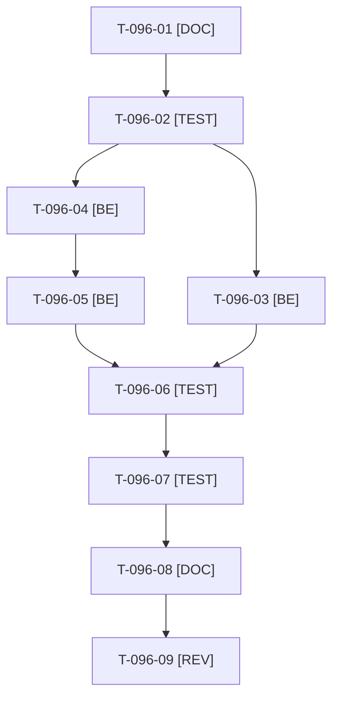

# Tâches : US-096 : Données vivantes (1/2) : panier de départ, historique et approbation en attente

## Informations US

- **Epic** : EPIC-11
- **Persona** : Claire
- **Story Points** : 5 (Must)
- **Sprint** : sprint-16-demo-credible
- **Story** : [US-096](../../../backlog/user-stories/US-096.md)

## Résumé de la US

**En tant que** Claire
**Je veux** trouver un panier de départ, des commandes passées et une commande en attente d'approbation
**Afin de** comprendre les fonctions de la démo sans construire le scénario moi-même

## Règles

- Fixtures : liste Atelier en panier (quantités cohérentes), 6 à 8 commandes historiques sur 6 mois, une commande en attente chez Paul ; dates relatives à la date du reset.
- Un seul worker sur les fixtures et la commande de remise à zéro à la fois (US-096 puis US-097). Reset sous 10 minutes (`bin/profile-reset`).
- Le journal d'audit est alimenté par US-097 (T-097-06), pas ici.
- Rappels du sprint (D4) : rendu réel vérifié ; `TEST_DB_NAME=<db> WKHTMLTOPDF_BINARY="$PWD/tests/Fixtures/bin/fake-wkhtmltopdf" bin/run-tests …` (jamais phpunit en direct, le seuil `MIN_FREE_GB` n'est jamais abaissé, `bin/clean-test-caches` avant un lot) ; ECS sur `src tests` ; aucun détail exploitable dans les documents (dépôt public) ; seul l'orchestrateur reconstruit l'image Docker. Contrat de fin de worker (≤ 100 mots) : voir [README.md](./README.md).

## Vue d'ensemble des tâches

| ID | Type | Tâche | Estimation | Dépend de | Statut |
|----|------|-------|------------|-----------|--------|
| T-096-01 | [DOC] | État des fixtures (panier, commandes, approbations), dates, durée du reset actuelle (`docs/remise-a-zero-demo.md`) | 0,5h | - | ✅ |
| T-096-02 | [TEST] | Tests rouges : panier de Claire (liste Atelier), 6 à 8 commandes sur 6 mois, approbation en attente chez Paul, dates relatives (horloge simulée), reset < 10 minutes | 2h | T-096-01 | ✅ |
| T-096-03 | [BE] | Fixture du panier de départ de Claire | 1,5h | T-096-02 | ✅ |
| T-096-04 | [BE] | Fixtures de l'historique : 6 à 8 commandes réalistes, dates relatives au reset | 2h | T-096-02 | ✅ |
| T-096-05 | [BE] | Fixture de la commande en attente d'approbation chez Paul (validable) | 1,5h | T-096-04 | ✅ |
| T-096-06 | [TEST] | Mesure du reset (`bin/profile-reset`) < 10 minutes ; fumée : aucun de ces écrans vide | 1h | T-096-05, T-096-03 | ✅ |
| T-096-07 | [TEST] | Rendu réel FR et EN : panier de Claire, commandes, approbations de Paul | 0,5h | T-096-06 | 🔄 |
| T-096-08 | [DOC] | ⚠️ `docs/remise-a-zero-demo.md` (fixtures et mesure) | 0,5h | T-096-07 | ✅ |
| T-096-09 | [REV] | Revue (dates relatives, aucun secret) | 0,5h | T-096-08 | ✅ |

**Total estimé : 10 h** (9 tâches).

## Dépendances

