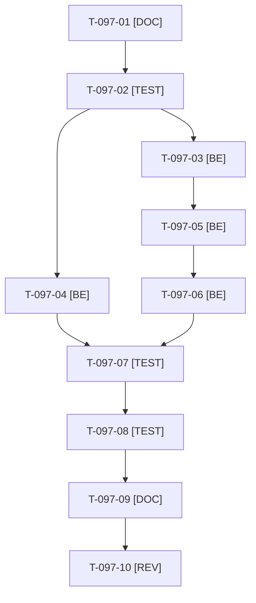

# Tâches : US-097 : Données vivantes (2/2) : devis en négociation, échéances de crédit, brouillons, suggestions IA et journal d'audit

## Informations US

- **Epic** : EPIC-11
- **Persona** : Claire
- **Story Points** : 5 (Must)
- **Sprint** : sprint-16-demo-credible
- **Story** : [US-097](../../../backlog/user-stories/US-097.md)

## Résumé de la US

**En tant que** Claire
**Je veux** voir un devis en négociation, des échéances de crédit, des suggestions pré-générées et un journal d'audit qui vit
**Afin de** mesurer ce que chaque plugin apporte

## Règles

- Décision de Thibaut : quelques événements métier alimentent le journal d'audit (vide depuis le sprint 14) : commande, approbation, devis (T-097-06). Reset masqué et journal lisible : US-088 (sprint 19).
- Devis en négociation avec numérotation de l'année courante ; 2 à 3 pièces ouvertes dont une échue et un dépassement de plafond ; au moins 5 suggestions IA marquées « démonstration » (aucun fournisseur IA réel) ; brouillons ; commandes en préparation.
- Après US-096 (mêmes fixtures). Contrôle de données : numérotation incohérente et écran clé vide font échouer la fumée en nommant l'écran.
- Rappels du sprint (D4) : rendu réel vérifié ; `TEST_DB_NAME=<db> WKHTMLTOPDF_BINARY="$PWD/tests/Fixtures/bin/fake-wkhtmltopdf" bin/run-tests …` (jamais phpunit en direct, le seuil `MIN_FREE_GB` n'est jamais abaissé, `bin/clean-test-caches` avant un lot) ; ECS sur `src tests` ; aucun détail exploitable dans les documents (dépôt public) ; seul l'orchestrateur reconstruit l'image Docker. Contrat de fin de worker (≤ 100 mots) : voir [README.md](./README.md).

## Vue d'ensemble des tâches

| ID | Type | Tâche | Estimation | Dépend de | Statut |
|----|------|-------|------------|-----------|--------|
| T-097-01 | [DOC] | État des devis, du crédit, des brouillons, des suggestions IA et du journal d'audit ; événements métier à produire consignés | 1h | - | 🔲 |
| T-097-02 | [TEST] | Tests rouges : devis en négociation (numéro de l'année courante), pièces ouvertes dont une échue, ≥ 5 suggestions « démonstration », événements au journal d'audit, numérotation incohérente refusée | 1,5h | T-097-01 | 🔲 |
| T-097-03 | [BE] | Fixture du devis en négociation avec historique | 1,5h | T-097-02 | 🔲 |
| T-097-04 | [BE] | Fixtures du crédit : pièces ouvertes dont une échue, dépassement de plafond, jauge | 1,5h | T-097-02 | 🔲 |
| T-097-05 | [BE] | Brouillons, commandes en préparation et suggestions IA pré-générées | 1h | T-097-03 | 🔲 |
| T-097-06 | [BE] | ⚠️ Quelques événements métier au journal d'audit après le reset (commande, approbation, devis) | 1h | T-097-05 | 🔲 |
| T-097-07 | [TEST] | Contrôle de données, fumée « écran resté vide » nommant l'écran, reset < 10 minutes (`bin/profile-reset`) | 1h | T-097-04, T-097-06 | 🔲 |
| T-097-08 | [TEST] | Rendu réel FR et EN : Mes devis, encours, suggestions IA, journal d'audit | 0,5h | T-097-07 | 🔲 |
| T-097-09 | [DOC] | ⚠️ `docs/remise-a-zero-demo.md` (fixtures, journal d'audit) | 0,5h | T-097-08 | 🔲 |
| T-097-10 | [REV] | Revue (numérotation, mention « démonstration », aucun détail exploitable) | 0,5h | T-097-09 | 🔲 |

**Total estimé : 10 h** (10 tâches).

## Dépendances

