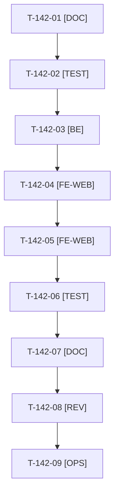

# Tâches : US-142 : Appel à l'action « Me contacter » mis en avant dans toute la démo

## Informations US

- **Epic** : EPIC-12
- **Persona** : Thibaut, Didier
- **Story Points** : 5 (Must)
- **Sprint** : sprint-16-demo-credible
- **Story** : [US-142](../../../backlog/user-stories/US-142.md)

## Résumé de la US

**En tant que** Thibaut
**Je veux** un appel à l'action « Me contacter » bien visible un peu partout dans la démo
**Afin de** transformer chaque visite intéressée en prise de contact

## Règles

- Décision D3 : les URL (Calendly, formulaire de contact) ne sont pas fournies ; paramètres `DEMO_BOOKING_URL` et `DEMO_CONTACT_URL` vides par défaut (composant masqué sans erreur), valeurs factices `https://exemple.test/...` dans les tests. Pose des valeurs dans Railway : Thibaut (T-142-09).
- Composant partagé unique (variantes bandeau, carte, lien), libellés FR et EN, `https` seulement (validation de `SiteLinks`), `rel="noopener"` et mention « nouvelle fenêtre », UTM `utm_source=demo-b2b`, `utm_medium=cta`, `utm_content=<emplacement>`.
- Ton neutre (charte d'US-063), pas de widget Calendly, pas de fenêtre surgissante ni de bandeau collant. AAA et mobile conservés (cibles de 44 px, `bin/measure-mobile` vert). US-115 est absorbée.
- Rappels du sprint (D4) : rendu réel vérifié ; `TEST_DB_NAME=<db> WKHTMLTOPDF_BINARY="$PWD/tests/Fixtures/bin/fake-wkhtmltopdf" bin/run-tests …` (jamais phpunit en direct, le seuil `MIN_FREE_GB` n'est jamais abaissé, `bin/clean-test-caches` avant un lot) ; ECS sur `src tests` ; aucun détail exploitable dans les documents (dépôt public) ; seul l'orchestrateur reconstruit l'image Docker. Contrat de fin de worker (≤ 100 mots) : voir [README.md](./README.md).

## Vue d'ensemble des tâches

| ID | Type | Tâche | Estimation | Dépend de | Statut |
|----|------|-------|------------|-----------|--------|
| T-142-01 | [DOC] | Inventaire des emplacements (barre de démo, accueil, fiche, Plugins, À propos, MCP, simulateur PunchOut, confirmations) et de `SiteLinks` ; gabarits concernés consignés | 1h | - | ✅ |
| T-142-02 | [TEST] | Tests rouges : validation des URL (https, sans identifiants), masquage si vide ou invalide, UTM par emplacement, une cible seule, FR et EN (valeurs factices) | 2h | T-142-01 | ✅ |
| T-142-03 | [BE] | Paramètre `DEMO_BOOKING_URL`, extension de `SiteLinks`, fonction Twig et construction des UTM | 1,5h | T-142-02 | ✅ |
| T-142-04 | [FE-WEB] | Composant partagé (bandeau, carte, lien), libellés FR et EN, cibles de 44 px, AAA | 1,5h | T-142-03 | ✅ |
| T-142-05 | [FE-WEB] | Intégration aux emplacements (barre de démo, accueil, fiche produit, Plugins, À propos, MCP, simulateur PunchOut, confirmations) | 2h | T-142-04 | ✅ |
| T-142-06 | [TEST] | Rendu réel FR et EN avec valeurs factices et vides : desktop, 375 et 320 px (`bin/measure-mobile`), pa11y WCAG2AAA | 1h | T-142-05 | 🔲 |
| T-142-07 | [DOC] | ⚠️ `docs/theme-b2b.md`, variables dans `docs/deploiement-railway.md`, US-115 marquée absorbée | 0,5h | T-142-06 | ✅ |
| T-142-08 | [REV] | Revue (URL absentes = composant masqué, aucune URL en dur) | 0,5h | T-142-07 | 🔲 |
| T-142-09 | [OPS] | Thibaut : fournir l'URL Calendly et celle du formulaire de contact, les poser dans Railway | 0,5h | T-142-08 | 🔲 |

**Total estimé : 10,5 h** (9 tâches, dont 1 de Thibaut).

## Dépendances

