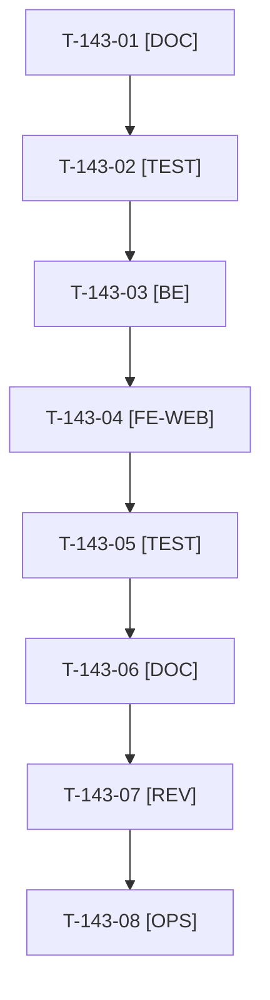

# Tâches : US-143 : Mesure d'audience de la démo avec Umami

## Informations US

- **Epic** : EPIC-13
- **Persona** : Thibaut
- **Story Points** : 3 (Must)
- **Sprint** : sprint-16-demo-credible
- **Story** : [US-143](../../../backlog/user-stories/US-143.md)

## Résumé de la US

**En tant que** Thibaut
**Je veux** mesurer l'audience de la démo dans mon compte Umami, sans cookie ni consentement
**Afin de** savoir ce qui intéresse les visiteurs et d'où ils viennent

## Règles

- Décision D3 : `DEMO_UMAMI_SCRIPT_URL` et `DEMO_UMAMI_WEBSITE_ID` vides par défaut (aucun script, aucune requête, CSP inchangée) ; valeurs factices dans les tests. Pose des valeurs : Thibaut (T-143-08).
- CSP : hôte du script en `script-src`, collecte en `connect-src`, seulement quand les paramètres sont valides (`SecurityHeadersSubscriber`). Script en `defer`, `data-do-not-track`. Exclus : `/admin`, porte privée, `/demo/mails`, `/healthz`.
- Événements préfixés `demo-` (CTA d'US-142 avec l'emplacement, connexion en un clic par rôle, demande de devis, simulateur PunchOut, guide MCP, dépôt GitHub) ; aucune donnée personnelle. Mentions légales FR et EN. Après US-142.
- Rappels du sprint (D4) : rendu réel vérifié ; `TEST_DB_NAME=<db> WKHTMLTOPDF_BINARY="$PWD/tests/Fixtures/bin/fake-wkhtmltopdf" bin/run-tests …` (jamais phpunit en direct, le seuil `MIN_FREE_GB` n'est jamais abaissé, `bin/clean-test-caches` avant un lot) ; ECS sur `src tests` ; aucun détail exploitable dans les documents (dépôt public) ; seul l'orchestrateur reconstruit l'image Docker. Contrat de fin de worker (≤ 100 mots) : voir [README.md](./README.md).

## Vue d'ensemble des tâches

| ID | Type | Tâche | Estimation | Dépend de | Statut |
|----|------|-------|------------|-----------|--------|
| T-143-01 | [DOC] | Volume d'événements autorisé par le plan gratuit, format de l'identifiant, périmètre et exclusions consignés dans la story | 0,5h | - | 🔲 |
| T-143-02 | [TEST] | Tests rouges : configuration vide ou invalide désactive la mesure, script en `defer`, CSP conditionnelle, exclusions, aucun cookie (valeurs factices) | 1h | T-143-01 | 🔲 |
| T-143-03 | [BE] | Paramètres, validation (https, UUID), extension de la CSP et variable Twig | 1,5h | T-143-02 | 🔲 |
| T-143-04 | [FE-WEB] | Script dans le gabarit de la boutique, `data-umami-event` sur CTA, connexion, devis, PunchOut, MCP, GitHub ; mentions légales FR et EN | 1,5h | T-143-03 | 🔲 |
| T-143-05 | [TEST] | Rendu réel : script présent sur une page mesurée, absent de l'admin, aucun cookie, console sans erreur de CSP, Lighthouse mobile sur 3 pages sans régression | 1h | T-143-04 | 🔲 |
| T-143-06 | [DOC] | ⚠️ `docs/deploiement-railway.md` (variables), `docs/durcissement-demo.md` (CSP), décision d'outil reportée dans US-117 | 0,5h | T-143-05 | 🔲 |
| T-143-07 | [REV] | Revue (aucune donnée personnelle dans les événements) | 0,5h | T-143-06 | 🔲 |
| T-143-08 | [OPS] | Thibaut : fournir l'identifiant du site Umami de thibaut-monier.fr et l'URL du script, les poser dans Railway | 0,5h | T-143-07 | 🔲 |

**Total estimé : 7 h** (8 tâches, dont 1 de Thibaut).

## Dépendances

