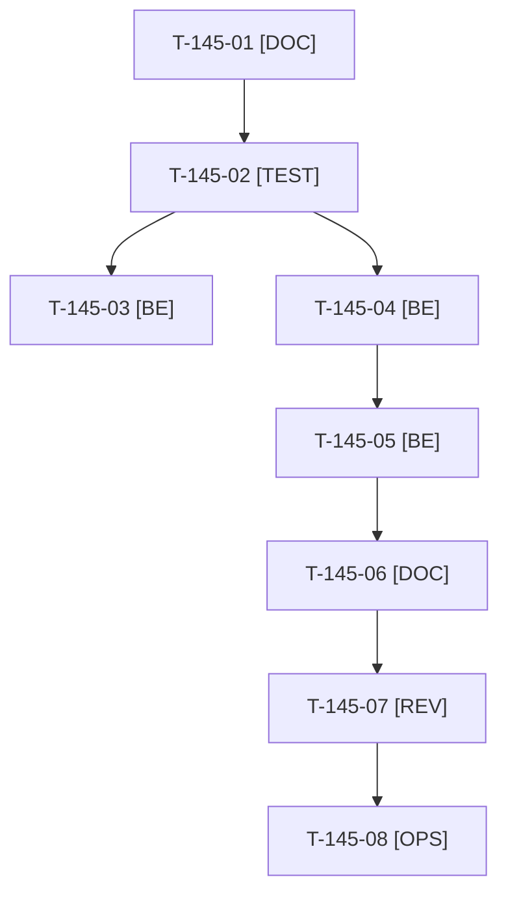

# Tâches : US-145 : Images produit persistantes sur Railway

## Informations US

- **Epic** : EPIC-10
- **Persona** : Thibaut
- **Story Points** : 3 (Must)
- **Sprint** : sprint-16-demo-credible
- **Story** : [US-145](../../../backlog/user-stories/US-145.md)

## Résumé de la US

**En tant que** Thibaut
**Je veux** que les images produit survivent aux redéploiements de la démo
**Afin de** ouvrir la démo au public sans fiches produit cassées

## Règles

- Décision D2 : volume Railway monté sur le dossier des médias (`public/media`), déclaré dans l'IaC `.railway/railway.ts` (SDK `railway` 3.16.0). `railway config plan` / `apply` sont lancés par Thibaut, jamais par Claude (T-145-08).
- Le spike (T-145-01) établit le chemin exact des images Sylius (`public/media/image`) et du cache LiipImagine (`public/media/cache`), les droits `www-data` (le `Dockerfile` les pose, un volume monté en `root` les masque) et la façon de déclarer un volume dans le SDK.
- Premier démarrage : volume vide, la remise à zéro le remplit, `/healthz` ne doit pas échouer ; purge des images orphelines après chaque reset (option `--dry-run`).
- Aucun identifiant de volume, nom de service ni jeton dans les documents (dépôt public). Seul l'orchestrateur reconstruit l'image.
- Rappels du sprint (D4) : rendu réel vérifié ; `TEST_DB_NAME=<db> WKHTMLTOPDF_BINARY="$PWD/tests/Fixtures/bin/fake-wkhtmltopdf" bin/run-tests …` (jamais phpunit en direct, le seuil `MIN_FREE_GB` n'est jamais abaissé, `bin/clean-test-caches` avant un lot) ; ECS sur `src tests` ; aucun détail exploitable dans les documents (dépôt public) ; seul l'orchestrateur reconstruit l'image Docker. Contrat de fin de worker (≤ 100 mots) : voir [README.md](./README.md).

## Vue d'ensemble des tâches

| ID | Type | Tâche | Estimation | Dépend de | Statut |
|----|------|-------|------------|-----------|--------|
| T-145-01 | [DOC] | Spike : chemin exact des médias (images Sylius, cache LiipImagine), droits `www-data`, déclaration d'un volume dans le SDK `railway` 3.16.0 ; conclusions consignées dans la story (sans identifiant) | 1h | - |✅ |
| T-145-02 | [TEST] | Tests rouges : `railway.ts` déclare un volume sur le dossier des médias (sans identifiant) ; démarrage sur dossier vide ou propriété de root rétablit les droits ; purge des orphelines (dry-run sans suppression, images référencées conservées) | 1h | T-145-01 |✅ |
| T-145-03 | [BE] | Déclarer le volume dans `.railway/railway.ts` (chemin de montage = dossier des médias) | 1h | T-145-02 |✅ |
| T-145-04 | [BE] | Premier démarrage : droits `www-data` et dossiers rétablis à l'entrée du conteneur, `/healthz` sain sur volume vide, erreur explicite si non inscriptible | 1,5h | T-145-02 |✅ |
| T-145-05 | [BE] | Purge des images orphelines après le reset (`--dry-run`), cache LiipImagine purgé comme aujourd'hui | 1h | T-145-04 |✅ |
| T-145-06 | [DOC] | `docs/deploiement-railway.md` (volume, premier démarrage, purge, procédure de redéploiement) et `docs/dossier-de-go.md` ligne 14, sans détail exploitable | 0,5h | T-145-05 |✅ |
| T-145-07 | [REV] | Revue (relecture « aucun détail exploitable », rendu réel d'une fiche produit après reset) | 0,5h | T-145-06 |🔲 |
| T-145-08 | [OPS] | Thibaut : `railway config plan` puis `apply`, lancer le reset, redéployer deux fois sans reset et vérifier les images d'une fiche (FR et EN) | 0,5h | T-145-07 | 🔲 |

**Total estimé : 7 h** (8 tâches, dont 1 de Thibaut).

## Dépendances

