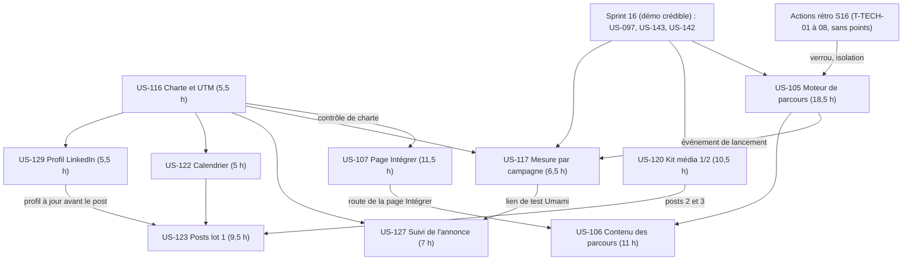
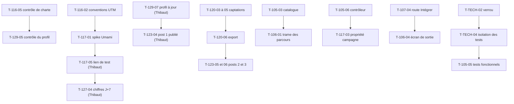

# Dépendances : Sprint 017 (conversion)

## Entre stories et avec les sprints précédents

## Entre tâches (vue transversale)

## Chemin critique

Deux chemins. **Calendaire (2026-10-26)** : T-116-01 → T-116-05 (5,5 h) → T-129 (profil, 4 h de Claude + 1,5 h de Thibaut) → T-123-01 à T-123-04 (post 1) ; T-117-01 → T-117-05 → T-127-04 → T-127-05 (bilan J+7). **Développement** : T-TECH-01 à T-TECH-04 (5 h) → US-105 (≈ 18,5 h) → US-106 (≈ 11 h) → T-117-03 : environ 36 h en série pour la piste parcours ; la piste « Intégrer » (US-107, 11,5 h) et la piste kit média (US-120, 10,5 h, avant les posts 2 et 3) sont parallèles. Les actions de Thibaut sortent du chemin critique de développement mais pas du chemin calendaire.

## Ressources partagées

- Gabarits du thème (pied de page, page Plugins, barre de démo) et traductions communes : US-105/106 (domaine `journeys`) et US-107 (domaine `integrate`) ; un seul worker à la fois sur un fichier commun.
- `config/demo/journeys.yaml` : US-105 puis US-106. `config/demo/charter_forbidden_terms.yaml` et `src/Demo/Check/EditorialCharterCheck.php` : US-116 puis extension par US-123.
- `src/Demo/Site/ContactCta.php` : US-107 (placement `integrate`) et US-106 (écran de sortie) ; `src/Demo/Analytics/UmamiEvent.php` : US-105/106/117 en lecture, US-117 seule en écriture.
- `bin/run-tests`, `tests/Smoke/LiveDemoDataSmokeTest.php` : actions de la rétro seulement (T-TECH), puis lecture par tous.
- Fixtures et reset : lecture seule ; la captation d'US-120 remet la démo locale à zéro (un worker à la fois sur la base locale).
- `../communication/` : US-116 (charte), US-129, US-122, US-123, US-127, US-120 (un dossier par story, aucun fichier partagé sauf le calendrier lu par US-123 et mis à jour par US-127).
- `.bmad/sprint-status.yaml` : orchestrateur seulement (écrivain unique).
- Actions de Thibaut : publications, mise à jour du profil, relevés LinkedIn et Umami, validation des délais, relecture des textes.
