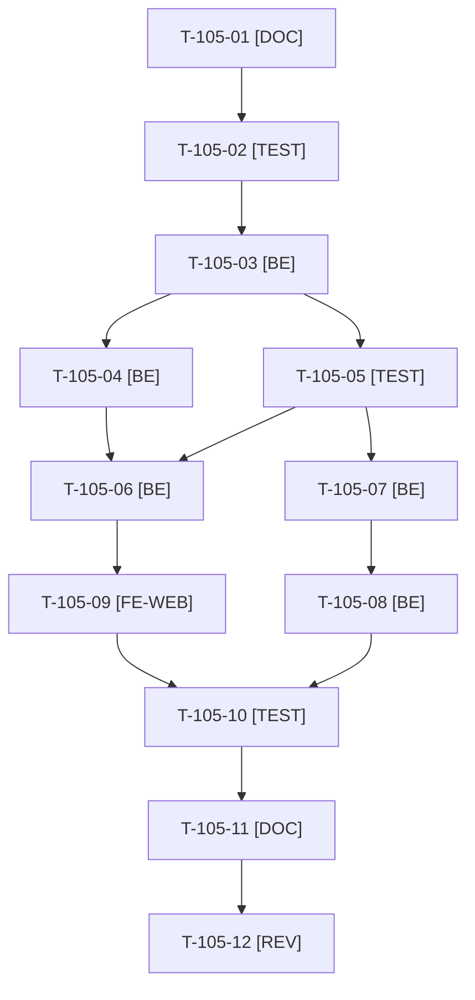

# Tâches : US-105 : Parcours guidés : moteur de visite par étapes

## Informations US

- **Epic** : EPIC-12
- **Persona** : Nadia
- **Story Points** : 8 (Must)
- **Sprint** : sprint-17-conversion
- **Story** : [US-105](../../../backlog/user-stories/US-105.md)

## Résumé de la US

**En tant que** Nadia
**Je veux** suivre un parcours guidé en étapes avec une barre de progression et un bouton « Je lance ce scénario »
**Afin de** découvrir une fonction en quelques minutes

## Règles et fichiers visés

- Décision de conception (T-105-01) : rendu serveur (une URL par étape, Twig + Turbo), sans JavaScript obligatoire ; progression en session ; parcours décrits dans `config/demo/journeys.yaml` (même principe que `config/demo/accounts.yaml`).
- Fichiers visés : `src/Demo/Journey/` (`Journey`, `JourneyStep`, `JourneyCatalog`, `JourneyProgress`, `ScenarioPreparer` et préparateurs), `src/Demo/Controller/JourneyController.php`, `templates/demo/journey/`, `translations/journeys.{fr,en}.yaml`, `docs/parcours-guides.md`.
- Réutilise : `DemoAccountCatalog` (compte conseillé), formulaire de connexion en un clic (`templates/demo/_login_form.html.twig`), marqueur de reset (`ResetStatus`, `DemoResetCommand`), `SharedDemoAccountGuardListener`, `ContactCta`, `UmamiEvent`.
- Tests avec `TEST_DB_NAME=<db> bin/run-tests` seulement ; tout test qui modifie un compte partagé (panier de Claire) l'isole ou annule ses effets (règle de T-TECH-03).
- Pas de dépendance avec US-107 : le thème (gabarits, pied de page, traductions) est partagé, un seul worker à la fois sur chaque fichier commun.
- Règles du sprint : voir [README.md](./README.md) (contrat de fin de worker, gel disque, `bin/run-tests` seulement, aucun détail exploitable dans le dépôt public, aucune action externe sans GO). Les livrables rédactionnels sont dans `../communication/` (hors dépôt public), les livrables de code dans le dépôt de la démo.

## Vue d'ensemble des tâches

La colonne « Réalisé par » dit qui fait la tâche : **Claude** seul, **Thibaut** (action de sa part), ou les deux. ⚠️ = sacrifiable (voir [README.md](./README.md)).

| ID | Type | Tâche | Estimation | Dépend de | Réalisé par | Statut |
|----|------|-------|------------|-----------|-------------|--------|
| T-105-01 | [DOC] | Inventaire (scénarios existants de `home_journeys` et `accounts.html.twig`, comptes, connexion en un clic, marqueur de reset) et décisions de conception consignées dans la story | 0,5 h | - | Claude | ✅ |
| T-105-02 | [TEST] | Tests unitaires rouges : modèle `Journey`/`JourneyStep`, catalogue validé au chargement (étape sans route, compte inconnu refusés), précédent et suivant, bornes | 2 h | T-105-01 | Claude | ✅ |
| T-105-03 | [BE] | `Journey`, `JourneyStep`, `JourneyCatalog` et `config/demo/journeys.yaml` (un parcours d'essai de 4 étapes) | 1,5 h | T-105-02 | Claude | ✅ |
| T-105-04 | [BE] | `JourneyProgress` en session (étape courante, empreinte du dernier reset) : retour à l'étape 1 après un reset | 1,5 h | T-105-03 | Claude | ✅ |
| T-105-05 | [TEST] | Tests fonctionnels rouges : liste et étape, avancer et reculer, « Je lance ce scénario » (préparation puis redirection), mauvais compte, reset en cours de parcours | 2 h | T-105-03 | Claude | ✅ |
| T-105-06 | [BE] | `JourneyController` (liste, étape, lancement) et routes `/{_locale}/guides…`, événements Umami `demo-journey-*` | 2 h | T-105-04, T-105-05 | Claude | ✅ |
| T-105-07 | [BE] | `ScenarioPreparer` (interface, registre par étiquette de service) et préparateur de panier (lignes d'une liste d'achat du compte) | 2 h | T-105-05 | Claude | ✅ |
| T-105-08 | [BE] | Préparateur de devis (brouillon de demande de devis pré-rempli via le plugin quote-request) | 1,5 h | T-105-07 | Claude | ✅ |
| T-105-09 | [FE-WEB] | Gabarits : liste ordonnée des étapes, progression visible et annoncée (`aria-live`), précédent et suivant, bouton de lancement, message de changement de compte en un clic, message de reset ; styles (cibles 44 px, contraste AAA, 320 px) ; libellés FR et EN | 2,5 h | T-105-06 | Claude | ✅ |
| T-105-10 | [TEST] | Accessibilité et rendu réel : clavier seul, pa11y WCAG2AAA, `bin/measure-mobile`, FR et EN | 1,5 h | T-105-09, T-105-08 | Claude | ✅ |
| T-105-11 | [DOC] | `docs/parcours-guides.md` (format du fichier, ajout d'un parcours, préparateurs) ⚠️ | 0,5 h | T-105-10 | Claude | ✅ |
| T-105-12 | [REV] | Revue (accessibilité, compte partagé non altéré, aucun détail exploitable) | 1 h | T-105-11 | Claude | 👀 |

**Total estimé : 18,5 h** (12 tâches, dont 0 de Thibaut, soit 0 h).

## Dépendances

