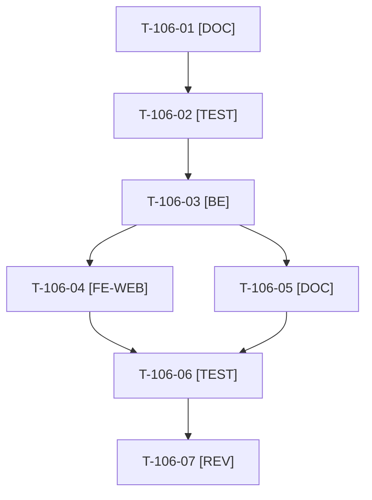

# Tâches : US-106 : Parcours guidés : contenu par persona et écran de sortie vers le contact

## Informations US

- **Epic** : EPIC-12
- **Persona** : Nadia
- **Story Points** : 5 (Must)
- **Sprint** : sprint-17-conversion
- **Story** : [US-106](../../../backlog/user-stories/US-106.md)

## Résumé de la US

**En tant que** Nadia
**Je veux** des parcours pour l'acheteuse, l'approbateur, le directeur financier, le directeur e-commerce et le responsable informatique, chacun terminé par un écran « ce que vous avez vu peut être déployé chez vous »
**Afin de** savoir quoi faire ensuite

## Règles et fichiers visés

- Contenu dans `config/demo/journeys.yaml` (suite de T-105-03) et `translations/journeys.{fr,en}.yaml` ; écran de sortie `templates/demo/journey/_exit.html.twig` (composant `_contact_cta.html.twig` existant ; « En savoir plus » vers la page Intégrer d'US-107, route nommée convenue en T-107-04).
- Parcours (4 à 6 étapes) : acheteuse (commande rapide, listes, devis), approbateur (validation), directeur financier (plafonds, encours, factures), directeur e-commerce (container-fill, catalogue), responsable informatique (PunchOut, MCP). Les comptes conseillés sont ceux de `DemoAccountCatalog`.
- Test de fumée : parcourt tous les parcours, échoue en nommant l'étape dont la route ne se résout pas. Textes relus par Thibaut (ton neutre, aucune comparaison).
- Règles du sprint : voir [README.md](./README.md) (contrat de fin de worker, gel disque, `bin/run-tests` seulement, aucun détail exploitable dans le dépôt public, aucune action externe sans GO). Les livrables rédactionnels sont dans `../communication/` (hors dépôt public), les livrables de code dans le dépôt de la démo.

## Vue d'ensemble des tâches

La colonne « Réalisé par » dit qui fait la tâche : **Claude** seul, **Thibaut** (action de sa part), ou les deux. ⚠️ = sacrifiable (voir [README.md](./README.md)).

| ID | Type | Tâche | Estimation | Dépend de | Réalisé par | Statut |
|----|------|-------|------------|-----------|-------------|--------|
| T-106-01 | [DOC] | Trame des cinq parcours : objectif, compte conseillé, 4 à 6 étapes, plugins montrés, durée estimée | 2 h | T-105-03 | Claude | 🔲 |
| T-106-02 | [TEST] | Tests rouges : cinq parcours listés avec durée, écran de sortie avec et sans URL de contact, étape cassée nommée, clés FR et EN présentes | 1,5 h | T-106-01 | Claude | 🔲 |
| T-106-03 | [BE] | Les cinq parcours dans `journeys.yaml` (routes, comptes, préparateurs) ⚠️ | 2 h | T-106-02, T-105-08 | Claude | 🔲 |
| T-106-04 | [FE-WEB] | Écran de sortie : « En savoir plus » (page Intégrer) et « Échanger sur votre projet » (masqué sans URL), événements Umami | 1 h | T-106-03, T-107-04 | Claude | 🔲 |
| T-106-05 | [DOC] | Textes FR et EN des cinq parcours et de l'écran de sortie (domaine `journeys`) ⚠️ | 2 h | T-106-03 | Claude | 🔲 |
| T-106-06 | [TEST] | Fumée sur tous les parcours avec le bon compte, rendu réel FR et EN (375 px), pa11y AAA ⚠️ | 1,5 h | T-106-04, T-106-05 | Claude | 🔲 |
| T-106-07 | [REV] | Thibaut relit les textes (ton, exactitude) ; revue de code | 1 h | T-106-06 | Thibaut + Claude | 🔲 |

**Total estimé : 11 h** (7 tâches, dont 1 de Thibaut, soit 1 h).

## Dépendances

