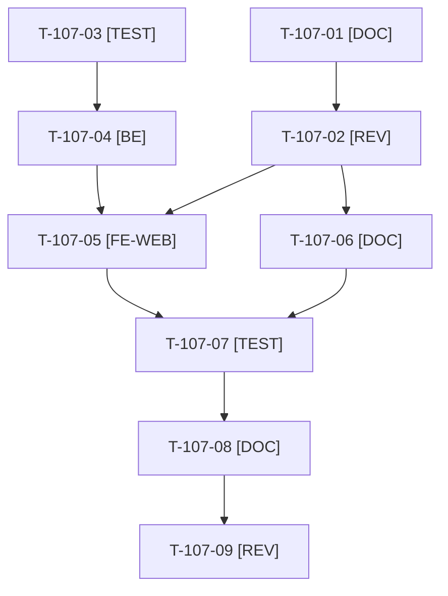

# Tâches : US-107 : Page « Intégrer ces plugins dans votre projet »

## Informations US

- **Epic** : EPIC-12
- **Persona** : Didier
- **Story Points** : 5 (Must)
- **Sprint** : sprint-17-conversion
- **Story** : [US-107](../../../backlog/user-stories/US-107.md)

## Résumé de la US

**En tant que** Didier
**Je veux** une page qui explique comment ces plugins s'intègrent à un projet (formules, questions préalables, architecture type, délais indicatifs)
**Afin de** évaluer l'effort et contacter Thibaut en connaissance de cause

## Règles et fichiers visés

- Fichiers visés : `src/Demo/Controller/IntegrateController.php` (modèle : `McpGuideController`), `templates/demo/integrate.html.twig`, `translations/integrate.{fr,en}.yaml`, lien dans le pied de page et sur la page Plugins, `docs/theme-b2b.md`.
- Contenu : trois formules neutres (Cadrage, Intégration, Accompagnement), questions préalables (ERP, PunchOut, facturation électronique, volumétrie), architecture type (SVG statique), délais indicatifs ; ni prix ni comparaison ; mention sobre du support sous contrat. Bouton de contact via `ContactCta` (placement `integrate`), masqué sans URL.
- Contrôle de charte : un test lit les traductions de la page avec `EditorialCharterCheck` (US-116). Les délais et les formules sont des informations de Thibaut (T-107-02).
- Règles du sprint : voir [README.md](./README.md) (contrat de fin de worker, gel disque, `bin/run-tests` seulement, aucun détail exploitable dans le dépôt public, aucune action externe sans GO). Les livrables rédactionnels sont dans `../communication/` (hors dépôt public), les livrables de code dans le dépôt de la démo.

## Vue d'ensemble des tâches

La colonne « Réalisé par » dit qui fait la tâche : **Claude** seul, **Thibaut** (action de sa part), ou les deux. ⚠️ = sacrifiable (voir [README.md](./README.md)).

| ID | Type | Tâche | Estimation | Dépend de | Réalisé par | Statut |
|----|------|-------|------------|-----------|-------------|--------|
| T-107-01 | [DOC] | Cadrage du contenu : trois formules, questions préalables, architecture type, délais indicatifs (fourchettes proposées) | 1,5 h | T-116-03 | Claude | ✅ |
| T-107-02 | [REV] | Thibaut valide formules, délais et mention du support sous contrat | 0,5 h | T-107-01 | Thibaut | 🔲 |
| T-107-03 | [TEST] | Tests rouges : page FR et EN (formules, questions, architecture), bouton avec UTM `integrate`, bouton masqué sans URL, terme interdit détecté par le contrôle de charte | 1,5 h | T-116-05 | Claude | ✅ |
| T-107-04 | [BE] | `IntegrateController`, route nommée, placement `integrate` dans `ContactCta`, métadonnées SEO (`noindex` conservé) | 1,5 h | T-107-03 | Claude | ✅ |
| T-107-05 | [FE-WEB] | Gabarit : cartes des formules, questions en `
`, architecture en SVG, bouton de contact ; lien dans le pied de page et sur la page Plugins ; cibles 44 px, AAA | 2,5 h | T-107-04, T-107-02 | Claude | ✅ |
| T-107-06 | [DOC] | Textes FR et EN de la page (domaine `integrate`) | 1,5 h | T-107-02 | Claude | ✅ |
| T-107-07 | [TEST] | Rendu réel FR et EN (desktop, 375 et 320 px), pa11y AAA, `bin/measure-mobile`, console sans erreur de CSP | 1 h | T-107-05, T-107-06 | Claude | ✅ |
| T-107-08 | [DOC] | `docs/theme-b2b.md` (page Intégrer, placement `integrate`) ⚠️ | 0,5 h | T-107-07 | Claude | ✅ |
| T-107-09 | [REV] | Revue de code et relecture par Thibaut avant publication | 1 h | T-107-08 | Claude + Thibaut | 👀 |

**Total estimé : 11,5 h** (9 tâches, dont 1 de Thibaut, soit 0,5 h).

## Dépendances

