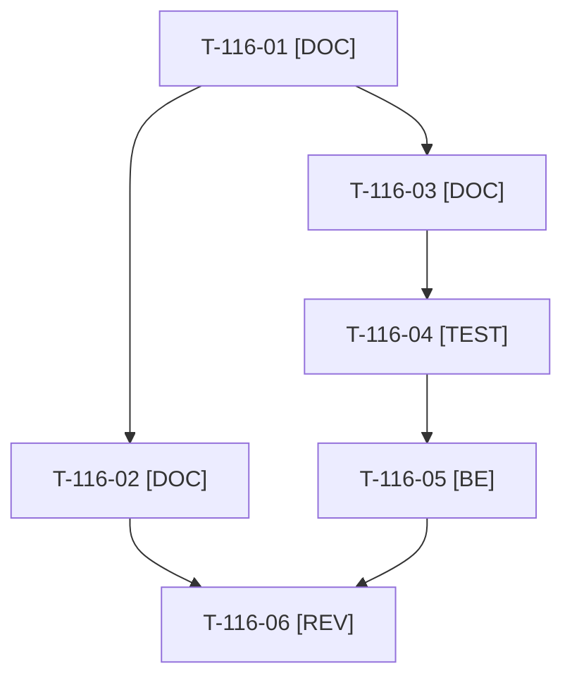

# Tâches : US-116 : Charte éditoriale LinkedIn et messages clés

## Informations US

- **Epic** : EPIC-13
- **Persona** : Thibaut
- **Story Points** : 2 (Must)
- **Sprint** : sprint-17-conversion
- **Story** : [US-116](../../../backlog/user-stories/US-116.md)

## Résumé de la US

**En tant que** Thibaut
**Je veux** une charte éditoriale (cibles, promesse, piliers, ton, interdits) pour LinkedIn et mon site
**Afin de** communiquer de façon cohérente et sans comparaison

## Règles et fichiers visés

- Charte et conventions UTM : `../communication/charte-editoriale.md` (hors dépôt public, dossier `communication/` de `sylius_plugins`).
- Liste des termes interdits : `config/demo/charter_forbidden_terms.yaml` (dans le dépôt, partagée avec le contrôle) ; contrôle : `src/Demo/Check/EditorialCharterCheck.php` et commande `app:charter:check <chemins>`, réutilisés par US-107, US-122, US-123, US-129.
- Première story à traiter (échéance du 2026-10-26) : T-116-01 à T-116-05 débloquent US-129, US-123 et US-127.
- Règles du sprint : voir [README.md](./README.md) (contrat de fin de worker, gel disque, `bin/run-tests` seulement, aucun détail exploitable dans le dépôt public, aucune action externe sans GO). Les livrables rédactionnels sont dans `../communication/` (hors dépôt public), les livrables de code dans le dépôt de la démo.

## Vue d'ensemble des tâches

La colonne « Réalisé par » dit qui fait la tâche : **Claude** seul, **Thibaut** (action de sa part), ou les deux. ⚠️ = sacrifiable (voir [README.md](./README.md)).

| ID | Type | Tâche | Estimation | Dépend de | Réalisé par | Statut |
|----|------|-------|------------|-----------|-------------|--------|
| T-116-01 | [DOC] | Charte : cibles (DSI, directeurs e-commerce, intégrateurs), promesse, 4 piliers, ton neutre, interdits, règles sur les données | 1,5 h | - | Claude | 🔲 |
| T-116-02 | [DOC] | Conventions UTM (source, support, campagne, contenu par post), noms de campagne (`ouverture-demo`, source `linkedin`), exemples de liens | 0,5 h | T-116-01 | Claude | 🔲 |
| T-116-03 | [DOC] | Liste des termes interdits (comparaison avec une offre éditeur, « alternative gratuite », canaux Sylius) en fichier de données | 0,5 h | T-116-01 | Claude | 🔲 |
| T-116-04 | [TEST] | Tests rouges : terme interdit signalé avec sa ligne, texte propre accepté, liste lue depuis le fichier partagé | 1 h | T-116-03 | Claude | 🔲 |
| T-116-05 | [BE] | `EditorialCharterCheck` et commande `app:charter:check` (chemins en argument, code de sortie non nul) | 1,5 h | T-116-04 | Claude | 🔲 |
| T-116-06 | [REV] | Thibaut relit et valide cibles, piliers, ton et interdits | 0,5 h | T-116-02, T-116-05 | Thibaut | 🔲 |

**Total estimé : 5,5 h** (6 tâches, dont 1 de Thibaut, soit 0,5 h).

## Dépendances

