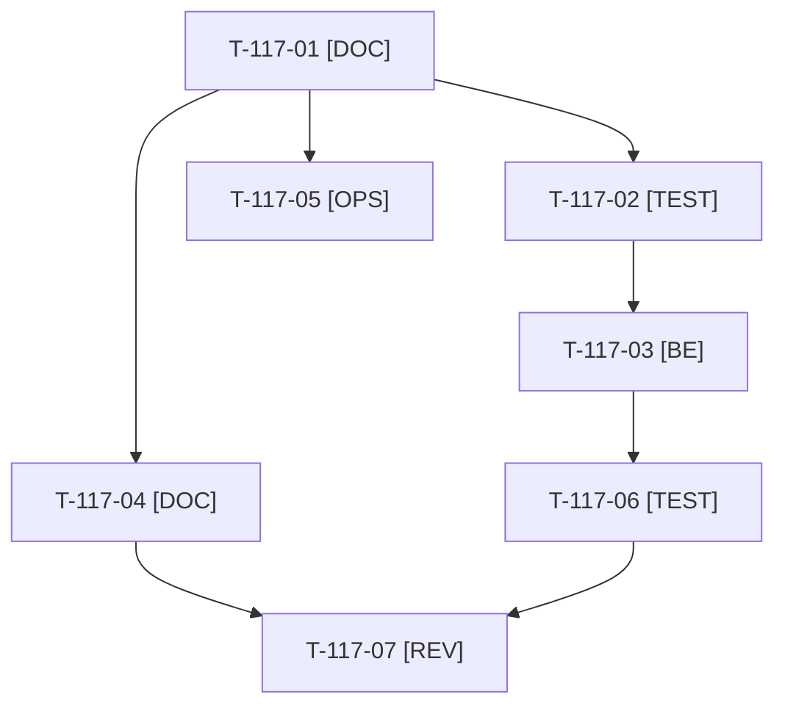

# Tâches : US-117 : Mesure de la communication : visites par campagne sans cookie

## Informations US

- **Epic** : EPIC-13
- **Persona** : Thibaut
- **Story Points** : 3 (Should)
- **Sprint** : sprint-17-conversion
- **Story** : [US-117](../../../backlog/user-stories/US-117.md)

## Résumé de la US

**En tant que** Thibaut
**Je veux** une mesure simple des visites venant de LinkedIn
**Afin de** savoir quels contenus amènent des échanges

## Règles et fichiers visés

- Réutilise `src/Demo/Analytics/UmamiEvent.php`, `UmamiTracker.php` et `templates/shared/_umami.html.twig` (US-143). Umami enregistre nativement les paramètres UTM de la première page vue : le code se limite aux propriétés d'événements (campagne nettoyée) ; si le spike le confirme, rien de plus.
- Documentation : `docs/mesure-communication.md` (lecture du tableau Umami : visites, parcours lancés, clics vers le contact par campagne).
- T-117-01 et T-117-05 sont sur le chemin du bilan J+7 (2026-10-26) et passent en tête.
- Règles du sprint : voir [README.md](./README.md) (contrat de fin de worker, gel disque, `bin/run-tests` seulement, aucun détail exploitable dans le dépôt public, aucune action externe sans GO). Les livrables rédactionnels sont dans `../communication/` (hors dépôt public), les livrables de code dans le dépôt de la démo.

## Vue d'ensemble des tâches

La colonne « Réalisé par » dit qui fait la tâche : **Claude** seul, **Thibaut** (action de sa part), ou les deux. ⚠️ = sacrifiable (voir [README.md](./README.md)).

| ID | Type | Tâche | Estimation | Dépend de | Réalisé par | Statut |
|----|------|-------|------------|-----------|-------------|--------|
| T-117-01 | [DOC] | Spike : ce qu'Umami enregistre nativement (UTM, référent, événements), limites du plan gratuit, décision sur le code nécessaire | 1 h | T-116-02 | Claude | ✅ |
| T-117-02 | [TEST] | Tests rouges : campagne inconnue ou trop longue ignorée, aucune donnée stockée, propriété `campaign` sur les événements de parcours et de contact, aucune requête externe sans configuration ⚠️ | 1 h | T-117-01 | Claude | ✅ |
| T-117-03 | [BE] | Nettoyage du paramètre de campagne (même règle que `UmamiEvent`) et propriété sur les événements de lancement de parcours et de contact ⚠️ | 1,5 h | T-117-02, T-105-06 | Claude | ✅ |
| T-117-04 | [DOC] | `docs/mesure-communication.md` : lecture du tableau Umami par campagne, vues enregistrées, anomalie « 0 visite » | 1 h | T-117-01 | Claude | ✅ |
| T-117-05 | [OPS] | Thibaut ouvre un lien de test `?utm_source=linkedin&utm_campaign=ouverture-demo` et vérifie la visite dans Umami (sinon : signaler) | 0,5 h | T-117-01 | Thibaut | 🔲 |
| T-117-06 | [TEST] | Rendu réel : script présent sur une page mesurée, absent sans configuration, console sans erreur de CSP ⚠️ | 1 h | T-117-03 | Claude | ✅ |
| T-117-07 | [REV] | Revue (aucune donnée personnelle dans les événements, doc relue) | 0,5 h | T-117-04, T-117-06 | Claude | 👀 |

**Total estimé : 6,5 h** (7 tâches, dont 1 de Thibaut, soit 0,5 h).

## Dépendances

