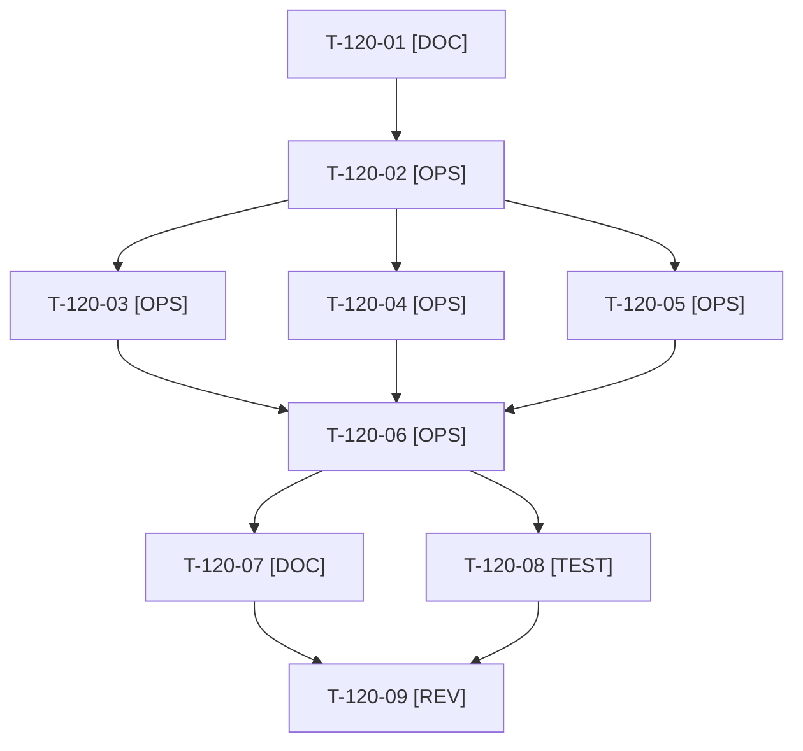

# Tâches : US-120 : Kit média (1/2) : GIF courts de PunchOut, devis et commande rapide

## Informations US

- **Epic** : EPIC-13
- **Persona** : Thibaut
- **Story Points** : 5 (Must)
- **Sprint** : sprint-17-conversion
- **Story** : [US-120](../../../backlog/user-stories/US-120.md)

## Résumé de la US

**En tant que** Thibaut
**Je veux** des GIF ou vidéos de 30 à 60 secondes pour trois plugins phares
**Afin de** les utiliser dans mes posts et mes fiches

## Règles et fichiers visés

- Livrables hors dépôt : `../communication/kit-media/` (MP4 et GIF, version carrée, sous-titres FR, textes alternatifs, script d'export `export.sh`). `ffmpeg` est installé en local.
- Captation : Claude pilote le navigateur (enregistrement GIF) depuis la démo locale remise à zéro ; si le rendu n'est pas assez net, Thibaut enregistre l'écran et Claude fait le montage et l'export (repli).
- Données de démonstration seulement : aucun courriel réel, URL privée ou logo de marque tierce à l'écran.
- Règles du sprint : voir [README.md](./README.md) (contrat de fin de worker, gel disque, `bin/run-tests` seulement, aucun détail exploitable dans le dépôt public, aucune action externe sans GO). Les livrables rédactionnels sont dans `../communication/` (hors dépôt public), les livrables de code dans le dépôt de la démo.

## Vue d'ensemble des tâches

La colonne « Réalisé par » dit qui fait la tâche : **Claude** seul, **Thibaut** (action de sa part), ou les deux. ⚠️ = sacrifiable (voir [README.md](./README.md)).

| ID | Type | Tâche | Estimation | Dépend de | Réalisé par | Statut |
|----|------|-------|------------|-----------|-------------|--------|
| T-120-01 | [DOC] | Scénario de chaque séquence (PunchOut, devis, commande rapide) : plan, compte, 30 à 60 s, sous-titres FR | 1,5 h | - | Claude | 🔲 |
| T-120-02 | [OPS] | Préparer la démo locale : remise à zéro propre, comptes, fenêtre de captation ; contrôle d'absence de donnée sensible, d'URL privée et de marque tierce | 1 h | T-120-01 | Claude | 🔲 |
| T-120-03 | [OPS] | Captation de la séquence PunchOut (simulateur) | 1,5 h | T-120-02 | Claude (repli Thibaut) | 🔲 |
| T-120-04 | [OPS] | Captation de la séquence devis | 1,5 h | T-120-02 | Claude (repli Thibaut) | 🔲 |
| T-120-05 | [OPS] | Captation de la séquence commande rapide ⚠️ | 1 h | T-120-02 | Claude (repli Thibaut) | 🔲 |
| T-120-06 | [OPS] | Export : sous-titres FR incrustés, version carrée 1080×1080, MP4 et GIF de moins de 10 Mo (`export.sh`) | 2 h | T-120-03, T-120-04, T-120-05 | Claude | 🔲 |
| T-120-07 | [DOC] | Textes alternatifs, descriptions et fiche du kit (`kit-media/README.md`) | 1 h | T-120-06 | Claude | 🔲 |
| T-120-08 | [TEST] | Contrôle de durée, poids et dimensions (`ffprobe`) et relecture d'images extraites de chaque séquence (données sensibles, marques) | 0,5 h | T-120-06 | Claude | 🔲 |
| T-120-09 | [REV] | Thibaut valide les trois séquences (sinon séquence refaite) | 0,5 h | T-120-07, T-120-08 | Thibaut | 🔲 |

**Total estimé : 10,5 h** (9 tâches, dont 1 de Thibaut, soit 0,5 h).

## Dépendances

