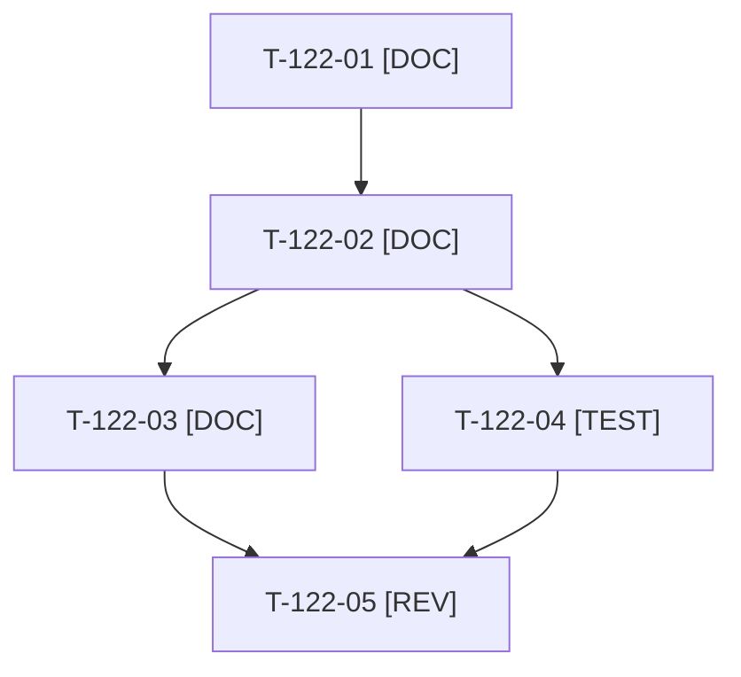

# Tâches : US-122 : Calendrier éditorial LinkedIn sur huit semaines

## Informations US

- **Epic** : EPIC-13
- **Persona** : Thibaut
- **Story Points** : 3 (Must)
- **Sprint** : sprint-17-conversion
- **Story** : [US-122](../../../backlog/user-stories/US-122.md)

## Résumé de la US

**En tant que** Thibaut
**Je veux** un calendrier de 6 à 8 semaines aligné sur l'ouverture publique
**Afin de** savoir quoi publier et quand

## Règles et fichiers visés

- Livrable hors dépôt : `../communication/calendrier-editorial.md`. Dates exprimées en J+n depuis une date d'ancrage (annonce du 2026-10-19), pour qu'un décalage du GO ne change que l'ancrage.
- Cadence (une ou deux publications par semaine) : choix de Thibaut à T-122-05.
- Règles du sprint : voir [README.md](./README.md) (contrat de fin de worker, gel disque, `bin/run-tests` seulement, aucun détail exploitable dans le dépôt public, aucune action externe sans GO). Les livrables rédactionnels sont dans `../communication/` (hors dépôt public), les livrables de code dans le dépôt de la démo.

## Vue d'ensemble des tâches

La colonne « Réalisé par » dit qui fait la tâche : **Claude** seul, **Thibaut** (action de sa part), ou les deux. ⚠️ = sacrifiable (voir [README.md](./README.md)).

| ID | Type | Tâche | Estimation | Dépend de | Réalisé par | Statut |
|----|------|-------|------------|-----------|-------------|--------|
| T-122-01 | [DOC] | Cadrage : date d'ancrage, cadence proposée, répartition piliers et plugins, visuels disponibles | 0,5 h | T-116-01 | Claude | ✅ |
| T-122-02 | [DOC] | Tableau de 8 semaines (date, pilier, plugin ou thème, visuel, lien UTM, objectif clic ou échange) ; semaine 1 = suite de l'annonce | 2,5 h | T-122-01, T-116-02 | Claude | ✅ |
| T-122-03 | [DOC] | Règle de recalage (dates en J+n, procédure de décalage conservant l'ordre) | 1 h | T-122-02 | Claude | ✅ |
| T-122-04 | [TEST] | Contrôle de charte sur le calendrier (une ligne visant un canal Sylius est refusée) (`charter_check.py`) | 0,5 h | T-122-02, T-116-05 | Claude | ✅ |
| T-122-05 | [REV] | Thibaut choisit la cadence et valide le calendrier | 0,5 h | T-122-03, T-122-04 | Thibaut | 🔲 |

**Total estimé : 5 h** (5 tâches, dont 1 de Thibaut, soit 0,5 h).

## Dépendances

