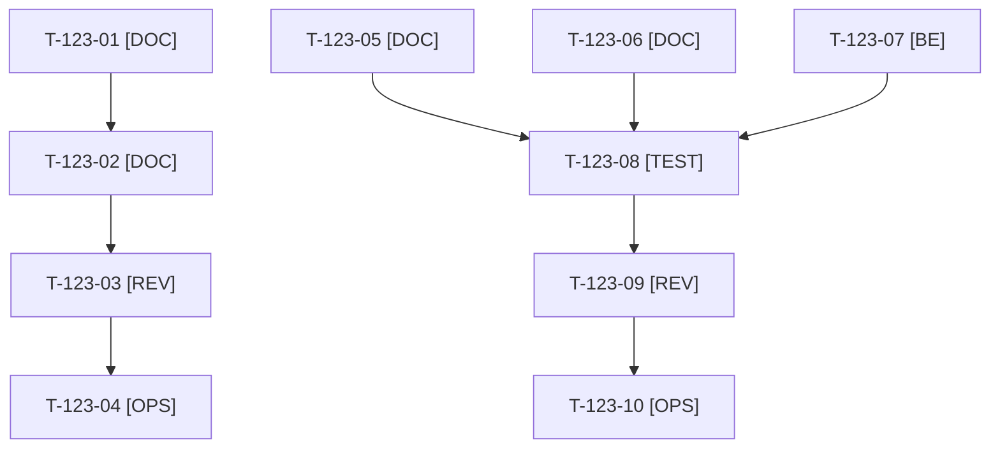

# Tâches : US-123 : Posts LinkedIn rédigés, lot 1 : trois posts de suite à l'annonce

## Informations US

- **Epic** : EPIC-13
- **Persona** : Thibaut
- **Story Points** : 3 (Must)
- **Sprint** : sprint-17-conversion
- **Story** : [US-123](../../../backlog/user-stories/US-123.md)

## Résumé de la US

**En tant que** Thibaut
**Je veux** trois posts de suite à mon annonce d'ouverture
**Afin de** garder l'élan du premier post et amener ses lecteurs vers mon profil et la démo

## Règles et fichiers visés

- Livrables hors dépôt : `../communication/posts-lot-1/post-1.md`, `post-2.md`, `post-3.md` (accroche, corps, appel à l'action explicite, lien UTM, variante courte < 600 caractères, visuel en en-tête).
- **Post 1 : prêt et publié au plus tard le 2026-10-26, sans attendre la charte** (T-123-01 à T-123-04). Posts 2 et 3 : charte, calendrier (US-122) et kit média (US-120).
- Contrôle des posts : extension de `app:charter:check` (T-123-07) pour visuel manquant, lien UTM absent, variante trop longue.
- Règles du sprint : voir [README.md](./README.md) (contrat de fin de worker, gel disque, `bin/run-tests` seulement, aucun détail exploitable dans le dépôt public, aucune action externe sans GO). Les livrables rédactionnels sont dans `../communication/` (hors dépôt public), les livrables de code dans le dépôt de la démo.

## Vue d'ensemble des tâches

La colonne « Réalisé par » dit qui fait la tâche : **Claude** seul, **Thibaut** (action de sa part), ou les deux. ⚠️ = sacrifiable (voir [README.md](./README.md)).

| ID | Type | Tâche | Estimation | Dépend de | Réalisé par | Statut |
|----|------|-------|------------|-----------|-------------|--------|
| T-123-01 | [DOC] | Post de suite n°1 : accroche, corps, appel à l'action explicite (profil, parcours de démo, rendez-vous), lien UTM, variante < 600 caractères | 2 h | - | Claude | ✅ |
| T-123-02 | [DOC] | Visuel du post 1 (réemploi des captures de `communication/linkedin-ouverture-demo/`) et texte alternatif | 1 h | T-123-01 | Claude | ✅ |
| T-123-03 | [REV] | Thibaut relit et ajuste le post 1 (relecture seule, sans charte) | 0,5 h | T-123-02 | Thibaut | 🔲 |
| T-123-04 | [OPS] | Thibaut publie le post 1 au plus tard le 2026-10-26 et épingle le commentaire avec le lien de la démo | 0,5 h | T-123-03, T-129-07 | Thibaut | 🔲 |
| T-123-05 | [DOC] | Post 2 (plugin phare selon le calendrier) : même structure, visuel ou GIF du kit | 1,5 h | T-122-03, T-120-06 | Claude | ✅ |
| T-123-06 | [DOC] | Post 3 : même structure, visuel ou GIF du kit ⚠️ | 1,5 h | T-122-03, T-120-06 | Claude | ✅ |
| T-123-07 | [BE] | Contrôle des posts : tests rouges puis extension de `app:charter:check` (visuel présent, lien UTM, variante courte < 600 caractères) (même script, option `--post`) | 1 h | T-116-05 | Claude | ✅ |
| T-123-08 | [TEST] | Contrôle exécuté sur les trois posts et corrections | 0,5 h | T-123-05, T-123-06, T-123-07 | Claude | ✅ |
| T-123-09 | [REV] | Thibaut relit les posts 2 et 3 | 0,5 h | T-123-08 | Thibaut | 🔲 |
| T-123-10 | [OPS] | Thibaut publie les posts 2 et 3 aux dates du calendrier | 0,5 h | T-123-09 | Thibaut | 🔲 |

**Total estimé : 9,5 h** (10 tâches, dont 4 de Thibaut, soit 2 h).

## Dépendances

