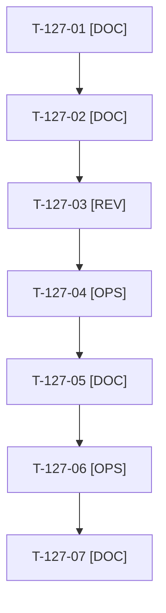

# Tâches : US-127 : Suivi de l'annonce d'ouverture, de J+1 à J+30

## Informations US

- **Epic** : EPIC-13
- **Persona** : Thibaut
- **Story Points** : 2 (Must)
- **Sprint** : sprint-17-conversion
- **Story** : [US-127](../../../backlog/user-stories/US-127.md)

## Résumé de la US

**En tant que** Thibaut
**Je veux** un plan de suivi de mon annonce d'ouverture sur 30 jours
**Afin de** transformer les réactions en visites de mon profil, de la démo et en échanges

## Règles et fichiers visés

- Livrables hors dépôt : `../communication/suivi-annonce/plan-suivi.md`, `bilan-j7.md`, `bilan-j30.md`, gabarit du journal des échanges (le journal lui-même reste hors dépôt, sans nom ni contenu de conversation).
- Échéances : bilan J+7 le 2026-10-26, bilan J+30 le 2026-11-18. Le chiffre Umami de J+7 dépend de la vérification T-117-05 (lien de test).
- Règles du sprint : voir [README.md](./README.md) (contrat de fin de worker, gel disque, `bin/run-tests` seulement, aucun détail exploitable dans le dépôt public, aucune action externe sans GO). Les livrables rédactionnels sont dans `../communication/` (hors dépôt public), les livrables de code dans le dépôt de la démo.

## Vue d'ensemble des tâches

La colonne « Réalisé par » dit qui fait la tâche : **Claude** seul, **Thibaut** (action de sa part), ou les deux. ⚠️ = sacrifiable (voir [README.md](./README.md)).

| ID | Type | Tâche | Estimation | Dépend de | Réalisé par | Statut |
|----|------|-------|------------|-----------|-------------|--------|
| T-127-01 | [DOC] | Plan de suivi J+1 à J+30 : actions, responsable, échéance, indicateur ; modèles de réponse aux commentaires avec lien UTM ; gabarit du journal privé et règle sans nominatif | 2,5 h | T-116-02 | Claude | ✅ |
| T-127-02 | [DOC] | Gabarits des bilans J+7 et J+30 (réactions, vues du profil, visites par campagne, clics rendez-vous, messages ; anomalie « 0 visite » avec vérifications UTM, CSP, script) | 1 h | T-127-01 | Claude | ✅ |
| T-127-03 | [REV] | Thibaut relit le plan de suivi | 0,5 h | T-127-02 | Thibaut | 🔲 |
| T-127-04 | [OPS] | Thibaut relève les chiffres LinkedIn et Umami à J+7 (2026-10-26) | 0,5 h | T-127-03, T-117-05 | Thibaut | 🔲 |
| T-127-05 | [DOC] | Bilan J+7 avec les chiffres réels et proposition d'ajustement (gabarit prêt à remplir avec la base J+1 ; chiffres de J+7 à relever par Thibaut) | 1 h | T-127-04 | Claude | 🔄 |
| T-127-06 | [OPS] | Thibaut relève les chiffres LinkedIn et Umami à J+30 (2026-11-18) | 0,5 h | T-127-05 | Thibaut | 🔲 |
| T-127-07 | [DOC] | Bilan J+30 et ajustements reportés dans le calendrier (US-122) | 1 h | T-127-06, T-122-03 | Claude | 🔲 |

**Total estimé : 7 h** (7 tâches, dont 3 de Thibaut, soit 1,5 h).

## Dépendances

