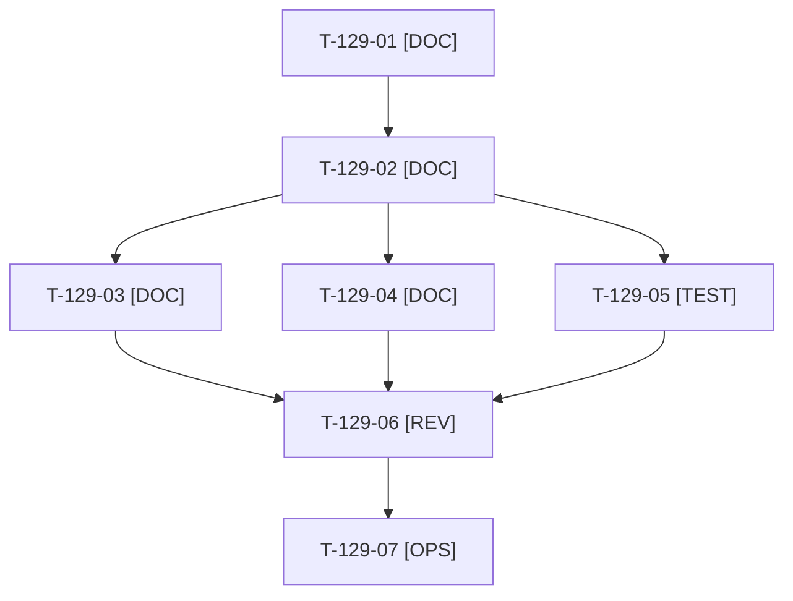

# Tâches : US-129 : Profil LinkedIn : texte, bannière et section « À la une »

## Informations US

- **Epic** : EPIC-13
- **Persona** : Thibaut
- **Story Points** : 2 (Must)
- **Sprint** : sprint-17-conversion
- **Story** : [US-129](../../../backlog/user-stories/US-129.md)

## Résumé de la US

**En tant que** Thibaut
**Je veux** un texte « À propos », une bannière et une section « À la une » alignés sur la démo
**Afin de** que les visiteurs de mon profil comprennent mon offre

## Règles et fichiers visés

- Livrables hors dépôt : `../communication/profil-linkedin/` (textes FR et EN, bannière PNG, liste « À la une »). Modèle de bannière : `../communication/linkedin-ouverture-demo/visuel.html`.
- À traiter avant US-123 (profil à jour avant le premier post de suite, échéance du 2026-10-26). Le lien vers la page « Intégrer » (US-107) est ajouté à la liste quand elle est en ligne.
- Règles du sprint : voir [README.md](./README.md) (contrat de fin de worker, gel disque, `bin/run-tests` seulement, aucun détail exploitable dans le dépôt public, aucune action externe sans GO). Les livrables rédactionnels sont dans `../communication/` (hors dépôt public), les livrables de code dans le dépôt de la démo.

## Vue d'ensemble des tâches

La colonne « Réalisé par » dit qui fait la tâche : **Claude** seul, **Thibaut** (action de sa part), ou les deux. ⚠️ = sacrifiable (voir [README.md](./README.md)).

| ID | Type | Tâche | Estimation | Dépend de | Réalisé par | Statut |
|----|------|-------|------------|-----------|-------------|--------|
| T-129-01 | [DOC] | Thibaut fournit le texte actuel du profil (titre, À propos, bannière, À la une) pour partir de l'existant | 0,5 h | - | Thibaut | 🔲 |
| T-129-02 | [DOC] | Titre et « À propos » FR et EN (offre, démo, prise de rendez-vous ; ton neutre, aucun résultat promis ni comparaison) | 1,5 h | T-129-01, T-116-01 | Claude | ✅ |
| T-129-03 | [DOC] | Bannière 1584×396 (depuis le modèle `visuel.html`), lisible sur mobile | 1,5 h | T-129-02 | Claude | ✅ |
| T-129-04 | [DOC] | Liste « À la une » (ordre, titres, liens UTM : démo, parcours, rendez-vous) et texte du commentaire épinglé | 0,5 h | T-129-02, T-116-02 | Claude | ✅ |
| T-129-05 | [TEST] | Contrôle de charte sur les textes (`app:charter:check`) (`charter_check.py`) | 0,5 h | T-129-02, T-116-05 | Claude | ✅ |
| T-129-06 | [REV] | Thibaut relit textes, bannière et liste | 0,5 h | T-129-03, T-129-04, T-129-05 | Thibaut | 🔲 |
| T-129-07 | [OPS] | Thibaut met à jour son profil (texte, bannière, À la une) et épingle le commentaire | 0,5 h | T-129-06 | Thibaut | 🔲 |

**Total estimé : 5,5 h** (7 tâches, dont 3 de Thibaut, soit 1,5 h).

## Dépendances

