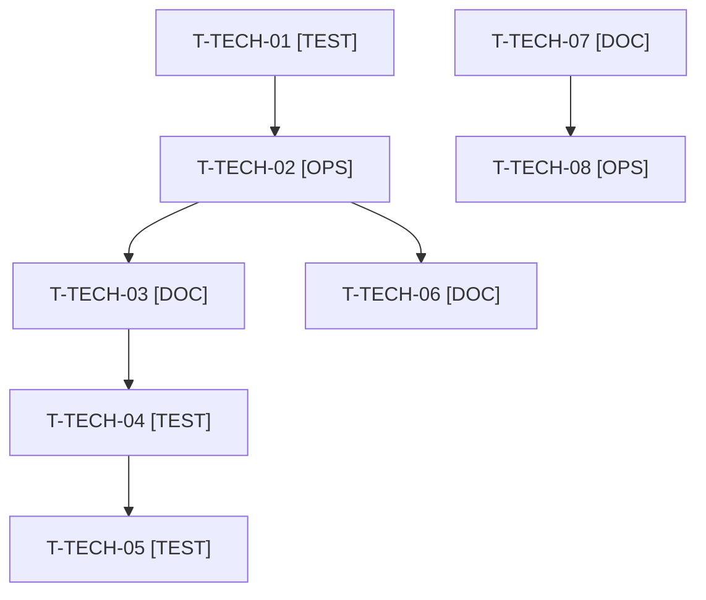

# Tâches transverses : actions de la rétrospective du sprint 16

Source : [sprint-retro.md](../../sprint-16-demo-credible/sprint-retro.md). Tâches **sans points** : elles ne comptent pas dans les 38 points mais dans les heures. Elles passent avant la première story qui touche des données de démo (action 2) et dès le démarrage pour le verrou (action 1).

| Action | Description | Tâches |
|--------|-------------|--------|
| 1 | Verrou dans `bin/run-tests` | T-TECH-01, T-TECH-02 |
| 2 | Isoler les tests qui modifient un compte de démo partagé | T-TECH-03, T-TECH-04, T-TECH-05 |
| 3 | Arrêt explicite des tâches de fond avant relance | T-TECH-06 |
| 4 | Reconstruire l'image après tout correctif de revue touchant l'image | T-TECH-07, T-TECH-08 |

## Vue d'ensemble des tâches

| ID | Type | Tâche | Estimation | Dépend de | Réalisé par | Statut |
|----|------|-------|------------|-----------|-------------|--------|
| T-TECH-01 | [TEST] | Tests rouges du verrou de `bin/run-tests` (script shell) : un second run échoue aussitôt avec un message clair, un verrou périmé (PID absent) est repris, le verrou est retiré à la sortie même en échec | 1 h | - | Claude | 🔲 |
| T-TECH-02 | [OPS] | Verrou dans `bin/run-tests` (action 1 de la rétro) : répertoire de verrou atomique avec PID, détection du périmé par `kill -0`, retrait au `trap`, code de sortie non nul ; l'attente de fin repose sur ce verrou, jamais sur `pgrep` | 1,5 h | T-TECH-01 | Claude | 🔲 |
| T-TECH-03 | [DOC] | Règle d'isolation des comptes de démo partagés dans `tasks/README.md` et `docs/tests-locaux.md` (action 2) ; description du verrou | 0,5 h | T-TECH-02 | Claude | 🔲 |
| T-TECH-04 | [TEST] | Isoler les deux tests de données vivantes dépendant de l'ordre (panier de Claire) par transaction ou annulation, assertions strictes rétablies (action 2) | 2 h | T-TECH-03 | Claude | 🔲 |
| T-TECH-05 | [TEST] | Suite complète en ordre aléatoire (`--order-by=random`, deux graines) verte, 0 test dépendant de l'ordre (action 2) | 1 h | T-TECH-04 | Claude | 🔲 |
| T-TECH-06 | [DOC] | Consigne d'orchestration : arrêt explicite (TaskStop) et vérification de l'arrêt avant toute relance (action 3) ; ajout dans le gabarit de consigne de worker | 0,5 h | T-TECH-02 | Orchestrateur | 🔲 |
| T-TECH-07 | [DOC] | Checklist de revue : un correctif touchant le Dockerfile, l'entrypoint ou les droits est validé par reconstruction et démarrage du conteneur avant la clôture de la revue (action 4) | 0,5 h | - | Orchestrateur | 🔲 |
| T-TECH-08 | [OPS] | Reconstruction de l'image et démarrage du conteneur (`/healthz`) par l'orchestrateur en fin de sprint, avant la revue, puis après tout correctif touchant l'image (action 4) | 1 h | T-TECH-07 | Orchestrateur | 🔲 |

**Total estimé : 8 h** (8 tâches, aucune de Thibaut). T-TECH-06 à T-TECH-08 relèvent de l'orchestrateur (seul à reconstruire l'image).

## Dépendances

