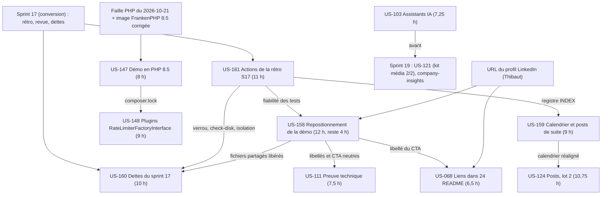
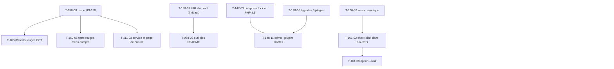

# Dépendances : Sprint 018 (repositionnement)

## Entre stories et avec les sprints précédents

## Entre tâches (vue transversale)

## Chemin critique

Trois chemins. **Calendaire (2026-10-26)** : T-159-01 → T-159-02 → T-159-03 → T-159-04 → T-159-05 (post 1 : 3,75 h dont 1 h de Thibaut), à faire dès la décision de Thibaut. **Plateforme (faille de PHP)** : T-147-01 (veille) → T-147-03 → T-147-05 → T-147-08 ; la veille programmée réalise T-147-01 à T-147-04 dès que l'image corrigée est publiée. **Développement** : T-160-01 → T-160-02 → T-161-02 → T-161-08 (outillage, ≈ 4,5 h en série) puis T-158-05 → T-158-08 → T-160-03 → T-160-04 → T-160-07 (≈ 6 h) ; US-111 et US-103 en fin de piste, sacrifiables. Les actions de Thibaut (publication, GO, URL, Railway) sortent du chemin critique de développement mais pas du chemin calendaire.

## Ressources partagées

- `bin/run-tests` : T-160-02, puis T-161-02, puis T-161-08 (un seul écrivain à la fois) ; `bin/clean-test-caches`, `bin/check-disk` et `docs/tests-locaux.md` : US-161 seule.
- Code non commité d'US-158 : `src/Demo/Site/`, `templates/shared/_contact_cta.html.twig`, `templates/demo/integrate.html.twig`, `config/demo/journeys.yaml`, traductions `integrate`, `journeys`, `messages`, `seo`, `shop_layout`, `theme_demo`, tests `ContactCta`, `IntegratePage`, `Journey` : US-158 seule jusqu'à T-158-08, puis US-160 (parcours, menu compte) et US-111 (page de preuve), un worker à la fois.
- `composer.json`, `composer.lock`, `docker/Dockerfile`, `.github/workflows/ci.yaml` : US-147 puis US-148 (T-148-11) ; l'image n'est reconstruite que par l'orchestrateur, un build à la fois.
- Dépôts de plugins : US-148 (cinq dépôts, un worker par dépôt) puis US-068 (24 dépôts, README seulement) ; deux workers ne touchent jamais le même dépôt en même temps ; `git fetch` et branche courante vérifiés.
- `bin/vitrine-readme` et `src/Demo/Vitrine/` : US-068 seule.
- Page et contrôleur Assistants IA, traductions communes : US-103 après US-111 (un seul worker sur les traductions partagées).
- `/Users/tmonier/Projects/sylius_plugins/communication/sprint-18/` : US-159 puis US-124 (calendrier lu par US-124 après sa réécriture) ; `communication/INDEX.md` : US-161 (création), puis US-159 et US-124 (mise à jour).
- `.bmad/sprint-status.yaml` : orchestrateur seulement (écrivain unique).
- Actions de Thibaut : URL du profil, relectures, publications, GO (plugins, README, merges), Railway, conversation avec l'assistant.
