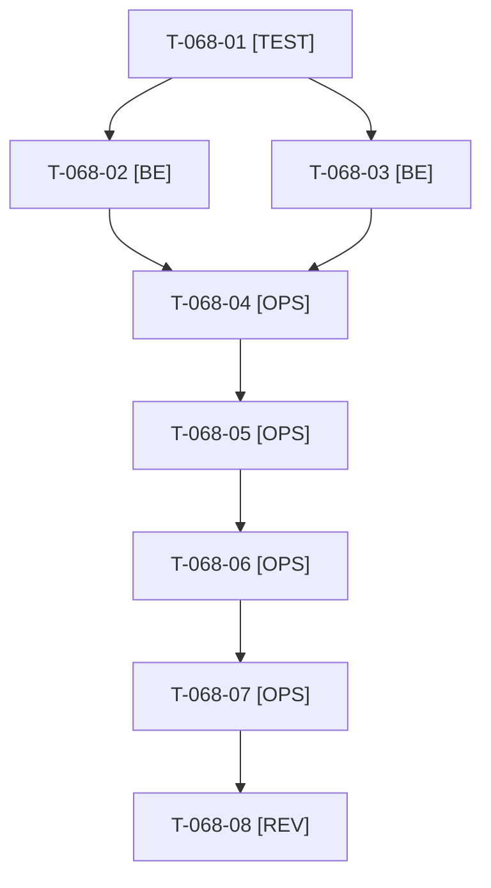

# Tâches : US-068 : Liens vers la démo et le profil de l'auteur dans les 24 README

## Informations US

- **Epic** : EPIC-09
- **Persona** : Camille
- **Story Points** : 3 (Should)
- **Sprint** : sprint-18-repositionnement
- **Story** : [US-068](../../../backlog/user-stories/US-068.md)

## Résumé de la US

**En tant que** Camille, qui arrive sur un dépôt GitHub d'un des 24 plugins
**Je veux** y trouver un lien vers la démo en ligne et vers le profil de l'auteur
**Afin de** relier le code que je lis à la personne et à ses 25 ans de delivery

## Règles et fichiers visés

- **24 dépôts, une PR par dépôt, GO unique de Thibaut** pour le push, les PR et le merge (T-068-05). Sacrifice n°1. Le GO couvre aussi les attentes de CI : aucun merge avant la fin du run de chaque dépôt.
- Outil : `bin/vitrine-readme` (`apply`, `--check`) et ses classes `src/Demo/Vitrine/` (`ReadmeApplier`, `ReadmeChecker`) ; tests dans `tests/Unit/Bin/VitrineReadmeTest.php`. Libellés « Démo en ligne » et « Auteur : Thibaut Monier », aucune formule de disponibilité ni d'offre.
- **Pour chaque dépôt : `git fetch` puis vérifier la branche courante avant de commiter** (des branches fusionnées traînent localement) ; une branche `docs/readme-liens-auteur` par dépôt ; `git add` par chemins explicites (README.md et README.fr.md).
- URL du profil : fournie par Thibaut (T-158-09), passée en argument, jamais commitée dans le dépôt de la démo. Un plugin absent de la démo (`config/demo/plugins.yaml`) reçoit seulement le lien vers le profil ; `sylius-wishlist-plugin-fork` fait partie des 24 dépôts.
- Règles du sprint : voir [README.md](./README.md) (contrat de fin de worker, disque, isolation par worker, vérification croisée, attente bornée, `bin/run-tests` seulement, aucun détail exploitable dans le dépôt public, aucune action externe sans GO).

## Vue d'ensemble des tâches

La colonne « Réalisé par » dit qui fait la tâche : **Claude** seul, **Orchestrateur** (Claude en rôle d'orchestrateur) ou **Thibaut** (action de sa part). ⚠️ = sacrifiable (voir [README.md](./README.md)).

| ID | Type | Tâche | Estimation | Dépend de | Réalisé par | Statut |
|----|------|-------|------------|-----------|-------------|--------|
| T-068-01 | [TEST] | Tests rouges de l'outil (`VitrineReadmeTest`) : deux liens EN et FR identiques partout, relance sans diff, plugin sans démo (profil seul), URL absente refusée, terme commercial ou lien mort signalé | 1 h | - | Claude | ✅ |
| T-068-02 | [BE] | `bin/vitrine-readme apply` : liens démo et profil (argument d'URL), refus sans URL, détection du plugin sans démo | 1 h | T-068-01, T-158-09 | Claude | ✅ |
| T-068-03 | [BE] | `--check` : termes « mission », « devis », « prestation », liens morts, cohérence des liens entre les 24 dépôts | 0,75 h | T-068-01 | Claude | ✅ |
| T-068-04 | [OPS] | Application aux 24 dépôts (`git fetch`, branche courante vérifiée, une branche par dépôt), `--check` avant et après, aucun push | 1 h | T-068-02, T-068-03 | Claude | 🔄 |
| T-068-05 | [OPS] | Thibaut donne le GO unique : push des 24 branches, 24 PR, merge quand les CI sont vertes | 0,25 h | T-068-04 | Thibaut | 🔲 |
| T-068-06 | [OPS] | 24 PR (une par dépôt) et suivi de chaque CI | 1,25 h | T-068-05 | Claude | 🔲 |
| T-068-07 | [OPS] | Merge des 24 PR après run terminé de chacune (branche principale protégée) | 0,75 h | T-068-06 | Claude | 🔲 |
| T-068-08 | [REV] | Revue : `--check` sur les 24 branches principales, liens qui répondent, aucun secret | 0,5 h | T-068-07 | Claude | 🔲 |

**Total estimé : 6,5 h** (8 tâches, dont 1 de Thibaut, soit 0,25 h).

## Dépendances

Dépendances hors story : T-158-09.
