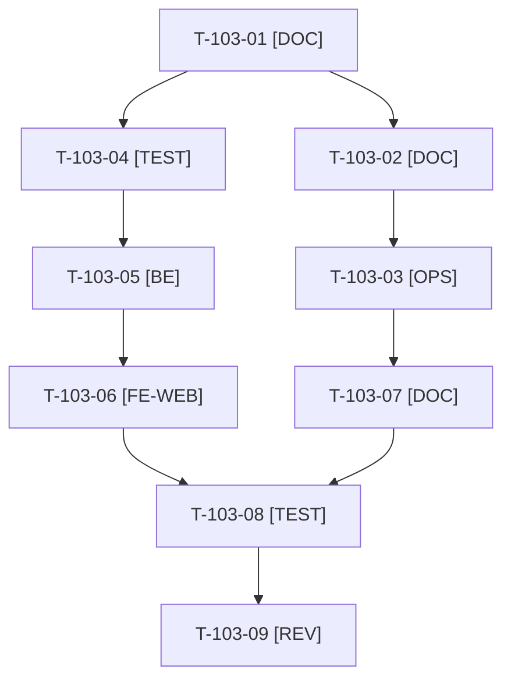

# Tâches : US-103 : Assistants IA : page utile avec transcript d'une vraie conversation

## Informations US

- **Epic** : EPIC-11
- **Persona** : Nadia
- **Story Points** : 3 (Should)
- **Sprint** : sprint-18-repositionnement
- **Story** : [US-103](../../../backlog/user-stories/US-103.md)

## Résumé de la US

**En tant que** Nadia
**Je veux** voir ce qu'un assistant fait réellement avec la démo (transcript et courte vidéo)
**Afin de** comprendre le bénéfice sans configurer d'assistant

## Règles et fichiers visés

- Fiche [US-103](../../../backlog/user-stories/US-103.md) complétée le 2026-10-21 à cinq scénarios Gherkin (1 nominal, 2 alternatifs, 2 erreurs) : T-103-01 ✅. Sacrifice n°2 ; avant US-121 (sprint 19).
- **Prérequis d'environnement** (action 5 de la rétro) : serveur MCP de production joignable en HTTPS, compte OAuth de démonstration, assistant branché par Thibaut ; sans enregistrement, le bloc reste masqué.
- Transcript de 4 à 6 échanges réels, daté, dans un fichier de données validé au chargement (jeton, e-mail ou URL locale refusés) ; l'URL MCP affichée est celle de l'hôte public, jamais `localhost` ; rappel que l'assistant ne paie jamais.
- Fichiers : page Assistants IA (`templates/demo/`, contrôleur MCP de la démo), `docs/mcp.md`, traductions FR et EN ; un seul worker à la fois sur les traductions communes.
- Règles du sprint : voir [README.md](./README.md) (contrat de fin de worker, disque, isolation par worker, vérification croisée, attente bornée, `bin/run-tests` seulement, aucun détail exploitable dans le dépôt public, aucune action externe sans GO).

## Vue d'ensemble des tâches

La colonne « Réalisé par » dit qui fait la tâche : **Claude** seul, **Orchestrateur** (Claude en rôle d'orchestrateur) ou **Thibaut** (action de sa part). ⚠️ = sacrifiable (voir [README.md](./README.md)).

| ID | Type | Tâche | Estimation | Dépend de | Réalisé par | Statut |
|----|------|-------|------------|-----------|-------------|--------|
| T-103-01 | [DOC] | Fiche complétée à cinq scénarios (1 nominal, 2 alternatifs, 2 erreurs) | 0,5 h | - | Claude | ✅ |
| T-103-02 | [DOC] | Script de la conversation (4 à 6 échanges, outils MCP appelés, compte de démo, rappel que l'assistant ne paie jamais) à partir de `docs/mcp.md` et de la page existante | 1 h | T-103-01 | Claude | ✅ |
| T-103-03 | [OPS] | Thibaut réalise la conversation réelle avec son assistant sur le MCP de production, enregistre le transcript brut et un GIF ou une vidéo courte | 1 h | T-103-02 | Thibaut | 🔲 |
| T-103-04 | [TEST] | Tests rouges : transcript daté visible, transcript sans vidéo, bloc masqué sans enregistrement, URL MCP de l'hôte public, jeton, e-mail ou `localhost` refusés | 1 h | T-103-01 | Claude | ✅ |
| T-103-05 | [BE] | Fichier de données du transcript, validation au chargement, URL MCP depuis l'hôte public | 1 h | T-103-04 | Claude | ✅ |
| T-103-06 | [FE-WEB] | Bloc transcript daté et vidéo ou GIF (alternative textuelle, sans lecture automatique), masqué si absent ; libellés FR et EN ; `docs/mcp.md` | 1,25 h | T-103-05 | Claude | ✅ |
| T-103-07 | [DOC] | Relecture du transcript : retrait de toute donnée privée avant intégration | 0,25 h | T-103-03 | Claude | 🔲 |
| T-103-08 | [TEST] | Rendu réel FR et EN, pa11y WCAG2AAA, `bin/measure-mobile`, suite complète, ECS, PHPStan — *Clôture 2026-10-21 : suite complète, ECS et PHPStan verts (`McpTranscriptTest` et `McpGuideTest` rejoués) ; rendu réel, pa11y et `bin/measure-mobile` attendent le transcript réel (T-103-03)* | 0,75 h | T-103-06, T-103-07 | Claude | 🔄 |
| T-103-09 | [REV] | Revue (aucune donnée personnelle ni secret dans le transcript, URL de production) | 0,5 h | T-103-08 | Claude | 🔲 |

**Total estimé : 7,25 h** (9 tâches, dont 1 de Thibaut, soit 1 h) ; reste à faire : 6,75 h (le reste est ✅).

## Dépendances

