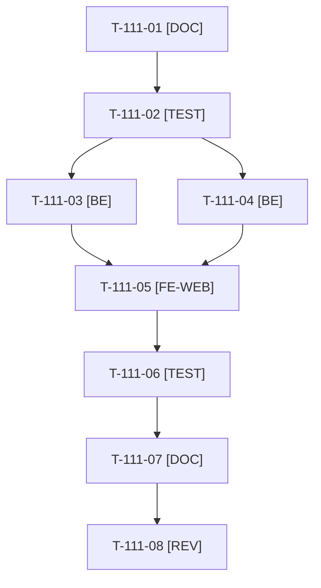

# Tâches : US-111 : Bloc de preuve technique : qualité, compatibilité, versions

## Informations US

- **Epic** : EPIC-12
- **Persona** : Camille
- **Story Points** : 3 (Should)
- **Sprint** : sprint-18-repositionnement
- **Story** : [US-111](../../../backlog/user-stories/US-111.md)

## Résumé de la US

**En tant que** Camille, qui veut vérifier que la qualité reste intacte quand on livre avec l'IA, et Hugo
**Je veux** un tableau avec, pour chaque plugin, sa version publiée, sa compatibilité Sylius 2.3 et son niveau de qualité
**Afin de** juger la fiabilité sur des faits

## Règles et fichiers visés

- Après US-158 (libellés et CTA neutres) : attendre T-158-08 pour les gabarits et traductions partagés. Sacrifice n°3.
- Données de `project-management/plugins-inventory.md` et des 24 dépôts (`sylius-*-plugin`) : Packagist (version), CI GitHub (statut, matrice), PHPStan, tests ; couverture seulement si mesurée (sinon « non mesurée »). Seules des valeurs vérifiées avec lien vers la source sont affichées.
- Forme retenue : un fichier de données versionné, rafraîchi par une commande manuelle (même principe que `bin/vitrine-readme`, jamais par le reset, le build Docker ni la CI) ; la page sert la dernière valeur vérifiée avec sa date, ou « non disponible », sans erreur 500 si une source est en échec. Le jeton GitHub éventuel vient de l'environnement ; aucun fichier `.env` n'est lu.
- Ligne « Comment cette démo est livrée » : nombre de tests, outils d'analyse, scan d'image et SBOM de la CI, tous publics.
- Règles du sprint : voir [README.md](./README.md) (contrat de fin de worker, disque, isolation par worker, vérification croisée, attente bornée, `bin/run-tests` seulement, aucun détail exploitable dans le dépôt public, aucune action externe sans GO).

## Vue d'ensemble des tâches

La colonne « Réalisé par » dit qui fait la tâche : **Claude** seul, **Orchestrateur** (Claude en rôle d'orchestrateur) ou **Thibaut** (action de sa part). ⚠️ = sacrifiable (voir [README.md](./README.md)).

| ID | Type | Tâche | Estimation | Dépend de | Réalisé par | Statut |
|----|------|-------|------------|-----------|-------------|--------|
| T-111-01 | [DOC] | Inventaire des sources vérifiables par plugin (Packagist, CI, PHPStan, tests, couverture) et décision de forme consignée dans la story | 0,5 h | - | Claude | ✅ |
| T-111-02 | [TEST] | Tests rouges : tableau complet, plugin non publié, couverture non mesurée, donnée sans source non affichée, source en échec (dernière valeur datée, pas de 500) | 1,25 h | T-111-01 | Claude | ✅ |
| T-111-03 | [BE] | Lecture du fichier de données, service et contrôleur de la page de preuve | 1,25 h | T-111-02, T-158-08 | Claude | ✅ |
| T-111-04 | [BE] | Commande manuelle de rafraîchissement (Packagist, GitHub Actions) avec liens de source ; première série de données | 1,25 h | T-111-02 | Claude | ✅ |
| T-111-05 | [FE-WEB] | Gabarit du tableau et ligne « Comment cette démo est livrée » ; libellés FR et EN ; 320 px | 1,25 h | T-111-03, T-111-04 | Claude | ✅ |
| T-111-06 | [TEST] | Rendu réel FR et EN, pa11y WCAG2AAA, `bin/measure-mobile`, suite complète, ECS, PHPStan — *Clôture 2026-10-21 : suite, ECS, PHPStan et `ProofPageTest` verts ; `proof.json` rafraîchi (1055d17) ; pa11y, `bin/measure-mobile` et rendu réel non rejoués* | 1 h | T-111-05 | Claude | 🔄 |
| T-111-07 | [DOC] | Documentation (`docs/theme-b2b.md`, procédure de rafraîchissement) | 0,5 h | T-111-06 | Claude | ✅ |
| T-111-08 | [REV] | Revue (aucun chiffre sans source, aucun secret) | 0,5 h | T-111-07 | Claude | 🔲 |

**Total estimé : 7,5 h** (8 tâches, dont 0 de Thibaut, soit 0 h).

## Dépendances

Dépendances hors story : T-158-08.
