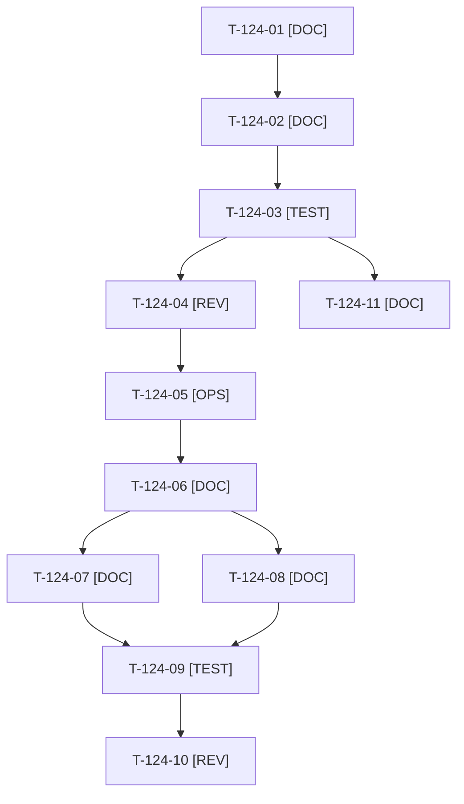

# Tâches : US-124 : Posts LinkedIn rédigés, lot 2 : semaines 3 à 8

## Informations US

- **Epic** : EPIC-13
- **Persona** : Thibaut
- **Story Points** : 5 (Should)
- **Sprint** : sprint-18-repositionnement
- **Story** : [US-124](../../../backlog/user-stories/US-124.md)

## Résumé de la US

**En tant que** Thibaut
**Je veux** les posts des semaines 3 à 8 selon les quatre piliers
**Afin de** tenir un rythme régulier qui prouve ma méthode sans rédaction de dernière minute

## Règles et fichiers visés

- Après US-159 (calendrier réaligné). Livraison en deux tranches : **tranche 1 = semaines 3 et 4** (non sacrifiable) ; **tranche 2 = semaines 5 à 8**, révisée après les chiffres des semaines 1 et 2, sacrifiable (semaines 7 et 8 d'abord).
- Mêmes règles qu'US-159 (dossier `communication/sprint-18/`, `charter_check.py --post`, aucun chiffre invérifiable). Aucun post n'annonce une date de sortie de plugin ; les posts MCP et approbation attendent le kit d'US-121 (sprint 19) sans le promettre.
- Angles : incident réel de la démo et ce qu'il a appris (sans détail de sécurité), IA encadrée (qui décide, ce qui vérifie), sprint de 38 points avec ses échecs, rôle de l'humain.
- Règles du sprint : voir [README.md](./README.md) (contrat de fin de worker, disque, isolation par worker, vérification croisée, attente bornée, `bin/run-tests` seulement, aucun détail exploitable dans le dépôt public, aucune action externe sans GO).

## Vue d'ensemble des tâches

La colonne « Réalisé par » dit qui fait la tâche : **Claude** seul, **Orchestrateur** (Claude en rôle d'orchestrateur) ou **Thibaut** (action de sa part). ⚠️ = sacrifiable (voir [README.md](./README.md)).

| ID | Type | Tâche | Estimation | Dépend de | Réalisé par | Statut |
|----|------|-------|------------|-----------|-------------|--------|
| T-124-01 | [DOC] | Angles des six posts rattachés aux piliers, sources publiques vérifiées (sans détail de sécurité) | 1 h | T-159-07 | Claude | ✅ |
| T-124-02 | [DOC] | Tranche 1 : posts des semaines 3 et 4 (accroche, corps, CTA unique, visuel, lien UTM, variante < 600 caractères) | 2 h | T-124-01 | Claude | ✅ |
| T-124-03 | [TEST] | `charter_check.py --post` sur la tranche 1 | 0,5 h | T-124-02 | Claude | ✅ |
| T-124-04 | [REV] | Thibaut relit la tranche 1 | 0,5 h | T-124-03 | Thibaut | 🔲 |
| T-124-05 | [OPS] | Thibaut relève les chiffres des semaines 1 et 2 (vues du profil, messages reçus) | 0,5 h | T-124-04 | Thibaut | 🔲 |
| T-124-06 | [DOC] | Révision de la tranche 2 d'après les retours (angles conservés ou abandonnés, justification notée) ⚠️ | 1 h | T-124-05 | Claude | 🔄 |
| T-124-07 | [DOC] | Posts des semaines 5 et 6 ⚠️ | 2 h | T-124-06 | Claude | ✅ |
| T-124-08 | [DOC] | Posts des semaines 7 et 8 ⚠️ | 2 h | T-124-06 | Claude | ✅ |
| T-124-09 | [TEST] | `charter_check.py --post` sur la tranche 2 ; au plus 2 mentions de disponibilité sur les six posts ; aucune date de sortie ⚠️ | 0,5 h | T-124-07, T-124-08 | Claude | ✅ |
| T-124-10 | [REV] | Thibaut relit la tranche 2 ⚠️ | 0,5 h | T-124-09 | Thibaut | 🔲 |
| T-124-11 | [DOC] | Registre `communication/INDEX.md` à jour | 0,25 h | T-124-03 | Claude | ✅ |

**Total estimé : 10,75 h** (11 tâches, dont 3 de Thibaut, soit 1,5 h).

## Dépendances

Dépendances hors story : T-159-07.
