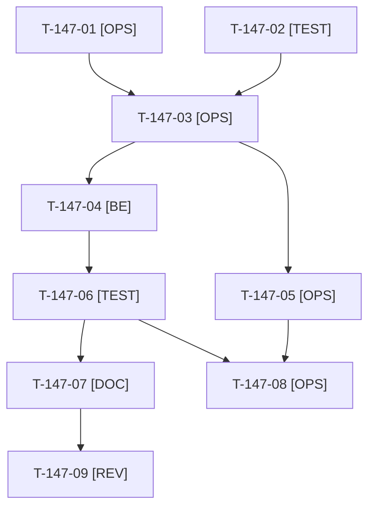

# Tâches : US-147 : Démo en PHP 8.5 (image, CI et plateforme Composer)

## Informations US

- **Epic** : EPIC-01
- **Persona** : Thibaut
- **Story Points** : 3 (Must)
- **Sprint** : sprint-18-repositionnement
- **Story** : [US-147](../../../backlog/user-stories/US-147.md)

## Résumé de la US

**En tant que** Thibaut, mainteneur de la démo
**Je veux** que la démo tourne en PHP 8.5, sur une version corrigée de la faille du 2026-10-21
**Afin de** qu'elle reste au plus haut des versions proposées et serve de vitrine crédible

## Règles et fichiers visés

- **Veille programmée** : T-147-01 à T-147-04 peuvent être réalisées par une veille programmée de l'orchestrateur dès que l'image `dunglas/frankenphp:1-php8.5-bookworm` corrigée de la faille du 2026-10-21 (CVSS 9.2) est publiée. Dans ce cas la story est livrée avant le sprint (PR) et fermée avec sa référence ; il reste alors l'image (T-147-05), la validation et la revue. Ne jamais épingler une image antérieure au correctif.
- Fichiers visés : `docker/Dockerfile` (`ARG PHP_IMAGE`, digest), `.github/workflows/ci.yaml` (`php-version` aux lignes 39 et 186), `composer.json` (`require.php` `^8.4`, `config.platform.php` `8.4.15`) et `composer.lock`, `bin/check-pinned-refs`, `docs/adr/` (ADR-0014).
- Seul l'orchestrateur reconstruit l'image Docker ; un seul build à la fois ; contrôle disque avant (au moins 15 Go recommandés, gel sous 5 Go).
- Aucun détail sur la faille dans le dépôt public : l'ADR cite seulement la version de PHP corrigée.
- Écrivain unique de `composer.json` et `composer.lock` : US-147 d'abord, puis US-148 (montée des plugins) ; pas de commande Railway par Claude.
- Règles du sprint : voir [README.md](./README.md) (contrat de fin de worker, disque, isolation par worker, vérification croisée, attente bornée, `bin/run-tests` seulement, aucun détail exploitable dans le dépôt public, aucune action externe sans GO).

## Vue d'ensemble des tâches

La colonne « Réalisé par » dit qui fait la tâche : **Claude** seul, **Orchestrateur** (Claude en rôle d'orchestrateur) ou **Thibaut** (action de sa part). ⚠️ = sacrifiable (voir [README.md](./README.md)).

| ID | Type | Tâche | Estimation | Dépend de | Réalisé par | Statut |
|----|------|-------|------------|-----------|-------------|--------|
| T-147-01 | [OPS] | Veille : l'image FrankenPHP PHP 8.5 corrigée est-elle publiée (version de PHP au moins égale au correctif, digest relevé) ? Veille programmée de l'orchestrateur | 0,5 h | - | Orchestrateur | 🔲 |
| T-147-02 | [TEST] | Tests rouges : un test lit Dockerfile, `ci.yaml` et `composer.json` et exige PHP 8.5 partout ; `bin/check-pinned-refs` échoue sur une image référencée par tag seul | 1 h | - | Claude | 🔲 |
| T-147-03 | [OPS] | Dockerfile (nouveau digest), deux jobs de la CI en 8.5, `composer.json` (`^8.5`, `platform.php` 8.5.x), `composer.lock` régénéré sans mise à jour de paquets (`composer validate`, `composer install`) | 1,5 h | T-147-01, T-147-02 | Claude | 🔲 |
| T-147-04 | [BE] | Dépréciations PHP 8.5 levées par `src/` corrigées (suite avec `E_ALL`) ; celles des dépendances listées sans être corrigées | 1 h | T-147-03 | Claude | 🔲 |
| T-147-05 | [OPS] | Reconstruction de l'image, `php -v` (version corrigée), extensions (intl, gd ou imagick, pdo_mysql, opcache, apcu), `docker/php.ini`, `/healthz`, mode worker (ADR-0013) revérifié, smoke test et scan d'image | 1,5 h | T-147-03 | Orchestrateur | 🔲 |
| T-147-06 | [TEST] | Suite complète, ECS, PHPStan en 8.5 ; rendu réel local (vitrine, compte acheteur, admin) ; preuves rejouables | 1 h | T-147-04 | Claude | 🔲 |
| T-147-07 | [DOC] | ADR-0014 complété (versions de la démo, dépréciations des dépendances) ; l'orchestrateur met à jour la mémoire « dernières versions » | 0,5 h | T-147-06 | Claude | 🔲 |
| T-147-08 | [OPS] | Thibaut redéploie sur Railway après le merge et vérifie `/healthz` et la version de PHP | 0,5 h | T-147-05, T-147-06 | Thibaut | 🔲 |
| T-147-09 | [REV] | Revue (digest épinglé, aucun détail de la faille, CI verte, run terminé avant merge) | 0,5 h | T-147-07 | Claude | 🔲 |

**Total estimé : 8 h** (9 tâches, dont 1 de Thibaut, soit 0,5 h).

## Dépendances

