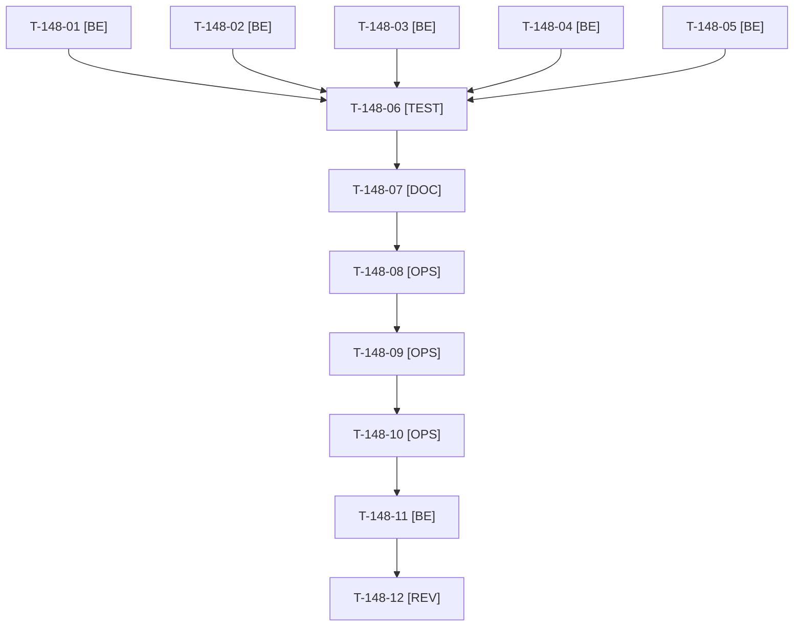

# Tâches : US-148 : Plugins : limiteurs de débit typés `RateLimiterFactoryInterface` (Symfony 8)

## Informations US

- **Epic** : EPIC-07
- **Persona** : Thibaut
- **Story Points** : 3 (Must)
- **Sprint** : sprint-18-repositionnement
- **Story** : [US-148](../../../backlog/user-stories/US-148.md)

## Résumé de la US

**En tant que** un intégrateur Symfony 8 qui installe un plugin tmonier
**Je veux** que les limiteurs de débit s'injectent par `RateLimiterFactoryInterface`
**Afin de** que le plugin fonctionne en autowiring sans type concret que Symfony 8 ne câble plus

## Règles et fichiers visés

- Cinq dépôts sous `/Users/tmonier/Projects/sylius_plugins/` : `sylius-punchout-cxml-plugin` (`AuthenticationThrottle`, `CxmlEndpointAction`, `OciEntryAction`, extension DI ; tests `OciTest`, `CxmlProtectionTest`, `DatabaseTransactionTrait`), `sylius-quote-request-plugin` (`QuoteRequestController`, extension DI, `tests/Integration/Process/consume_rate_limit.php`), `sylius-quick-order-plugin` (`QuickOrderController`, `BulkAddItemsProcessor`, extension DI), `sylius-b2b-mcp-plugin` (`RequestQuoteTool`, `RateLimit/RateLimiter`), `sylius-command-palette-plugin` (`Admin/SearchController`, extension DI).
- `new RateLimiterFactory(...)` reste autorisé dans les tests ; compatibilité Symfony 7.4 conservée (l'interface existe depuis 7.3 ; `symfony/rate-limiter` déjà `^7.4 || ^8.0`, matrices CI 7.4 et 8.x).
- **Avant tout commit dans un dépôt : `git fetch` puis vérifier la branche courante** (`sylius-quote-request-plugin` est sur `feature/rate-limit-transitions`, pas sur `main`) ; une branche par dépôt à partir de `main` à jour. Les dépôts de plugins ne partagent aucun fichier : les cinq tâches 01 à 05 peuvent aller en parallèle (un worker par dépôt).
- `CHANGELOG.md` absent de `quote-request` et `command-palette` : à créer au format Keep a Changelog ; releases patch (version suivante de chaque plugin), tags seulement après le GO.
- Aucune release ni tag sans GO ; la démo ne monte les versions qu'après publication (Packagist) et après US-147 (écrivain unique de `composer.lock`).
- Règles du sprint : voir [README.md](./README.md) (contrat de fin de worker, disque, isolation par worker, vérification croisée, attente bornée, `bin/run-tests` seulement, aucun détail exploitable dans le dépôt public, aucune action externe sans GO).

## Vue d'ensemble des tâches

La colonne « Réalisé par » dit qui fait la tâche : **Claude** seul, **Orchestrateur** (Claude en rôle d'orchestrateur) ou **Thibaut** (action de sa part). ⚠️ = sacrifiable (voir [README.md](./README.md)).

| ID | Type | Tâche | Estimation | Dépend de | Réalisé par | Statut |
|----|------|-------|------------|-----------|-------------|--------|
| T-148-01 | [BE] | punchout-cxml : test rouge (aucun `RateLimiterFactory` hors instanciation), puis 10 occurrences typées `RateLimiterFactoryInterface` — *Clôture 2026-10-21 : test `RateLimiterTypeTest` et typage par l'interface* | 1,5 h | - | Claude | ✅ |
| T-148-02 | [BE] | quote-request : idem (8 à 10 occurrences) ; branche vérifiée après `git fetch` | 0,75 h | - | Claude | ✅ |
| T-148-03 | [BE] | quick-order : idem | 0,75 h | - | Claude | ✅ |
| T-148-04 | [BE] | b2b-mcp : idem (`RateLimit/RateLimiter`, `RequestQuoteTool`) | 0,75 h | - | Claude | ✅ |
| T-148-05 | [BE] | command-palette : idem | 0,5 h | - | Claude | ✅ |
| T-148-06 | [TEST] | Dans chaque plugin : ECS, PHPStan max, Rector, tests ; compilation du conteneur en autowiring (service surchargé avec `autowire: true`) sur Symfony 8.1 et 7.4 (Docker) — *Clôture 2026-10-21 : ECS, PHPStan et tests passés par la CI des plugins (matrices Symfony 7.4 et 8.0 vertes) ; cellule Symfony 6.4 retirée ; test d'autowiring d'un service surchargé non écrit* | 1 h | T-148-01, T-148-02, T-148-03, T-148-04, T-148-05 | Claude | 🔄 |
| T-148-07 | [DOC] | `CHANGELOG.md` de chaque plugin (créé pour quote-request et command-palette), numéro de version patch — *Clôture 2026-10-21 : versions mineures pour quatre plugins (Symfony 6.4 abandonné), patch pour b2b-mcp* | 0,5 h | T-148-06 | Claude | ✅ |
| T-148-08 | [OPS] | Thibaut donne le GO unique : push des 5 branches, 5 PR, merge quand les CI sont vertes, tag des 5 versions patch — *Clôture 2026-10-21 : GO le 2026-10-21, avec la décision d'abandonner Symfony 6.4 (`RateLimiterFactoryInterface` existe depuis Symfony 7.3)* | 0,25 h | T-148-07 | Thibaut | ✅ |
| T-148-09 | [OPS] | 5 commits, 5 PR, suivi des CI (matrices 7.4 et 8.1), merges après run terminé — *Clôture 2026-10-21 : premier run rouge sur la cellule Symfony 6.4 des quatre plugins, vert après retrait ; 5 PR fusionnées* | 1 h | T-148-08 | Claude | ✅ |
| T-148-10 | [OPS] | Tags et releases patch des cinq plugins après merge ; vérification Packagist — *Clôture 2026-10-21 : punchout-cxml v1.3.0, quote-request v1.1.0, quick-order v1.3.0, command-palette v1.1.0, b2b-mcp v1.2.2 ; Packagist vérifié* | 0,5 h | T-148-09 | Claude | ✅ |
| T-148-11 | [BE] | Démo : montée des cinq versions (`composer update` ciblé), tests de limitation de débit existants verts, aucun limiteur contourné — *Clôture 2026-10-21 : 586e2bb ; suite complète verte (1 633 tests, graine 3131)* | 1 h | T-148-10, T-147-03 | Claude | ✅ |
| T-148-12 | [REV] | Revue (aucune occurrence du type concret hors instanciation, 5 CHANGELOG, matrices vertes) | 0,5 h | T-148-11 | Claude | 🔲 |

**Total estimé : 9 h** (12 tâches, dont 1 de Thibaut, soit 0,25 h).

## Dépendances

Dépendances hors story : T-147-03.
