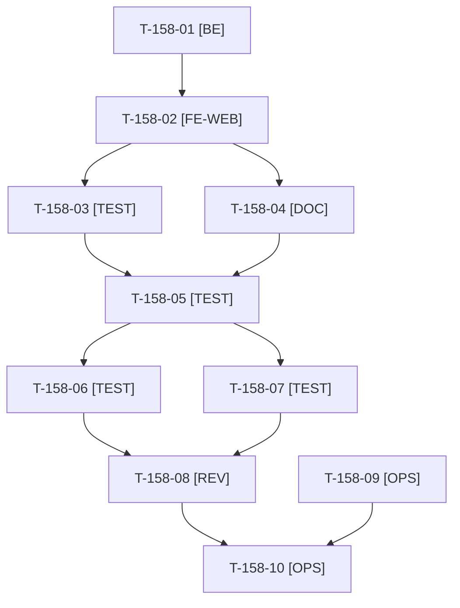

# Tâches : US-158 : Repositionnement de la démo : profil LinkedIn, libellés neutres, guide technique

## Informations US

- **Epic** : EPIC-12
- **Persona** : Camille
- **Story Points** : 3 (Must)
- **Sprint** : sprint-18-repositionnement
- **Story** : [US-158](../../../backlog/user-stories/US-158.md)

## Résumé de la US

**En tant que** Camille, recruteuse IT
**Je veux** que la démo me renvoie vers le profil de l'auteur par un appel à l'action sobre et que ses pages parlent de technique et de méthode
**Afin de** de vérifier ce que Thibaut affirme et de le contacter pour un poste

## Règles et fichiers visés

- Le code est déjà écrit et non commité sur la branche `feature/sprint-18-repositionnement` (CTA vers `DEMO_PROFILE_URL`, guide technique `/integrer`, sortie des parcours neutre, `tests/Unit/Demo/PositioningWordingTest.php`) : T-158-01 à T-158-04 sont ✅ (8 h déjà consommées, hors charge restante). Il reste la suite complète, le rendu réel FR et EN, pa11y et la revue.
- Ces fichiers ne sont pas modifiés par une autre tâche tant que T-158-08 n'est pas ✅ (un seul écrivain) : `src/Demo/Site/`, `templates/shared/_contact_cta.html.twig`, `templates/demo/integrate.html.twig`, `config/demo/journeys.yaml`, `translations/{integrate,journeys,messages,seo,shop_layout,theme_demo}.*.yaml`, `tests/Functional/Demo/{ContactCta,IntegratePage,Journey}Test.php`. US-160 et US-111 attendent donc T-158-08.
- Valeurs de test factices pour `DEMO_PROFILE_URL` (jamais l'URL réelle du profil dans le dépôt) ; la valeur réelle est posée par Thibaut sur Railway (variable préservée par l'IaC, `preserve()`).
- Aucun commit, push ni PR sans GO : le code non commité reste dans l'arbre jusqu'au GO de Thibaut.
- Règles du sprint : voir [README.md](./README.md) (contrat de fin de worker, disque, isolation par worker, vérification croisée, attente bornée, `bin/run-tests` seulement, aucun détail exploitable dans le dépôt public, aucune action externe sans GO).

## Vue d'ensemble des tâches

La colonne « Réalisé par » dit qui fait la tâche : **Claude** seul, **Orchestrateur** (Claude en rôle d'orchestrateur) ou **Thibaut** (action de sa part). ⚠️ = sacrifiable (voir [README.md](./README.md)).

| ID | Type | Tâche | Estimation | Dépend de | Réalisé par | Statut |
|----|------|-------|------------|-----------|-------------|--------|
| T-158-01 | [BE] | CTA vers `DEMO_PROFILE_URL` (https seulement, valeur http ou inconnue ignorée), `DEMO_BOOKING_URL` retirée de `config/` et de `.railway/railway.ts`, événement Umami `author_cta` | 2 h | - | Claude | ✅ |
| T-158-02 | [FE-WEB] | Libellés neutres FR et EN (accueil, fiche produit, pied de page, barre de démo, SEO), page `/integrer` en guide technique, écran de sortie des parcours | 3 h | T-158-01 | Claude | ✅ |
| T-158-03 | [TEST] | `PositioningWordingTest` (termes interdits dans `translations/` et `templates/`) et tests du CTA, de la page Intégrer et des parcours | 2 h | T-158-02 | Claude | ✅ |
| T-158-04 | [DOC] | Documentation (`docs/deploiement-railway.md`, `theme-b2b.md`, `mesure-communication.md`, `dossier-de-go.md`) | 1 h | T-158-02 | Claude | ✅ |
| T-158-05 | [TEST] | Suite complète via `TEST_DB_NAME=<db> bin/run-tests`, ECS (`src tests`) et PHPStan ; preuves rejouables dans le rapport — *Clôture 2026-10-21 : suite complète verte (1 633 tests), ECS et PHPStan en local et dans la CI de la PR #43* | 1 h | T-158-03, T-158-04 | Claude | ✅ |
| T-158-06 | [TEST] | Rendu réel FR et EN : accueil, fiche produit, écran de sortie d'un parcours, `/integrer`, avec URL renseignée puis vide ; `bin/measure-mobile` (23 pages sans débordement) — *Clôture 2026-10-21 : rendu réel et `bin/measure-mobile` non rejoués à la clôture* | 1 h | T-158-05 | Claude | 🔲 |
| T-158-07 | [TEST] | pa11y WCAG2AAA sur les pages modifiées, FR et EN (0 erreur) — *Clôture 2026-10-21 : pa11y non rejoué à la clôture* | 0,5 h | T-158-05 | Claude | 🔲 |
| T-158-08 | [REV] | Revue : aucun libellé commercial, aucun secret, `DEMO_BOOKING_URL` absente, fichiers partagés libérés pour US-160 et US-111 | 1 h | T-158-06, T-158-07 | Claude | 🔲 |
| T-158-09 | [OPS] | Thibaut fournit l'URL de son profil LinkedIn (`DEMO_PROFILE_URL`, https) par message ; elle ne va pas dans le dépôt — *Clôture 2026-10-21 : URL fournie hors dépôt* | 0,25 h | - | Thibaut | ✅ |
| T-158-10 | [OPS] | Thibaut valide les libellés exacts et pose `DEMO_PROFILE_URL` sur Railway après le merge (commande Railway par Thibaut) — *Clôture 2026-10-21 : à faire après le merge : `railway variables --set DEMO_PROFILE_URL=…`, puis retrait de `DEMO_BOOKING_URL`* | 0,25 h | T-158-08, T-158-09 | Thibaut | 🔲 |

**Total estimé : 12 h** (10 tâches, dont 2 de Thibaut, soit 0,5 h) ; reste à faire : 4 h (le reste est ✅).

## Dépendances

