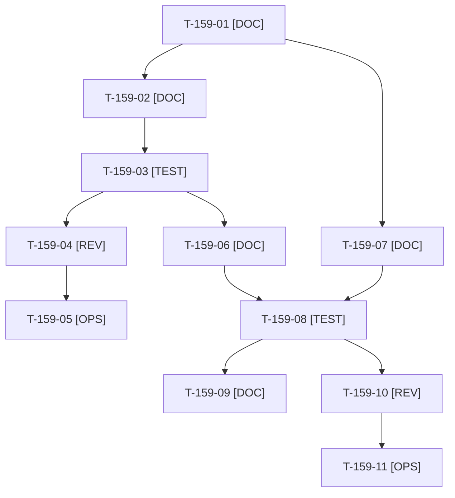

# Tâches : US-159 : Contenu LinkedIn réaligné sur la recherche d'emploi : calendrier et posts de suite

## Informations US

- **Epic** : EPIC-13
- **Persona** : Thibaut
- **Story Points** : 3 (Must)
- **Sprint** : sprint-18-repositionnement
- **Story** : [US-159](../../../backlog/user-stories/US-159.md)

## Résumé de la US

**En tant que** Thibaut
**Je veux** que le calendrier et les trois posts de suite suivent la charte v2
**Afin de** que chaque publication serve ma recherche d'emploi et amène recruteurs et dirigeants vers mon profil

## Règles et fichiers visés

- **Échéance : premier post de suite publié au plus tard le 2026-10-26**, profil v2 appliqué avant (US-129). T-159-01 à T-159-05 passent avant tout le reste du sprint.
- Livrables hors dépôt public dans `/Users/tmonier/Projects/sylius_plugins/communication/sprint-18/` (calendrier, posts) ; sources : `communication/sprint-17/` (charte, calendrier, posts-lot-1, profil-linkedin, kit-media) ; contrôle : `communication/sprint-17/outils/charter_check.py` (`--post` pour les posts).
- Aucun chiffre invérifiable (absent des dépôts ou de la CI publics), aucune donnée de recruteur, de prospect ou de collègue ; au plus 2 posts sur 8 mentionnent la disponibilité.
- Publication par Thibaut seulement ; Claude ne publie rien sur LinkedIn.
- Règles du sprint : voir [README.md](./README.md) (contrat de fin de worker, disque, isolation par worker, vérification croisée, attente bornée, `bin/run-tests` seulement, aucun détail exploitable dans le dépôt public, aucune action externe sans GO).

## Vue d'ensemble des tâches

La colonne « Réalisé par » dit qui fait la tâche : **Claude** seul, **Orchestrateur** (Claude en rôle d'orchestrateur) ou **Thibaut** (action de sa part). ⚠️ = sacrifiable (voir [README.md](./README.md)).

| ID | Type | Tâche | Estimation | Dépend de | Réalisé par | Statut |
|----|------|-------|------------|-----------|-------------|--------|
| T-159-01 | [DOC] | Cadrage : relecture charte v2, profil v2 et posts du lot 1 ; liste des formules de consultant à retirer ; angle des trois posts | 0,75 h | - | Claude | ✅ |
| T-159-02 | [DOC] | Post de suite n°1 : pilier, accroche, corps, variante de moins de 600 caractères, visuel, CTA unique | 1,5 h | T-159-01 | Claude | ✅ |
| T-159-03 | [TEST] | `charter_check.py --post` sur le post 1 ; chaque chiffre rattaché à une source publique | 0,5 h | T-159-02 | Claude | ✅ |
| T-159-04 | [REV] | Thibaut relit et ajuste le post 1 | 0,5 h | T-159-03 | Thibaut | 🔲 |
| T-159-05 | [OPS] | Thibaut publie le post 1 avant le 2026-10-26 et épingle le commentaire | 0,5 h | T-159-04 | Thibaut | 📅 |
| T-159-06 | [DOC] | Posts 2 et 3 réécrits avec variantes et légendes du kit média (US-120) | 2 h | T-159-03 | Claude | ✅ |
| T-159-07 | [DOC] | Calendrier de huit semaines : 3 posts delivery et IA, 2 qualité, 2 coulisses, 1 leadership ; au plus 2 mentions de disponibilité | 1,5 h | T-159-01 | Claude | ✅ |
| T-159-08 | [TEST] | `charter_check.py` sur posts 2 et 3 et calendrier ; chiffres invérifiables retirés | 0,5 h | T-159-06, T-159-07 | Claude | ✅ |
| T-159-09 | [DOC] | Registre `communication/INDEX.md` à jour (livrables du sprint 18) | 0,25 h | T-159-08, T-161-11 | Claude | ✅ |
| T-159-10 | [REV] | Thibaut relit le calendrier et les posts 2 et 3 | 0,5 h | T-159-08 | Thibaut | 🔲 |
| T-159-11 | [OPS] | Thibaut publie les posts 2 et 3 aux dates du calendrier | 0,5 h | T-159-10 | Thibaut | 📅 |

**Total estimé : 9 h** (11 tâches, dont 4 de Thibaut, soit 2 h).

## Dépendances

Dépendances hors story : T-161-11.
