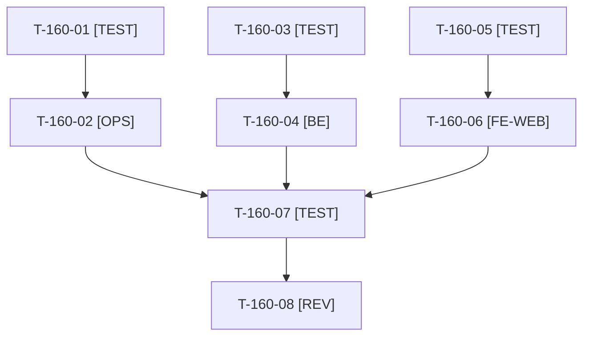

# Tâches : US-160 : Dettes du sprint 17 : verrou atomique, GET sans écriture de session, menu compte nommé

## Informations US

- **Epic** : EPIC-01
- **Persona** : Thibaut
- **Story Points** : 5 (Must)
- **Sprint** : sprint-18-repositionnement
- **Story** : [US-160](../../../backlog/user-stories/US-160.md)

## Résumé de la US

**En tant que** Thibaut, mainteneur
**Je veux** solder les trois dettes relevées à la revue du sprint 17
**Afin de** que la démo publique tienne ses promesses de qualité, de sécurité et d'accessibilité

## Règles et fichiers visés

- `bin/run-tests` : reprise d'un verrou périmé actuellement par `rm -rf` puis `mkdir` (course entre deux runs) ; à remplacer par un renommage atomique du verrou périmé vers un nom unique, puis `mkdir`. Tests dans `tests/Unit/Bin/RunTestsLockTest.php` (nettoyage : `CleanTestCachesTest.php`). Écrivain unique de `bin/run-tests` : T-160-02, puis T-161-02, puis T-161-08.
- GET d'une étape de parcours : `JourneyController` écrit la progression en session ; l'avancement passe par un POST protégé par jeton CSRF. Fichiers partagés avec US-158 (`config/demo/journeys.yaml`, `translations/journeys.*.yaml`, `JourneyTest`) : attendre T-158-08.
- Menu compte : bouton du cœur Sylius sans nom accessible (1 erreur pa11y au sprint 17) ; surcharge du gabarit dans `templates/bundles/` du thème ; libellés FR et EN ; réduire ce qui est montré aux anonymes (nom et rôle).
- Aucun détail exploitable dans le dépôt public : la description de la course du verrou reste générique.
- Règles du sprint : voir [README.md](./README.md) (contrat de fin de worker, disque, isolation par worker, vérification croisée, attente bornée, `bin/run-tests` seulement, aucun détail exploitable dans le dépôt public, aucune action externe sans GO).

## Vue d'ensemble des tâches

La colonne « Réalisé par » dit qui fait la tâche : **Claude** seul, **Orchestrateur** (Claude en rôle d'orchestrateur) ou **Thibaut** (action de sa part). ⚠️ = sacrifiable (voir [README.md](./README.md)).

| ID | Type | Tâche | Estimation | Dépend de | Réalisé par | Statut |
|----|------|-------|------------|-----------|-------------|--------|
| T-160-01 | [TEST] | Test de concurrence rouge : deux runs reprennent un verrou périmé en même temps, une seule obtient le verrou, 20 itérations ; verrou orphelin repris et journalisé | 1 h | - | Claude | ✅ |
| T-160-02 | [OPS] | `bin/run-tests` : reprise atomique du verrou périmé (renommage vers un nom unique puis `mkdir`), message journalisé | 1 h | T-160-01 | Claude | ✅ |
| T-160-03 | [TEST] | Tests fonctionnels rouges : GET d'étape répété ou préchargé sans modification de session ; avancement par POST avec jeton CSRF | 1 h | T-158-08 | Claude | ✅ |
| T-160-04 | [BE] | `JourneyController` et `JourneyProgress` : GET sans effet de bord, avancement par POST, formulaire « Suivant » | 1,5 h | T-160-03 | Claude | ✅ |
| T-160-05 | [TEST] | Tests rouges : menu compte au nom accessible FR et EN ; nom et rôle du compte non rendus aux anonymes | 1 h | T-158-08 | Claude | ✅ |
| T-160-06 | [FE-WEB] | Surcharge du gabarit du menu compte (nom accessible), information réduite pour les anonymes, libellés FR et EN | 2 h | T-160-05 | Claude | ✅ |
| T-160-07 | [TEST] | Suite complète sur trois graines aléatoires, ECS, PHPStan ; pa11y WCAG2AAA accueil FR et EN (connecté et anonyme) ; `bin/measure-mobile` — *Clôture 2026-10-21 : graines 1818, 2121 et 3131 vertes après 7de1789 (deux tests rendus indépendants de l'état laissé par d'autres tests) ; ECS et PHPStan OK ; pa11y et `bin/measure-mobile` non faits* | 1,5 h | T-160-02, T-160-04, T-160-06 | Claude | 🔄 |
| T-160-08 | [REV] | Revue (GET réellement sans effet de bord, aucun détail exploitable, verrou testé 20 fois) | 1 h | T-160-07 | Claude | 🔲 |

**Total estimé : 10 h** (8 tâches, dont 0 de Thibaut, soit 0 h).

## Dépendances

Dépendances hors story : T-158-08.

## Suivi de réalisation (worker F, 2026-10-21)

- T-160-01 à T-160-06 : faits. Reprise de verrou : renommage atomique vers un nom propre au run puis `mkdir` ; test de concurrence rejoué 20 fois (`RunTestsLockTest`), vérifié rouge sur l'ancienne version (20 itérations sur 20 à deux détenteurs) et vert sur la nouvelle (0 sur 20), puis sous Linux/dash (image `sylius-b2b-demo-web`, dépôt monté en lecture seule, copie dans `/tmp`). GET d'étape et liste sans aucune écriture en session (jetons CSRF des parcours rendus sans état, `demo_framework.yaml`) ; avancement par `POST /{_locale}/guides/{id}/{step}/advance`. Menu compte : surcharge `templates/bundles/SyliusShopBundle/.../mobile/menu.html.twig` (`aria-label`). Anonyme : message et bouton génériques, sans nom ni rôle.
- T-160-07 : en cours. ECS, PHPStan, lint Twig/YAML/conteneur et pa11y WCAG2AAA (accueil et parcours, FR et EN, connecté et anonyme) faits ; suite complète sur une graine (11) seulement, voir le rapport de fin ; `bin/measure-mobile` : pages de parcours OK, KO sans rapport (images absentes, barre de démo) sur le serveur PHP intégré sans médias.
- T-160-08 : revue indépendante à faire.
