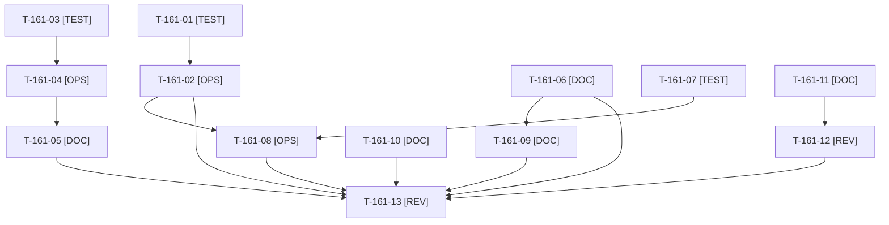

# Tâches : US-161 : Actions de la rétrospective du sprint 17

## Informations US

- **Epic** : EPIC-01
- **Persona** : Thibaut
- **Story Points** : 5 (Must)
- **Sprint** : sprint-18-repositionnement
- **Story** : [US-161](../../../backlog/user-stories/US-161.md)

## Résumé de la US

**En tant que** Thibaut, mainteneur
**Je veux** que les cinq actions SMART de la rétrospective du sprint 17 soient tenues
**Afin de** que le delivery assisté par l'IA reste fiable (disque, isolation, vérification croisée, attentes bornées, prérequis)

## Règles et fichiers visés

- Source : [sprint-retro.md](../../sprint-17-conversion/sprint-retro.md), actions 1 à 5 ; les actions 3 et 4 du sprint 16 (T-TECH-06 à T-TECH-08) y sont fusionnées. À traiter **en premier** : elle conditionne la fiabilité des tests des autres stories.
- Action 1 : `bin/check-disk` (ou option de `bin/run-tests`), alerte à 15 Go, message distinguant projet (caches `var/cache-*`, bases MySQL, volumes Docker) et machine ; le gel de `bin/run-tests` à 5 Go (`MIN_FREE_GB`) n'est jamais abaissé.
- Action 2 : identifiant de worker (`WORKER_ID`) ; `bin/clean-test-caches` ne supprime que `var/cache-<worker>*` et les bases `b2b_<worker>_*` ; `--all` réservé à l'orchestrateur hors lots. Aujourd'hui le script supprime toutes les bases `b2b_*`.
- Action 4 : `--wait` (délai 30 min, sortie avec rapport) lit le verrou `var/run-tests.lock`, jamais `pgrep`.
- Action 5 : le registre `communication/INDEX.md` est tenu hors dépôt public, dans `/Users/tmonier/Projects/sylius_plugins/communication/` ; il liste nom, date, statut, sans contenu, avec les livrables du sprint 17 (`sprint-17/` : calendrier, charte, kit média, outils, posts, profil, suivi) ; Thibaut valide le format.
- Écrivain unique de `bin/run-tests` : après T-160-02 ; de `bin/clean-test-caches` : cette story seule.
- Règles du sprint : voir [README.md](./README.md) (contrat de fin de worker, disque, isolation par worker, vérification croisée, attente bornée, `bin/run-tests` seulement, aucun détail exploitable dans le dépôt public, aucune action externe sans GO).

## Vue d'ensemble des tâches

La colonne « Réalisé par » dit qui fait la tâche : **Claude** seul, **Orchestrateur** (Claude en rôle d'orchestrateur) ou **Thibaut** (action de sa part). ⚠️ = sacrifiable (voir [README.md](./README.md)).

| ID | Type | Tâche | Estimation | Dépend de | Réalisé par | Statut |
|----|------|-------|------------|-----------|-------------|--------|
| T-161-01 | [TEST] | Tests rouges de `bin/check-disk` (script shell) : alerte sous 15 Go, distinction projet et machine, seuil paramétrable | 0,75 h | - | Claude | ✅ |
| T-161-02 | [OPS] | `bin/check-disk` et appel par `bin/run-tests` (affichage, gel à 5 Go conservé) | 1,25 h | T-161-01, T-160-02 | Claude | ✅ |
| T-161-03 | [TEST] | Tests rouges : un clean du worker A laisse la base du worker B ; le nettoyage global est refusé hors orchestrateur | 0,75 h | - | Claude | ✅ |
| T-161-04 | [OPS] | `bin/clean-test-caches` limité aux caches et bases du worker appelant (`WORKER_ID`), `--all` pour l'orchestrateur hors lots | 1,25 h | T-161-03 | Claude | ✅ |
| T-161-05 | [DOC] | `docs/tests-locaux.md` et gabarit de consigne de worker : un sous-dossier de scratchpad, une base et un cache par worker, clean ciblé | 0,5 h | T-161-04 | Claude | ✅ |
| T-161-06 | [DOC] | Checklist d'intégration et gabarit de rapport : commande et dernière ligne de sortie de PHPStan, ECS, lint Twig/YAML et suite ; rejeu de PHPStan et ECS par l'orchestrateur ; rapport refusé sans preuve ; suite en échec rejouée seule avant enquête | 1 h | - | Orchestrateur | 🔲 |
| T-161-07 | [TEST] | Tests rouges de `--wait` : verrou absent (sortie immédiate), verrou présent (attente), délai dépassé (sortie avec rapport) | 0,75 h | - | Claude | ✅ |
| T-161-08 | [OPS] | Option `--wait` de `bin/run-tests` (délai 30 min, variable de délai), lecture du verrou | 1,25 h | T-161-07, T-161-02 | Claude | ✅ |
| T-161-09 | [DOC] | Reste des actions du sprint 16 (T-TECH-06 et T-TECH-07) : arrêt explicite (TaskStop) et vérification avant relance dans le gabarit de consigne ; checklist de revue « image reconstruite après correctif » | 0,5 h | T-161-06 | Orchestrateur | 🔲 |
| T-161-10 | [DOC] | Rubrique « prérequis d'environnement » dans le gabarit de story ; contrôle au planning (story de captation ou d'intégration externe non engagée sans elle) | 0,75 h | - | Claude | ✅ |
| T-161-11 | [DOC] | Registre `communication/INDEX.md` (nom, date, statut, sans contenu) avec les livrables du sprint 17 | 1 h | - | Claude | ✅ |
| T-161-12 | [REV] | Thibaut valide le format du registre | 0,5 h | T-161-11 | Thibaut | 🔲 |
| T-161-13 | [REV] | Revue : tests des scripts verts via `bin/run-tests`, gabarits à jour, bilan des cinq indicateurs préparé pour la rétro | 0,75 h | T-161-02, T-161-05, T-161-06, T-161-08, T-161-09, T-161-10, T-161-12 | Claude | 🔲 |

**Total estimé : 11 h** (13 tâches, dont 1 de Thibaut, soit 0,5 h).

## Dépendances

Dépendances hors story : T-160-02.

## Suivi de réalisation (worker F, 2026-10-21)

- Faits (tâches de Claude) : T-161-01 à T-161-05, T-161-07, T-161-08, T-161-10, T-161-11. `bin/check-disk` (alerte à 15 Go, origine projet ou machine), `WORKER_ID` (verrou et nettoyage ciblé, `--all` refusé à un worker), `bin/run-tests --wait` (délai 30 min, code 5), gabarits `project-management/templates/consigne-worker.md` et `user-story.md`, registre `/Users/tmonier/Projects/sylius_plugins/communication/INDEX.md`, `docs/tests-locaux.md` à jour.
- Restent : T-161-06 et T-161-09 (orchestrateur), T-161-12 (validation du format du registre par Thibaut), T-161-13 (revue).
