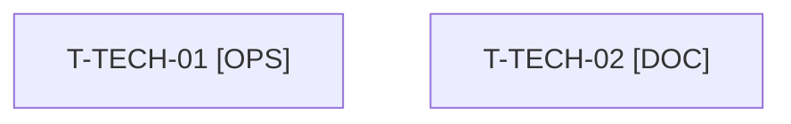

# Tâches transverses : clôture et bilan de l'orchestrateur

Tâches **sans points** : elles comptent dans les heures, pas dans les 36 points. Les actions de la rétrospective du sprint 17 sont des points de [US-161](./US-161-tasks.md) ; ici, seulement ce que l'orchestrateur fait en fin de sprint.

## Vue d'ensemble des tâches

| ID | Type | Tâche | Estimation | Dépend de | Réalisé par | Statut |
|----|------|-------|------------|-----------|-------------|--------|
| T-TECH-01 | [OPS] | Reconstruction de l'image et démarrage du conteneur (`/healthz`) par l'orchestrateur avant la revue, puis après tout correctif touchant l'image | 1 h | T-147-05, T-160-08, T-111-06, T-103-08 | Orchestrateur | 🔲 |
| T-TECH-02 | [DOC] | Bilan des cinq indicateurs de la rétro S17 (blocage disque, fichiers écrasés, écarts « vert annoncé », workers bloqués, prérequis découverts) préparé pour la rétro du 2027-03-05 | 0,5 h | T-161-13 | Orchestrateur | 🔲 |

**Total estimé : 1,5 h** (2 tâches, aucune de Thibaut).

## Dépendances

Dépendances hors fichier : T-103-08, T-111-06, T-147-05, T-160-08, T-161-13.
