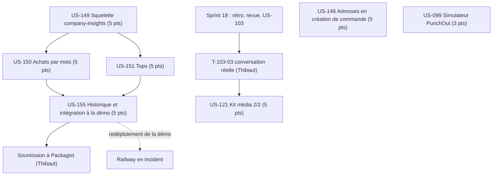

# Dépendances : Sprint 019 (pilotage des achats)

## Ressources partagées

- Un seul worker à la fois ; disque d'environ 7 Go libres.
- US-146 dans le dépôt `sylius-admin-order-creation-plugin`, indépendante des autres stories.
- US-099 touche le simulateur de `punchout-cxml` et la démo : ne pas la mener en même temps qu'US-155 (fichiers de la démo).

## Chemin critique

US-149 → US-150 et US-151 → US-155 (20 points, dans cet ordre). US-146 et US-099 se placent entre ces étapes ; US-121 attend T-103-03.
