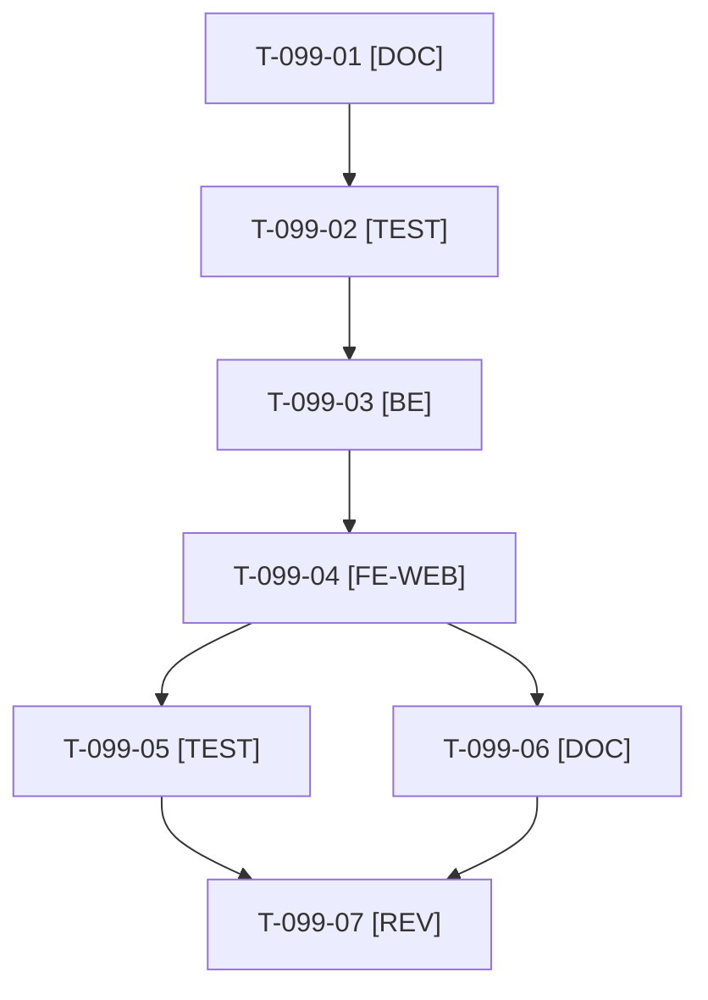

# Tâches : US-099 : Simulateur PunchOut habillé et expliqué

## Informations US

- **Epic** : EPIC-11
- **Persona** : Nadia (acheteuse d'un grand compte)
- **Story Points** : 3 (Should)
- **Sprint** : sprint-19-pilotage-achats
- **Story** : [US-099](../../../backlog/user-stories/US-099.md)

## Résumé de la US

**En tant que** Nadia, acheteuse d'un grand compte
**Je veux** un simulateur présenté comme un portail d'achat fictif, avec des étapes numérotées et un schéma du flux
**Afin de** comprendre PunchOut sans jargon

## Règles et fichiers visés

- Le simulateur est dans la démo, pas dans le plugin : `src/Demo/Controller/PunchOutSimulatorController.php` (cXML) et `PunchOutOciSimulatorController.php` (OCI), `templates/demo/punchout_simulator/simulator.html.twig`, `translations/simulator.{fr,en}.yaml`, tests dans `tests/Unit/Demo/PunchOutSimulator/` et `tests/Smoke/PunchOutSimulatorSmokeTest.php`. Il porte déjà le portail fictif « Fournitures Pro », les identifiants fictifs, la session expirée et le refus des domaines de retour.
- **Gherkin : 4 scénarios (1 nominal, 2 alternatifs, 1 erreur), minimum 1 + 2 + 2.** Correction proposée dans [US-099](../../../backlog/user-stories/US-099.md) : une erreur « URL de retour hors des domaines autorisés » (comportement déjà présent dans `simulator.*.yaml`) et une aide accessible au clavier autant qu'au survol.
- Ton de la charte d'US-063 (sobre, factuel) ; aucune marque réelle (Ariba, Coupa, SAP) comme logo ; les noms cités en texte restent ceux déjà publiés dans la page. Schéma du flux en SVG en ligne avec alternative textuelle.
- Pas en même temps qu'US-155 sur les fichiers de la démo : US-099 est terminée avant T-155-09. Libellés FR et EN, accessibilité WCAG2AAA, `bin/measure-mobile`.
- Règles du sprint : voir [README.md](./README.md).

## Vue d'ensemble des tâches

La colonne « Réalisé par » dit qui fait la tâche : **Claude** seul, **Orchestrateur** (Claude en rôle d'orchestrateur) ou **Thibaut** (action de sa part). 🚫 = bloquée (voir [README.md](./README.md)). Ordre TDD : les tâches [TEST] « rouges » précèdent le code qu'elles décrivent.

| ID | Type | Tâche | Estimation | Dépend de | Réalisé par | Statut |
|----|------|-------|------------|-----------|-------------|--------|
| T-099-01 | [DOC] | Fiche complétée d'une erreur (URL de retour hors domaines autorisés) et d'une aide au clavier ; plan des quatre étapes numérotées, glossaire (cXML, OCI, OrderRequest, HOOK_URL) en une phrase chacun, schéma du flux — correction proposée le 2026-10-21, à valider au planning | 0,75 h | - | Claude | 🔲 |
| T-099-02 | [TEST] | Tests rouges : quatre étapes numérotées (liste ordonnée) et retour de panier lisible, aide lisible au survol et au focus clavier, parité des clés FR et EN, session expirée avec lien pour relancer, URL de retour refusée avec explication | 1 h | T-099-01 | Claude | 🔲 |
| T-099-03 | [BE] | Étape courante calculée par le contrôleur (lancement, boutique, panier reçu, commande), message de session expirée avec action « relancer », explication du refus de domaine avec les domaines autorisés | 0,75 h | T-099-02 | Claude | 🔲 |
| T-099-04 | [FE-WEB] | Habillage du portail fictif (sans marque réelle), étapes numérotées, aides du jargon, schéma du flux en SVG avec alternative textuelle, retour de panier lisible, protocoles cXML et OCI ; libellés FR et EN (`simulator.*.yaml`) ; contrastes AAA | 2 h | T-099-03 | Claude | 🔲 |
| T-099-05 | [TEST] | Rendu réel FR et EN (cXML et OCI), pa11y WCAG2AAA, `bin/measure-mobile`, suite via `bin/run-tests`, ECS (`src tests`) et PHPStan | 1 h | T-099-04 | Claude | 🔲 |
| T-099-06 | [DOC] | Documentation à jour (guide des parcours, page du simulateur) et mention du simulateur habillé dans le kit média | 0,5 h | T-099-04 | Claude | 🔲 |
| T-099-07 | [REV] | Revue (aucune marque réelle comme logo, ton de la charte, parité FR et EN) | 0,5 h | T-099-05, T-099-06 | Claude | 🔲 |

**Total estimé : 6,5 h** (7 tâches, aucune de Thibaut).

## Dépendances

