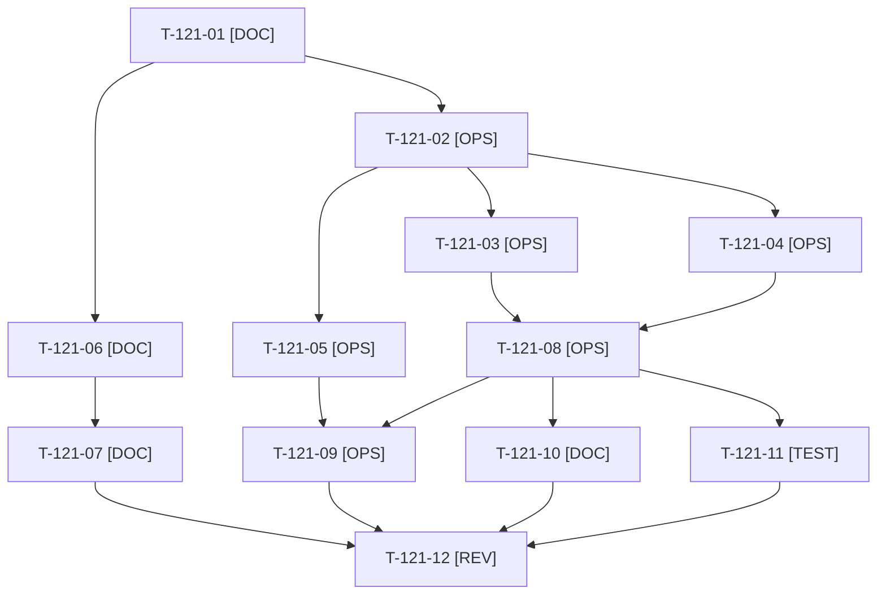

# Tâches : US-121 : Kit média (2/2) : approbation, MCP, container-fill et visite complète

## Informations US

- **Epic** : EPIC-13
- **Persona** : Thibaut
- **Story Points** : 5 (Should)
- **Sprint** : sprint-19-pilotage-achats
- **Story** : [US-121](../../../backlog/user-stories/US-121.md)

## Résumé de la US

**En tant que** Thibaut
**Je veux** les séquences restantes et le script d'une visite complète de 3 minutes
**Afin de** tenir la série de posts

## Règles et fichiers visés

- **Story en `backlog`** : elle dépend d'US-103 (T-103-03, conversation réelle de Thibaut, puis T-103-07 relecture du transcript). Les tâches qui en dépendent sont **bloquées (🚫)** : séquence MCP, segment MCP du script, son export et la validation finale. Les séquences approbation et container-fill et le script hors segment MCP peuvent avancer sans elle.
- Gherkin : 3 scénarios dans la fiche (minimum 1 + 2 + 2). **Correction proposée** dans [US-121](../../../backlog/user-stories/US-121.md) (deux alternatifs et une erreur ajoutés), à valider au planning.
- Livrables hors dépôt public : `/Users/tmonier/Projects/sylius_plugins/communication/sprint-19/kit-media/` (MP4 et GIF, version carrée 1080 x 1080 de moins de 10 Mo, sous-titres FR, textes alternatifs, script minuté à 180 s), référencés dans `communication/INDEX.md`. Même méthode que `communication/sprint-17/kit-media/` (`export.sh`, `check.sh`, `ffmpeg` local).
- La visite complète réutilise les séquences d'US-120 ; la séquence PunchOut d'US-120 est restée bloquée (retour HTTPS exigé par le plugin sur une démo locale en HTTP, T-120-03) : le segment PunchOut du script suit le simulateur habillé d'US-099 et la solution de repli de Thibaut.
- Données de démonstration seulement : aucun courriel réel, aucune URL privée, aucun logo de marque tierce à l'écran ; une séquence illisible sur mobile est refaite. Le montage final et la publication restent à Thibaut.
- Règles du sprint : voir [README.md](./README.md).

## Vue d'ensemble des tâches

La colonne « Réalisé par » dit qui fait la tâche : **Claude** seul, **Orchestrateur** (Claude en rôle d'orchestrateur) ou **Thibaut** (action de sa part). 🚫 = bloquée (voir [README.md](./README.md)). Ordre TDD : les tâches [TEST] « rouges » précèdent le code qu'elles décrivent.

| ID | Type | Tâche | Estimation | Dépend de | Réalisé par | Statut |
|----|------|-------|------------|-----------|-------------|--------|
| T-121-01 | [DOC] | Fiche complétée à 1 + 2 + 2 scénarios (correction proposée) ; plan des trois séquences et prérequis d'environnement (démo remise à zéro, comptes, T-103-03, US-099, retour HTTPS d'US-120) | 0,75 h | - | Claude | 🔲 |
| T-121-02 | [OPS] | Préparer la démo locale : remise à zéro propre, comptes, fenêtre de captation ; contrôle d'absence de donnée sensible, d'URL privée et de marque tierce | 0,75 h | T-121-01 | Claude | 🔲 |
| T-121-03 | [OPS] | Captation de la séquence approbation (Claire dépasse sa limite d'achat, Paul approuve) | 1,25 h | T-121-02 | Claude | 🔲 |
| T-121-04 | [OPS] | Captation de la séquence container-fill (jauge de la palette ou du camion) | 1,25 h | T-121-02 | Claude | 🔲 |
| T-121-05 | [OPS] | Captation de la séquence MCP : rejeu du parcours du transcript d'US-103 — *bloquée : dépend de T-103-03 (conversation réelle de Thibaut) et de T-103-07* | 1,25 h | T-121-02, T-103-07 | Claude | 🚫 |
| T-121-06 | [DOC] | Script minuté de la visite complète de 3 minutes (voix off, étapes, 180 s) : segments approbation, container-fill, PunchOut, devis et commande rapide | 1,25 h | T-121-01, T-099-07 | Claude | 🔲 |
| T-121-07 | [DOC] | Segment MCP du script (reprend le transcript d'US-103) et minutage final à 180 s — *bloquée : dépend de T-103-03 et de T-103-07* | 0,5 h | T-121-06, T-103-07 | Claude | 🚫 |
| T-121-08 | [OPS] | Export des séquences approbation et container-fill : sous-titres FR incrustés, version carrée 1080 x 1080, MP4 et GIF de moins de 10 Mo (`export.sh`) | 1 h | T-121-03, T-121-04 | Claude | 🔲 |
| T-121-09 | [OPS] | Export de la séquence MCP (mêmes formats) — *bloquée : dépend de T-121-05, donc de T-103-03* | 0,5 h | T-121-05, T-121-08 | Claude | 🚫 |
| T-121-10 | [DOC] | Textes alternatifs, descriptions et fiche du kit (`kit-media/README.md`), registre `communication/INDEX.md` à jour | 0,75 h | T-121-08 | Claude | 🔲 |
| T-121-11 | [TEST] | Contrôle de durée, poids et dimensions (`ffprobe`, `check.sh`) et relecture d'images extraites de chaque séquence (données sensibles, marques, lisibilité sur mobile) | 0,75 h | T-121-08 | Claude | 🔲 |
| T-121-12 | [REV] | Thibaut relit et valide les séquences et le script de la visite complète (sinon séquence refaite) — *bloquée : attend le segment et la séquence MCP* | 0,5 h | T-121-07, T-121-09, T-121-10, T-121-11 | Thibaut | 🚫 |

**Total estimé : 10,5 h** (12 tâches, dont 1 de Thibaut, soit 0,5 h).

## Dépendances

Dépendances hors fichier : T-099-07, T-103-07.
