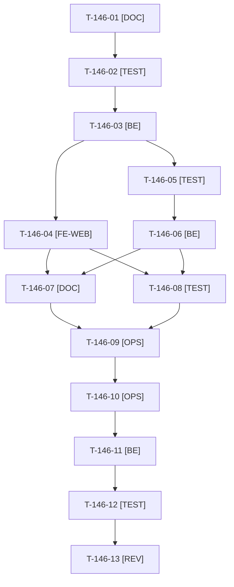

# Tâches : US-146 : Création de commande admin : choisir une adresse de l'entreprise ou du carnet du client

## Informations US

- **Epic** : EPIC-07
- **Persona** : Sophie (administratrice, commande pour le compte d'un client)
- **Story Points** : 5 (Should)
- **Sprint** : sprint-19-pilotage-achats
- **Story** : [US-146](../../../backlog/user-stories/US-146.md)

## Résumé de la US

**En tant que** Sophie, quand je crée une commande pour le compte d'un client
**Je veux** choisir à l'étape « adresse » une adresse de son entreprise ou de son carnet d'adresses, ou saisir une adresse comme aujourd'hui
**Afin de** ne pas ressaisir des adresses déjà connues et éviter les erreurs de livraison

## Règles et fichiers visés

- Dépôt `sylius-admin-order-creation-plugin` (`/Users/tmonier/Projects/sylius_plugins/sylius-admin-order-creation-plugin`). **Avant d'y travailler : `git fetch`, vérifier la branche courante (elle est sur `docs/readme-demo-profile`), partir de `main` à jour (b38ae6f au 2026-10-21)**, branche `feature/address-sources`.
- **Matrice CI et versions (lue le 2026-10-21, à relire en T-146-01)** : `composer.json` `php ^8.2`, `sylius/sylius ^2.2` ; `build.yaml` : PHP 8.3 et 8.4 × Symfony ^7.4 × Sylius ~2.2 / ~2.3 × MySQL 8.4, plus quatre cellules : PHP 8.2 / Symfony ^6.4 / Sylius ~2.2, PHP 8.4 / Symfony ^8.0 / Sylius ~2.3, MariaDB 11.4 et PostgreSQL 17 ; PHPStan sauté en Symfony 6.4. Impact : **code compatible PHP 8.2 et Symfony 6.4** (pas de propriété en lecture seule de classe, pas d'API Symfony 7.3+), traductions dans les sept langues du plugin (`TranslationsTest`).
- **Constat de cadrage** : l'étape adresse propose déjà le carnet du client (liste « Carnet d'adresses », lien « Utiliser » par `?address=id`, copie dans la commande, adresse par défaut préremplie ; `DraftOrderStepsController::getAddressBook` et `templates/admin/draft/step/address.html.twig`). Le reste à faire : point d'extension et adresses de l'entreprise, regroupement des trois sources, refus explicite d'un identifiant hors sources. **Correction proposée** dans [US-146](../../../backlog/user-stories/US-146.md).
- Point d'extension : interface de source d'adresses dans le plugin, services étiquetés, aucune dépendance obligatoire vers `company-accounts`. L'adaptateur des adresses d'entreprise vit dans `sylius-company-accounts-plugin` (dossier `src/Bridge/AdminOrderCreation/` existant, `CompanyAddressRepository::findByCompany`), release mineure v1.3.0 ; repli, si le temps manque : adaptateur dans la démo.
- Ordre des fusions : admin-order-creation d'abord (release v1.1.0, publiée sur Packagist), puis company-accounts (sa CI résout ^1.1). Push, PR, merge et tags : **GO unique de Thibaut** (T-146-09). `composer.lock` de la démo : écrivain unique, T-146-11 jamais en parallèle de T-155-09.
- Règles du sprint : voir [README.md](./README.md).

## Vue d'ensemble des tâches

La colonne « Réalisé par » dit qui fait la tâche : **Claude** seul, **Orchestrateur** (Claude en rôle d'orchestrateur) ou **Thibaut** (action de sa part). 🚫 = bloquée (voir [README.md](./README.md)). Ordre TDD : les tâches [TEST] « rouges » précèdent le code qu'elles décrivent.

| ID | Type | Tâche | Estimation | Dépend de | Réalisé par | Statut |
|----|------|-------|------------|-----------|-------------|--------|
| T-146-01 | [DOC] | Cadrage : `git fetch`, partir de `main`, branche vérifiée ; relire `composer.json` et la matrice CI (PHP 8.2, Symfony 6.4, Sylius 2.2) et rédiger la rubrique « versions supportées et impact de version » ; valider la correction de la fiche (carnet déjà livré) et le lieu de l'adaptateur | 1 h | T-TECH-03 | Claude | ✅ |
| T-146-02 | [TEST] | Tests rouges : unitaires de la chaîne de sources (ordre entreprise, carnet, saisie ; source absente ; identifiant d'une autre entreprise ou d'un autre client refusé) et fonctionnels des six scénarios (entreprise et carnet, carnet seul, aucune adresse, plugin company-accounts absent, adresse étrangère refusée avec message, copie non liée à la source) | 2,5 h | T-146-01 | Claude | ✅ |
| T-146-03 | [BE] | Point d'extension (interface et étiquette de service), chaîne de sources, source « carnet du client » extraite du contrôleur, contrôle serveur de l'identifiant avec message d'erreur, copie de l'adresse dans la commande | 2 h | T-146-02 | Claude | ✅ |
| T-146-04 | [FE-WEB] | Étape adresse : choix groupé (« Adresses de l'entreprise », « Carnet d'adresses », « Saisir une adresse ») dans un groupe étiqueté, préremplissage, formulaire de saisie inchangé ; libellés dans les sept langues, FR et EN d'abord | 2 h | T-146-03 | Claude | ✅ |
| T-146-05 | [TEST] | company-accounts : tests rouges de l'adaptateur (adresses de l'entreprise du client, client sans entreprise, autre entreprise exclue) | 0,5 h | T-146-03 | Claude | ✅ |
| T-146-06 | [BE] | company-accounts : adaptateur `src/Bridge/AdminOrderCreation/` (garde de présence du plugin comme le pont existant), `suggest` à jour | 1,25 h | T-146-05 | Claude | ✅ |
| T-146-07 | [DOC] | README EN et FR (point d'extension, versions supportées) et `CHANGELOG.md` (à créer) d'admin-order-creation ; CHANGELOG de company-accounts | 0,75 h | T-146-04, T-146-06 | Claude | ✅ |
| T-146-08 | [TEST] | Dans chaque dépôt : ECS, PHPStan max, Rector et tests dans Docker (PHP 8.4, Sylius 2.3) ; vérification locale des cellules PHP 8.2 et Symfony 6.4 par lecture du code | 0,75 h | T-146-04, T-146-06 | Claude | ✅ |
| T-146-09 | [OPS] | Thibaut donne le GO unique : push des deux branches, deux PR, merge quand les CI sont vertes, tags v1.1.0 (admin-order-creation) et v1.3.0 (company-accounts) | 0,25 h | T-146-07, T-146-08 | Thibaut | ✅ |
| T-146-10 | [OPS] | Deux PR, suivi des matrices CI, merges après run terminé, tags et releases dans l'ordre ; vérification Packagist (script du scratchpad à OK ou FAIL) | 1 h | T-146-09, T-TECH-07 | Claude | ✅ |
| T-146-11 | [BE] | Démo : montée des versions (`composer update` ciblé avec `php -d memory_limit=1G`), `composer.lock` écrit seul | 0,5 h | T-146-10 | Claude | ✅ |
| T-146-12 | [TEST] | Scénario « Sophie crée une commande pour Claire d'ACME et choisit une adresse de l'entreprise » dans `config/demo/plugins.yaml` ; rendu réel dans l'admin de la démo en FR et EN, accessibilité du choix ; suite via `bin/run-tests`, ECS, PHPStan | 1 h | T-146-11 | Claude | ✅ |
| T-146-13 | [REV] | Revue (aucune dépendance obligatoire vers company-accounts, refus d'une adresse étrangère, copie non liée, matrices vertes) | 0,5 h | T-146-12 | Claude | ✅ |

**Total estimé : 14 h** (13 tâches, dont 1 de Thibaut, soit 0,25 h).

## Dépendances

Dépendances hors fichier : T-TECH-03, T-TECH-07.
