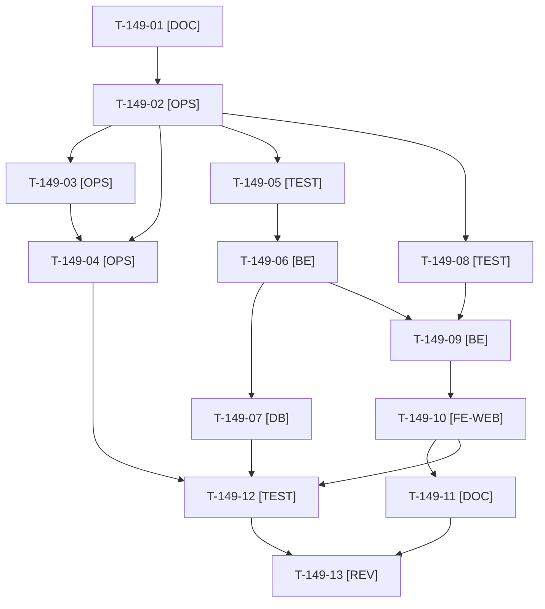

# Tâches : US-149 : Company-insights : squelette du plugin et indicateurs de la période

## Informations US

- **Epic** : EPIC-15
- **Persona** : Isabelle (administratrice d'Acme Industries)
- **Story Points** : 5 (Must)
- **Sprint** : sprint-19-pilotage-achats
- **Story** : [US-149](../../../backlog/user-stories/US-149.md)

## Résumé de la US

**En tant que** Isabelle, administratrice du compte Acme Industries
**Je veux** une page « Tableau de bord des achats » qui affiche les indicateurs de la période choisie
**Afin de** savoir d'un coup d'œil combien mon entreprise dépense et à quel rythme elle commande

## Règles et fichiers visés

- Nouveau dépôt `sylius-company-insights-plugin` (paquet `tmonier/sylius-company-insights-plugin`, espace de noms `Tmonier\SyliusCompanyInsightsPlugin`), à créer sous `/Users/tmonier/Projects/sylius_plugins/`. Release 0.1.0 ; **c'est Thibaut qui soumet le plugin à Packagist** (T-155-08).
- **Matrice CI et versions : à lire au cadrage (T-149-01), action 2 de la rétro S18.** La matrice du plugin le plus récent, `sylius-agentic-feeds-plugin` (`.github/workflows/build.yaml`), est PHP 8.2 à 8.4 × Symfony 6.4 / 7.4 / 8.0 × Sylius ~2.2 / ~2.3 × MySQL 8.4, MariaDB 11.4, PostgreSQL 17, PHPStan sauté en Symfony 6.4, `composer.json` : `php ^8.2`, `sylius/sylius ^2.2.9 || ^2.3`. `company-accounts` (dépendance) a la même matrice : le nouveau dépôt la reprend à l'identique. **Écart avec le plan du sprint** (« Symfony 7.4 et 8, PHP 8.4 et 8.5 ») : aucun plugin n'a de cellule PHP 8.5 et la cellule Symfony 6.4 reste couverte par `company-accounts` ; pas de cellule PHP 8.5 tant que la CI de `company-accounts` n'en a pas (à trancher en T-149-01, consigné dans la rubrique « versions supportées » du README).
- Dépend de `tmonier/sylius-company-accounts-plugin` ^1.1 (v1.2.0 publiée) : `Company`, `CompanyMember`, `CompanyOrder`, `CurrentMemberResolverInterface`, `CompanyVoter`. Le voter du plugin (`COMPANY_VIEW_INSIGHTS`) s'appuie sur `member->isAdmin()` ; **aucune modification de `company-accounts` n'est nécessaire**.
- Les commandes « en attente d'approbation » viennent d'un plugin compagnon optionnel (`purchase-approval` / `order-hold`) : le marqueur exact est relevé en T-149-01 ; sans le plugin, le bloc affiche zéro (port optionnel, pas de dépendance dure).
- Règles d'EPIC-15 : commandes comptées (checkout terminé, non annulées, rattachées par `CompanyOrder`), montants HT par devise, identifiant d'entreprise tiré de la session jamais de la requête, graphiques en apexcharts sans CDN (ADR du plugin), agrégats en SQL avec index (entreprise, date).
- Tests dans Docker des plugins (`make`/`docker compose`, base MySQL) ; ECS (`vendor/bin/ecs check`) et PHPStan max rejoués sur l'arbre exact avant chaque push (action 3). Création du dépôt GitHub, push, PR, tag : **GO de Thibaut** (T-149-03).
- Règles du sprint : voir [README.md](./README.md) (contrat de fin de worker, disque, isolation par worker, vérification croisée, attente bornée, aucune action externe sans GO).

## Vue d'ensemble des tâches

La colonne « Réalisé par » dit qui fait la tâche : **Claude** seul, **Orchestrateur** (Claude en rôle d'orchestrateur) ou **Thibaut** (action de sa part). 🚫 = bloquée (voir [README.md](./README.md)). Ordre TDD : les tâches [TEST] « rouges » précèdent le code qu'elles décrivent.

| ID | Type | Tâche | Estimation | Dépend de | Réalisé par | Statut |
|----|------|-------|------------|-----------|-------------|--------|
| T-149-01 | [DOC] | Cadrage : lire `composer.json` et la matrice CI de `company-accounts` et d'`agentic-feeds`, rubrique « versions supportées (PHP, Symfony, Sylius) et impact de version » du README ; relever le menu du compte entreprise, `CurrentMemberResolver`, `CompanyOrder` et le marqueur des commandes en attente d'approbation ; décider de la matrice du nouveau dépôt | 1 h | T-TECH-03 | Claude | 🔲 |
| T-149-02 | [OPS] | Squelette local du dépôt (`composer.json`, ECS, PHPStan max, Rector, PHPUnit unit et non-unit, application de test, `compose.yml`, `build.yaml` de la matrice retenue, Dependabot, licence MIT, README minimal) ; `composer validate --strict`, `lint:container` et amorçage dans Docker | 2 h | T-149-01 | Claude | 🔲 |
| T-149-03 | [OPS] | Thibaut donne le GO : création du dépôt public `sylius-company-insights-plugin` et premier push | 0,25 h | T-149-02 | Thibaut | 🔲 |
| T-149-04 | [OPS] | Création du dépôt GitHub (public, sujets `ecommerce`, `sylius`, `sylius-plugin`, `symfony`, `b2b`, `reporting`), push du squelette, branche `feature/walking-skeleton`, premier run de la matrice complète | 0,75 h | T-149-02, T-149-03 | Claude | 🔲 |
| T-149-05 | [TEST] | Tests d'intégration rouges (MySQL) des agrégats : dépense HT, nombre de commandes, panier moyen, acheteurs actifs, en attente (nombre et montant) ; période précédente de même durée ; commandes annulées exclues ; autre entreprise exclue ; entreprise sans commande | 1,5 h | T-149-02 | Claude | 🔲 |
| T-149-06 | [BE] | `PeriodResolver` (30 jours, trimestre en cours, 12 mois par défaut, année civile, période précédente), requêtes d'agrégation SQL, fournisseur d'indicateurs avec variation, port optionnel des commandes en attente | 3 h | T-149-05 | Claude | 🔲 |
| T-149-07 | [DB] | Migration des index (entreprise, date) après relevé de ceux de `company-accounts` (T-149-01) ; testée en montée et en descente | 0,75 h | T-149-06 | Claude | 🔲 |
| T-149-08 | [TEST] | Tests fonctionnels rouges : administratrice (200), acheteuse (refus expliqué, menu sans l'entrée), période en liste blanche rappelée dans le titre et l'URL, paramètre visant une autre entreprise ignoré, entreprise sans commande | 1,5 h | T-149-02 | Claude | 🔲 |
| T-149-09 | [BE] | Voter `COMPANY_VIEW_INSIGHTS` (administrateur du membre courant), contrôleur et route `/account/company/insights`, entrée du menu du compte entreprise, refus expliqué | 2 h | T-149-06, T-149-08 | Claude | 🔲 |
| T-149-10 | [FE-WEB] | Page « Tableau de bord des achats » : sélecteur de période, cinq indicateurs avec variation, bloc « En attente d'approbation » à part, message « Aucune commande sur la période » ; libellés FR et EN ; contrastes AAA ; mobile | 2 h | T-149-09 | Claude | 🔲 |
| T-149-11 | [DOC] | README EN et FR (installation, permission, matrice et versions supportées, captures), ADR du choix d'apexcharts sans CDN, `CHANGELOG.md` | 1,25 h | T-149-10 | Claude | 🔲 |
| T-149-12 | [TEST] | ECS, PHPStan max, Rector, couverture ≥ 80 %, `lint:container`, validation Doctrine ; rendu réel FR et EN dans l'application de test et pa11y WCAG2AAA sur la page ; matrice CI de la PR verte (run terminé) | 1,5 h | T-149-04, T-149-07, T-149-10 | Claude | 🔲 |
| T-149-13 | [REV] | Revue de sécurité (voter, cloisonnement entre entreprises sur chaque requête, paramètres en liste blanche) et de la matrice CI | 0,75 h | T-149-11, T-149-12 | Claude | 🔲 |

**Total estimé : 18,25 h** (13 tâches, dont 1 de Thibaut, soit 0,25 h).

## Dépendances

Dépendances hors fichier : T-TECH-03.
