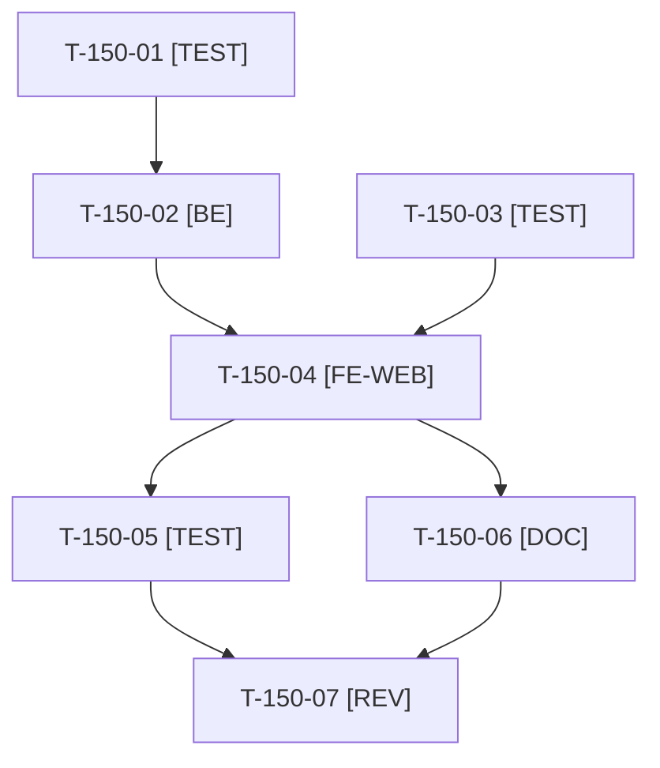

# Tâches : US-150 : Company-insights : achats par mois sur 12 mois, comparés à l'année précédente

## Informations US

- **Epic** : EPIC-15
- **Persona** : Isabelle (administratrice d'Acme Industries)
- **Story Points** : 5 (Must)
- **Sprint** : sprint-19-pilotage-achats
- **Story** : [US-150](../../../backlog/user-stories/US-150.md)

## Résumé de la US

**En tant que** Isabelle
**Je veux** voir mes achats mois par mois sur les 12 derniers mois, à côté des mêmes mois de l'année précédente
**Afin de** repérer la saisonnalité et les écarts de dépense de mon entreprise

## Règles et fichiers visés

- Dépôt `sylius-company-insights-plugin` (créé par US-149) ; branche par story à partir de `main` à jour (`git fetch` puis branche vérifiée). Matrice CI et versions : celles retenues en T-149-01.
- Série mensuelle sur 12 mois glissants plus la série de l'année précédente ; mois vides à zéro ; mois en cours marqué « en cours » ; fuseau du canal (une commande du 31 à 23 h 30 compte dans le bon mois) ; une série par devise, sans conversion ; bascule « montant HT » / « nombre de commandes ».
- Graphique en barres rendu par apexcharts **sans CDN** (CSP de la démo) ; tableau de données équivalent sous le graphique, lu par les lecteurs d'écran ; motifs en plus des couleurs.
- Fichiers communs avec US-151 (gabarit du tableau de bord, traductions) : un seul worker à la fois, US-150 avant US-151.
- Règles du sprint : voir [README.md](./README.md).

## Vue d'ensemble des tâches

La colonne « Réalisé par » dit qui fait la tâche : **Claude** seul, **Orchestrateur** (Claude en rôle d'orchestrateur) ou **Thibaut** (action de sa part). 🚫 = bloquée (voir [README.md](./README.md)). Ordre TDD : les tâches [TEST] « rouges » précèdent le code qu'elles décrivent.

| ID | Type | Tâche | Estimation | Dépend de | Réalisé par | Statut |
|----|------|-------|------------|-----------|-------------|--------|
| T-150-01 | [TEST] | Tests d'intégration rouges de la requête mensuelle : 12 barres plus l'année précédente, mois sans commande à zéro, commande du 31 mars à 23 h 30 en mars (fuseau du canal), deux devises sans total mélangé, mois en cours marqué | 1,5 h | T-149-06 | Claude | ✅ |
| T-150-02 | [BE] | Requête mensuelle (regroupement par mois dans le fuseau du canal et par devise), constructeur de série qui comble les mois vides, bascule montant / nombre | 2,5 h | T-150-01 | Claude | ✅ |
| T-150-03 | [TEST] | Tests fonctionnels rouges : somme des 12 barres égale à la dépense de l'indicateur « 12 derniers mois », bascule vers le nombre de commandes, tableau équivalent avec en-têtes (`th scope`), deux séries pour deux devises | 1 h | T-149-09 | Claude | ✅ |
| T-150-04 | [FE-WEB] | Graphique en barres apexcharts embarqué (sans CDN), tableau de données équivalent, motifs sans couleur seule, mois en cours marqué, bascule (Stimulus), libellés FR et EN | 3 h | T-150-02, T-150-03 | Claude | ✅ |
| T-150-05 | [TEST] | Rendu réel mobile et ordinateur en FR et EN, pa11y WCAG2AAA, contrôle qu'aucune ressource externe n'est chargée ; ECS, PHPStan max, Rector, couverture | 1 h | T-150-04 | Claude | 👀 |
| T-150-06 | [DOC] | README (graphique, fuseau, devises, accessibilité) et `CHANGELOG.md` | 0,5 h | T-150-04 | Claude | ✅ |
| T-150-07 | [REV] | Revue (somme mensuelle égale à l'indicateur, aucun mois manquant, aucune ressource externe, matrice CI verte) | 0,5 h | T-150-05, T-150-06 | Claude | ✅ |

**Total estimé : 10 h** (7 tâches, aucune de Thibaut).

## Dépendances

Dépendances hors fichier : T-149-06, T-149-09.
