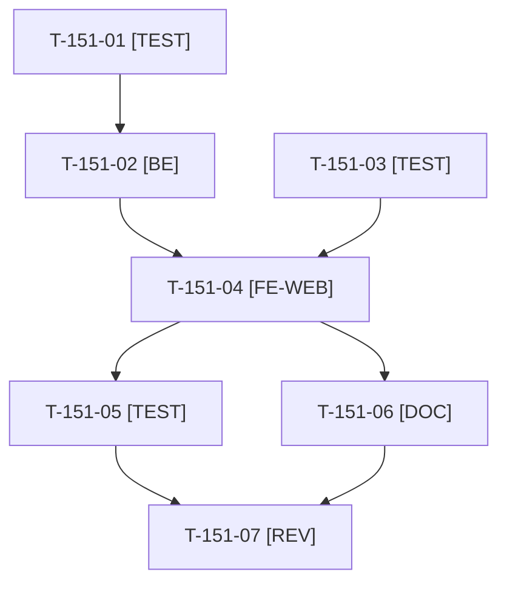

# Tâches : US-151 : Company-insights : tops acheteurs, produits et catégories

## Informations US

- **Epic** : EPIC-15
- **Persona** : Isabelle (administratrice d'Acme Industries)
- **Story Points** : 5 (Must)
- **Sprint** : sprint-19-pilotage-achats
- **Story** : [US-151](../../../backlog/user-stories/US-151.md)

## Résumé de la US

**En tant que** Isabelle
**Je veux** voir qui achète le plus dans mon entreprise, quels produits et quelles catégories pèsent le plus
**Afin de** négocier mes conditions et repérer les achats à rationaliser

## Règles et fichiers visés

- Dépôt `sylius-company-insights-plugin` ; mêmes commandes comptées que les indicateurs (US-149) ; ligne de commande comptée pour son montant HT après remises de ligne.
- Trois classements de 10 lignes avec lien « Voir tout » paginé : acheteurs (nom et prénom seulement, **sans e-mail**, membres désactivés signalés), produits (tri dépense ou quantité, dernière date d'achat, repli sur le code sans traduction), catégories (catégorie principale, part, anneau avec son tableau équivalent).
- Cloisonnement par entreprise testé sur chaque requête (scénarios « autre entreprise ») ; revue de sécurité de l'absence de donnée personnelle au-delà du nom.
- Fichiers communs avec US-150 (gabarit du tableau de bord, traductions) : US-151 après US-150, un seul worker à la fois.
- Règles du sprint : voir [README.md](./README.md).

## Vue d'ensemble des tâches

La colonne « Réalisé par » dit qui fait la tâche : **Claude** seul, **Orchestrateur** (Claude en rôle d'orchestrateur) ou **Thibaut** (action de sa part). 🚫 = bloquée (voir [README.md](./README.md)). Ordre TDD : les tâches [TEST] « rouges » précèdent le code qu'elles décrivent.

| ID | Type | Tâche | Estimation | Dépend de | Réalisé par | Statut |
|----|------|-------|------------|-----------|-------------|--------|
| T-151-01 | [TEST] | Tests d'intégration rouges des trois requêtes : top acheteurs (parts 62 % et 38 %, membre désactivé), top produits (tri dépense et quantité, dernière date), top catégories (somme 100 %), autre entreprise exclue, produit sans traduction affiché par son code | 2 h | T-149-06 | Claude | 🔲 |
| T-151-02 | [BE] | Trois requêtes d'agrégation SQL, objets de lecture, limite de 10 lignes et pages « Voir tout » paginées (tri et page en liste blanche) | 2,75 h | T-151-01 | Claude | 🔲 |
| T-151-03 | [TEST] | Tests fonctionnels rouges : classements sur le tableau de bord, pages « Voir tout », tri par quantité, mention « désactivé », aucun e-mail dans le HTML, aucun achat d'une autre entreprise | 1 h | T-149-09 | Claude | 🔲 |
| T-151-04 | [FE-WEB] | Blocs des trois classements, pages « Voir tout », anneau des catégories avec tableau équivalent, mention « désactivé », libellés FR et EN, contrastes AAA, mobile | 2,5 h | T-151-02, T-151-03, T-150-04 | Claude | 🔲 |
| T-151-05 | [TEST] | Rendu réel FR et EN, pa11y WCAG2AAA ; ECS, PHPStan max, Rector, couverture | 0,75 h | T-151-04 | Claude | 🔲 |
| T-151-06 | [DOC] | README (classements, données personnelles) et `CHANGELOG.md` | 0,5 h | T-151-04 | Claude | 🔲 |
| T-151-07 | [REV] | Revue de sécurité (cloisonnement, aucune donnée personnelle au-delà du nom, paramètres en liste blanche) et matrice CI verte | 0,75 h | T-151-05, T-151-06 | Claude | 🔲 |

**Total estimé : 10,25 h** (7 tâches, aucune de Thibaut).

## Dépendances

Dépendances hors fichier : T-149-06, T-149-09, T-150-04.
