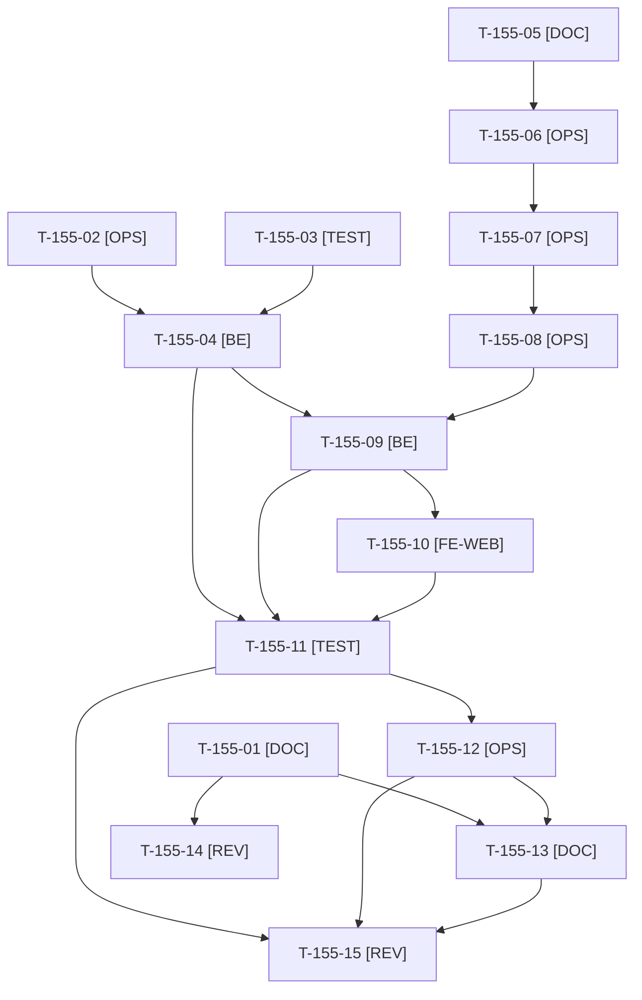

# Tâches : US-155 : Company-insights : historique d'achats de 12 mois et intégration à la démo

## Informations US

- **Epic** : EPIC-15
- **Persona** : Nadia (responsable e-commerce B2B, visiteuse de la démo) ; Isabelle (compte de démo)
- **Story Points** : 5 (Must)
- **Sprint** : sprint-19-pilotage-achats
- **Story** : [US-155](../../../backlog/user-stories/US-155.md)

## Résumé de la US

**En tant que** Nadia, visiteuse de la démo
**Je veux** voir le tableau de bord d'Isabelle rempli de 12 mois d'achats crédibles
**Afin de** juger ce que mes clients professionnels obtiendraient dans leur espace

## Règles et fichiers visés

- Deux dépôts : le plugin `sylius-company-insights-plugin` (release 0.1.0, tag et release GitHub préparés par Claude après GO) et la démo `sylius-b2b-demo` (branche `feature/sprint-19-pilotage-achats`).
- **Packagist : c'est Thibaut qui soumet le nouveau paquet** (T-155-08) ; la démo ne monte la version qu'une fois le paquet indexé (ADR-0006 : la démo installe par version taguée). Commandes longues pour Thibaut sous forme de script du scratchpad à OK ou FAIL par élément (T-TECH-07) ; Composer avec `php -d memory_limit=1G`.
- Plan de commandes de démo (`src/Demo/Order/DemoOrderPlan.php`, `DeterministicOrderFactory`) : environ 45 commandes pour Acme sur 18 mois (creux en août, pic à la rentrée), 4 acheteurs dont un désactivé, 2 sites, les 2 centres de coût, une dizaine de produits récurrents, une dizaine de commandes pour TechParts et BuildCo. **Les 8 commandes actuelles et leurs scénarios (approbation, encours échu, annulation) restent identiques** ; mêmes dates relatives à chaque remise à zéro ; durée de `app:demo:reset` au plus +20 % (mesure avant et après).
- `composer.lock` a un seul écrivain : la montée de version (T-155-09) se fait seule, jamais en parallèle de T-146-11, et après la décision de Thibaut sur la PR #46 (PHP 8.5.12) pour éviter un conflit. US-099 touche les fichiers de la démo : elle passe avant T-155-09.
- Classe Sylius Plus (docs/vitrine-plugins.md) : **hors périmètre (à confirmer)**, ton neutre, aucune mention de Plus dans les textes publiés, aucune communication sur les canaux Sylius (politique du 2026-10-14). La documentation technique de Plus (S9) n'est lisible que par Thibaut s'il y a accès.
- Seul l'orchestrateur reconstruit l'image Docker (T-TECH-08). Redéploiement Railway : commande de Thibaut, reportée tant que l'incident Railway dure. Aucune commande Railway par Claude.
- Règles du sprint : voir [README.md](./README.md).

## Vue d'ensemble des tâches

La colonne « Réalisé par » dit qui fait la tâche : **Claude** seul, **Orchestrateur** (Claude en rôle d'orchestrateur) ou **Thibaut** (action de sa part). 🚫 = bloquée (voir [README.md](./README.md)). Ordre TDD : les tâches [TEST] « rouges » précèdent le code qu'elles décrivent.

| ID | Type | Tâche | Estimation | Dépend de | Réalisé par | Statut |
|----|------|-------|------------|-----------|-------------|--------|
| T-155-01 | [DOC] | `docs/vitrine-plugins.md` : ligne 25 `company-insights` (tableau avec fonction, écrans, point de contact, classe **hors périmètre (à confirmer)**, sources S1 et S2 dont l'« historique » du compte maître), totaux mis à jour, ton neutre ; vérification de la documentation officielle consignée avant toute communication | 0,75 h | - | Claude | ✅ |
| T-155-02 | [OPS] | Mesure de référence de la durée de `app:demo:reset` (trois runs, `bin/profile-reset`) avant toute modification du plan | 0,5 h | - | Claude | ✅ |
| T-155-03 | [TEST] | Tests rouges du plan étendu : environ 45 commandes Acme sur 18 mois avec creux en août, 4 acheteurs dont un désactivé, 2 sites, 2 centres de coût, 10 produits récurrents, commandes de TechParts et BuildCo, mêmes commandes et dates relatives après deux remises à zéro, 8 commandes existantes inchangées | 1,5 h | - | Claude | ✅ |
| T-155-04 | [BE] | Extension de `DemoOrderPlan` et de la fabrique déterministe (saisonnalité, acheteurs, sites, centres de coût, produits), scénarios existants conservés à l'identique | 2,75 h | T-155-02, T-155-03 | Claude | ✅ |
| T-155-05 | [DOC] | Préparation de la 0.1.0 du plugin : `CHANGELOG.md`, numéro de version, matrice CI de `main` verte (run terminé), README à jour | 0,5 h | T-150-07, T-151-07 | Claude | ✅ |
| T-155-06 | [OPS] | Thibaut donne le GO du tag et de la release `v0.1.0` du plugin | 0,25 h | T-155-05 | Thibaut | ✅ |
| T-155-07 | [OPS] | Tag `v0.1.0` et release GitHub ; URL du dépôt remise à Thibaut avec le script de soumission (OK ou FAIL par élément) | 0,5 h | T-155-06, T-TECH-07 | Claude | ✅ |
| T-155-08 | [OPS] | Thibaut soumet le plugin à Packagist (nouveau paquet) et confirme l'indexation de la 0.1.0 | 0,25 h | T-155-07 | Thibaut | ✅ |
| T-155-09 | [BE] | Démo : `php -d memory_limit=1G composer require tmonier/sylius-company-insights-plugin:^0.1`, bundle, routes, configuration, migration et menu ; `composer.lock` écrit seul | 1,25 h | T-155-04, T-155-08, T-099-07 | Claude | ✅ |
| T-155-10 | [FE-WEB] | Scénario « Isabelle consulte le tableau de bord des achats » dans `config/demo/plugins.yaml` (FR et EN, compte conseillé `isabelle`) et badge du plugin | 0,5 h | T-155-09 | Claude | ✅ |
| T-155-11 | [TEST] | Tests de la démo : 12 mois avec creux en août et comparaison, au moins 4 acheteurs et 10 produits dans les tops, TechParts absent des tops d'Acme, parcours de Claire, Paul et Isabelle inchangés, durée de remise à zéro ≤ +20 % ; suite complète via `bin/run-tests`, ECS (`src tests`), PHPStan | 2 h | T-155-04, T-155-09, T-155-10 | Claude | ✅ |
| T-155-12 | [OPS] | Captures de la page Plugins et du tableau de bord (démo locale remise à zéro, données fictives, sans marque tierce) pour la page Plugins et le README | 1 h | T-155-11 | Claude | ✅ |
| T-155-13 | [DOC] | Documentation de la démo (`docs/remise-a-zero-demo.md`, `docs/vitrine-plugins.md`) et captures dans le README du plugin | 0,5 h | T-155-01, T-155-12 | Claude | ✅ |
| T-155-14 | [REV] | Thibaut relit la documentation technique de Sylius Plus (S9) s'il y a accès et confirme ou corrige la classe de company-insights (non bloquant) | 0,25 h | T-155-01 | Thibaut | 🔲 |
| T-155-15 | [REV] | Revue (déterminisme, cloisonnement visible, durée de remise à zéro, ton neutre, aucun secret, `composer.lock`) | 0,75 h | T-155-11, T-155-12, T-155-13 | Claude | ✅ |

**Total estimé : 13,25 h** (15 tâches, dont 3 de Thibaut, soit 0,75 h).

## Dépendances

Dépendances hors fichier : T-099-07, T-150-07, T-151-07, T-TECH-07.
